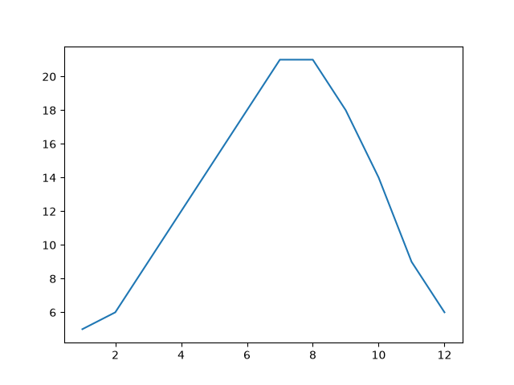
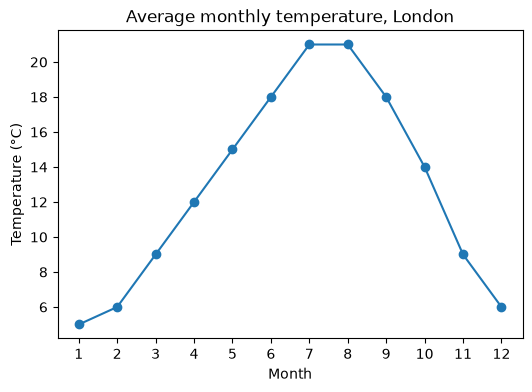
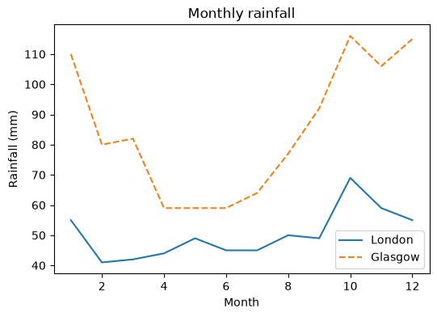
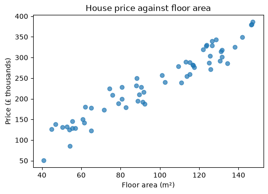

# 15-01 Matplotlib fundamentals

## What you will learn

- Explain the parts of a Matplotlib plot: the figure and its axes.
- Draw line and scatter plots.
- Add titles, axis labels and legends.
- Save figures to files, and inspect them in code.

## Why it matters

A good chart shows in a second what a table of numbers hides. You will plot data to explore it (Module 16), to check how a model learns (the loss curves of Module 18), and to show results to other people. **Matplotlib** is the standard plotting library in Python; pandas and seaborn are built on it, so understanding it pays off everywhere.

## Concepts

### Setting up

Matplotlib's plotting interface is imported as `plt`. The examples in this course save figures to files rather than opening windows, so the first lines choose the file-only **backend** (the part of Matplotlib that draws), and make a `figures` folder next to the script:

```python
from pathlib import Path

import matplotlib

matplotlib.use("Agg")  # draw to files only; no window needed
import matplotlib.pyplot as plt
import numpy as np

FIGURES = Path(__file__).parent / "figures"
FIGURES.mkdir(exist_ok=True)
```

In your own scripts you can leave out `matplotlib.use("Agg")` and call `plt.show()` to open a window instead. Never call `plt.show()` in code that tests run, because it waits for you to close the window.

### Figures and axes

A Matplotlib plot has two main parts:

- The **figure** is the whole image, the canvas.
- An **axes** (plural axes too) is one plot inside it, with its own x and y axis. A figure can hold several (15-03).

`plt.subplots()` creates a figure and one axes. You then call methods on the axes to draw:

```python
months = np.arange(1, 13)
temperature = np.array([5, 6, 9, 12, 15, 18, 21, 21, 18, 14, 9, 6])

fig, ax = plt.subplots()
ax.plot(months, temperature)
fig.savefig(FIGURES / "first_line.png")
plt.close(fig)
print(type(fig).__name__, type(ax).__name__)
```

```
Figure Axes
```



`ax.plot(x, y)` draws a line through the points. `fig.savefig(path)` writes the image; the format comes from the extension (`.png`, `.pdf`, `.svg`). `plt.close(fig)` frees the memory, which matters when you make many figures.

This is the **object-oriented** style: you hold the figure and axes in variables and call their methods. You will also see code that calls `plt.plot(...)` directly; that draws on "the current axes" behind the scenes. The object-oriented style is clearer once a figure has more than one plot, so this course uses it throughout.

### Labels and titles

A chart without labels makes the reader guess. Every chart should say what it shows and give units:

```python
fig, ax = plt.subplots(figsize=(6, 4))
ax.plot(months, temperature, marker="o")
ax.set_title("Average monthly temperature, London")
ax.set_xlabel("Month")
ax.set_ylabel("Temperature (°C)")
ax.set_xticks(months)
fig.savefig(FIGURES / "labelled_line.png", dpi=100, bbox_inches="tight")
plt.close(fig)
```



- `figsize=(width, height)` sets the size in inches; `dpi` (dots per inch) sets the resolution, so this image is 600 by 400 pixels.
- `marker="o"` draws a dot at each data point.
- `set_xticks` chooses where the tick marks go: here one per month.
- `bbox_inches="tight"` trims empty space around the figure.

### Several lines and a legend

Call `plot` once per line. Give each a `label`, then `ax.legend()` draws a key:

```python
rainfall_london = np.array([55, 41, 42, 44, 49, 45, 45, 50, 49, 69, 59, 55])
rainfall_glasgow = np.array([110, 80, 82, 59, 59, 59, 64, 77, 92, 116, 106, 115])
fig, ax = plt.subplots(figsize=(6, 4))
ax.plot(months, rainfall_london, label="London")
ax.plot(months, rainfall_glasgow, label="Glasgow", linestyle="--")
ax.set_title("Monthly rainfall")
ax.set_xlabel("Month")
ax.set_ylabel("Rainfall (mm)")
ax.legend()
fig.savefig(FIGURES / "two_lines.png", dpi=100, bbox_inches="tight")
plt.close(fig)
```



Matplotlib picks a new colour for each line automatically. `linestyle="--"` makes a dashed line, which also helps readers who cannot tell the colours apart.

### Scatter plots

A **scatter plot** draws one dot per data point, with no connecting line. Use it to show the relationship between two numeric variables:

```python
rng = np.random.default_rng(42)
floor_area = rng.uniform(40, 150, size=60)
price = 2.5 * floor_area + rng.normal(0, 30, size=60)
fig, ax = plt.subplots(figsize=(6, 4))
ax.scatter(floor_area, price, alpha=0.7)
ax.set_title("House price against floor area")
ax.set_xlabel("Floor area (m²)")
ax.set_ylabel("Price (£ thousands)")
fig.savefig(FIGURES / "scatter.png", dpi=100, bbox_inches="tight")
plt.close(fig)
```



The data is simulated: price is 2.5 times the area plus random noise. The upward trend is clear, and so is the scatter around it. This is exactly the kind of data that linear regression (Module 21) fits a line to. `alpha=0.7` makes the dots slightly transparent, so overlapping points show up darker.

### Inspecting a figure in code

Axes remember what was drawn on them, so code (and tests) can check a chart:

```python
fig, ax = plt.subplots()
line, = ax.plot(months, temperature, label="London")
ax.set_title("Check me")
print(ax.get_title(), len(ax.get_lines()), line.get_label())
print(line.get_ydata()[:3])
plt.close(fig)
```

```
Check me 1 London
[5 6 9]
```

`ax.plot` returns a list of lines; `line, = ...` unpacks the single line from it. The exercises in this module return figures, and the tests use these methods to check them.

## Common mistakes

- **Calling `plt.show()` in a script that should save files.** It opens a window and waits. Save with `fig.savefig` instead, or call `show` only at the very end of an interactive script.
- **Saving after closing.** `plt.close(fig)` then `fig.savefig(...)` saves a blank or broken image. Save first, then close.
- **Forgetting `ax.legend()`.** Labels passed to `plot` only appear once you call `legend`.
- **Missing units.** "Temperature" could be Celsius or Fahrenheit. Put units in the axis labels.

## Try it

Plot the two rainfall lines again, but add a third line showing the difference (Glasgow minus London). Then try `ax.set_ylim(0, None)` so the y axis starts at zero. How does that change the impression the chart gives?

## Exercises

Open `ex_15_01.py`. Each function returns a Matplotlib `Figure`; the tests inspect it.

1. `line_chart`: a labelled line chart.
2. `multi_line_chart`: several labelled lines with a legend.
3. `scatter_chart`: a labelled scatter plot.
4. `save_figure`: save a figure, creating its folder if needed.

Run the tests:

```
python -m pytest part-3-data-toolkit/15-visualisation/15-01-matplotlib-fundamentals
```

## Summary

- `fig, ax = plt.subplots()` creates a figure (the canvas) and an axes (one plot).
- `ax.plot` draws lines; `ax.scatter` draws points.
- `set_title`, `set_xlabel` and `set_ylabel` label a chart; give lines a `label` and call `ax.legend()`.
- `fig.savefig(path, dpi=..., bbox_inches="tight")` saves; `plt.close(fig)` frees memory.
- `ax.get_title()`, `ax.get_lines()` and friends let code inspect a chart.
