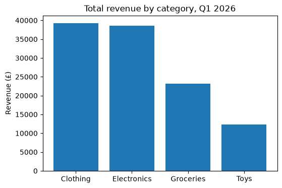
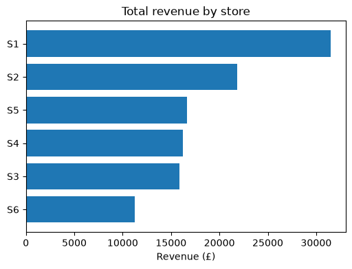
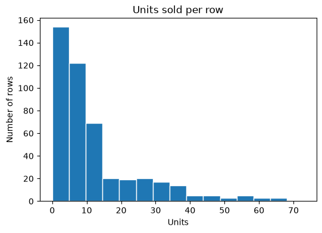
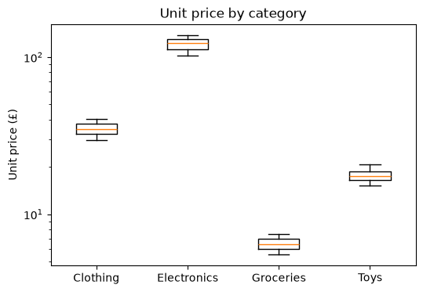
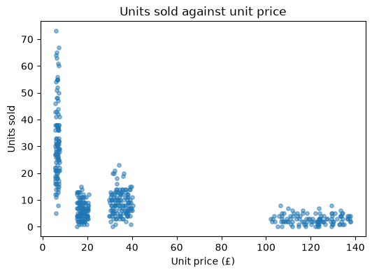
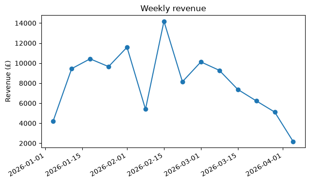

# 15-02 Chart types and when to use them

## What you will learn

- Draw bar charts, histograms, box plots, scatter plots and line charts.
- Match a chart type to the question you are asking.
- Read what each chart shows, and what it hides.

## Why it matters

The wrong chart can hide the answer or suggest a false one. A pie chart of seven similar slices tells you nothing; a line joining unrelated categories implies a trend that is not there. Choosing the chart starts from the question. In exploratory analysis (Module 16) you will make dozens of quick charts, and knowing which one to reach for makes that fast.

## Concepts

All examples use the cleaned sales data with a `revenue` column.

### Start from the question

| Question | Chart |
|----------|-------|
| How does a number compare across categories? | bar chart |
| How is one numeric variable distributed? | histogram |
| How do distributions compare between groups? | box plot |
| How are two numeric variables related? | scatter plot |
| How does something change over time? | line chart |

### Bar charts: comparing categories

A **bar chart** draws one bar per category, with length proportional to a number. Sort the bars so the ranking is easy to read:

```python
revenue = sales.groupby("category")["revenue"].sum().sort_values(ascending=False)
print(revenue.round(0))
fig, ax = plt.subplots(figsize=(6, 4))
ax.bar(revenue.index, revenue.values)
ax.set_title("Total revenue by category, Q1 2026")
ax.set_ylabel("Revenue (£)")
```

```
category
Clothing       39300.0
Electronics    38635.0
Groceries      23125.0
Toys           12254.0
Name: revenue, dtype: float64
```



Bar lengths are compared by eye, so the value axis must start at zero. Matplotlib does this for bars automatically.

**Horizontal bars** (`barh`) suit long labels or many categories, because the labels do not have to squeeze along the bottom:

```python
store_revenue = sales.groupby("store")["revenue"].sum().sort_values()
fig, ax = plt.subplots(figsize=(6, 4))
ax.barh(store_revenue.index, store_revenue.values)
ax.set_title("Total revenue by store")
ax.set_xlabel("Revenue (£)")
```



### Histograms: one distribution

A **histogram** splits a numeric range into **bins** and draws a bar for how many values fall in each. It shows the **shape** of a distribution: where values cluster, how spread out they are, and whether there is a long tail.

```python
fig, ax = plt.subplots(figsize=(6, 4))
counts, edges, _ = ax.hist(sales["units"], bins=15, edgecolor="white")
ax.set_title("Units sold per row")
ax.set_xlabel("Units")
ax.set_ylabel("Number of rows")
print(counts[:5], np.round(edges[:3], 2))
```

```
[154. 122.  69.  20.  19.] [0.   4.87 9.73]
```



Most rows sell under 15 units, but a long **right tail** stretches to over 70. This is the skew that made the mean (12.3) much larger than the median (7) in 14-01. `hist` returns the bin counts and edges: 154 rows fall in the first bin, from 0 to 4.87 units. The number of bins changes the picture; try a few values.

### Box plots: comparing distributions

A **box plot** summarises a distribution in five numbers, so several can be compared side by side:

- the **box** spans the middle half of the values, from the 25th to the 75th percentile;
- the **line** inside the box is the median;
- the **whiskers** reach to the furthest values within 1.5 box-lengths of the box;
- points beyond the whiskers are drawn individually as possible **outliers**.

```python
groups = [sales.loc[sales["category"] == name, "unit_price"] for name in revenue.index]
fig, ax = plt.subplots(figsize=(6, 4))
ax.boxplot(groups, tick_labels=revenue.index)
ax.set_title("Unit price by category")
ax.set_ylabel("Unit price (£)")
ax.set_yscale("log")
```



Prices in different categories barely overlap. Because Electronics prices are about 20 times Grocery prices, the y axis uses a **log scale** (`set_yscale("log")`), where each step up multiplies the value by 10. Without it, the three cheaper boxes would be squashed flat at the bottom.

### Scatter plots: relationships

```python
fig, ax = plt.subplots(figsize=(6, 4))
ax.scatter(sales["unit_price"], sales["units"], alpha=0.5, s=15)
ax.set_title("Units sold against unit price")
ax.set_xlabel("Unit price (£)")
ax.set_ylabel("Units sold")
print(round(sales["unit_price"].corr(sales["units"]), 3))
```

```
-0.511
```



Cheaper products sell more units. The **correlation** of −0.511 measures this as a number between −1 and 1 (Module 19). But look at the plot: the points form four separate clusters, one per category. The relationship is really between categories, not a smooth trend. This is why you always plot rather than relying on a single number. `s=15` sets the dot size.

### Line charts: change over time

A line chart joins points in order, so use it when the x axis has a natural order, usually time:

```python
daily = sales.assign(date=pd.to_datetime(sales["date"])).groupby("date")["revenue"].sum()
weekly = daily.resample("W").sum()
fig, ax = plt.subplots(figsize=(7, 4))
ax.plot(weekly.index, weekly.values, marker="o")
ax.set_title("Weekly revenue")
ax.set_ylabel("Revenue (£)")
fig.autofmt_xdate()
print(len(weekly), weekly.index[0].date(), weekly.index[-1].date())
```

```
14 2026-01-04 2026-04-05
```



`resample("W")` groups a date-indexed Series into weeks ending on Sunday, which smooths out day-to-day noise. `autofmt_xdate` tilts the date labels so they do not overlap. Notice the drop at the end: the last "week" only contains a few days of data, a common trap when summarising by period.

### Charts to avoid

- **Pie charts** make readers compare angles, which people judge badly. A sorted bar chart nearly always works better.
- **3-D effects** distort lengths and areas. Never use them for data.
- **Lines between categories** suggest an order or trend that does not exist. Use bars.

## Common mistakes

- **Bars that do not start at zero.** Cutting the axis exaggerates differences. Keep bar axes at zero; if the differences are tiny, a dot plot may suit better.
- **Too few or too many histogram bins.** Five bins hide the shape; 500 turn it into noise. Try several.
- **Over-plotting.** Thousands of solid points become a blob. Use `alpha`, smaller markers, or a histogram of the relationship.
- **Partial periods.** The first and last periods of a time series are often incomplete, as in the weekly chart above. Drop or mark them.

## Try it

Make a histogram of `unit_price` for all rows. It has four peaks. What causes them? Then make the same histogram for Groceries only.

## Exercises

Open `ex_15_02.py`:

1. `choose_chart`: name the right chart type for a kind of question.
2. `bar_chart`: a sorted bar chart from a Series.
3. `histogram`: a histogram with a chosen number of bins.
4. `box_by_group`: one box per group.

Run the tests:

```
python -m pytest part-3-data-toolkit/15-visualisation/15-02-chart-types
```

## Summary

- Choose the chart from the question: bar (compare categories), histogram (one distribution), box plot (compare distributions), scatter (relationships), line (over time).
- Sort bar charts and start their axis at zero.
- Histograms show shape, including skew and long tails; try several bin counts.
- Box plots show median, middle half and outliers; log scales help when groups differ hugely.
- Always plot relationships; a single number such as a correlation can hide structure.
