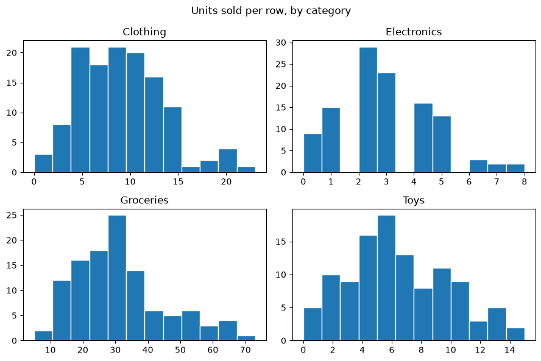
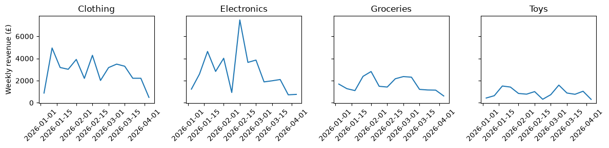
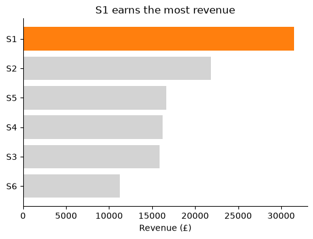
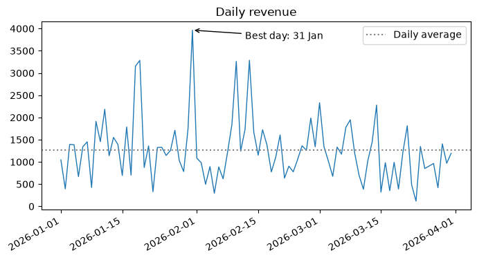
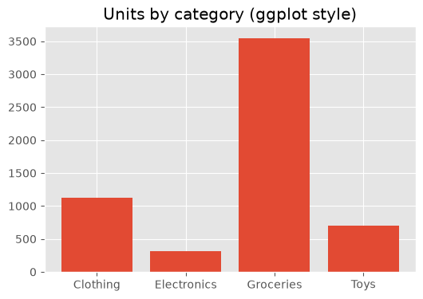

# 15-03 Subplots and styling

## What you will learn

- Put several plots in one figure with `plt.subplots(rows, columns)`.
- Share axes so that panels can be compared fairly.
- Use colour, annotations and reference lines to direct attention.
- Change the overall look of charts with style sheets.

## Why it matters

One chart answers one question; a grid of small charts can answer "how does this differ between groups?" at a glance. Most of the time, the difference between a confusing chart and a clear one is styling: a highlight colour, an annotation, a shared scale. You will use these techniques in your Part 3 EDA report and whenever you present model results.

## Concepts

The examples use the cleaned sales data, with `categories` as the sorted list of the four category names.

### A grid of subplots

`plt.subplots(nrows, ncols)` returns a figure and a 2-D NumPy array of axes. `axes.flat` goes through them one by one, which pairs nicely with `zip`:

```python
fig, axes = plt.subplots(nrows=2, ncols=2, figsize=(9, 6))
print(axes.shape)
for ax, category in zip(axes.flat, categories):
    subset = sales[sales["category"] == category]
    ax.hist(subset["units"], bins=12, edgecolor="white")
    ax.set_title(category)
fig.suptitle("Units sold per row, by category")
fig.tight_layout()
```

```
(2, 2)
```



- `axes[0, 1]` is the top-right axes; `axes.flat` lists them row by row.
- `fig.suptitle` gives the whole figure a title above the panels.
- `fig.tight_layout()` adjusts spacing so titles and labels do not overlap.

A grid of the same chart for different groups is called **small multiples**. It makes groups easy to compare, if the panels are on the same scale.

### Shared axes

Look again at the grid: each panel chose its own x and y ranges, so Groceries' bars look no taller than Electronics', even though Groceries sell ten times more units. `sharex=True` or `sharey=True` forces panels onto one scale:

```python
fig, axes = plt.subplots(1, 4, figsize=(12, 3), sharey=True)
for ax, category in zip(axes, categories):
    weekly = sales[sales["category"] == category].groupby(pd.Grouper(key="date", freq="W"))["revenue"].sum()
    ax.plot(weekly.index, weekly.values)
    ax.set_title(category)
    ax.tick_params(axis="x", labelrotation=45)
axes[0].set_ylabel("Weekly revenue (£)")
fig.tight_layout()
```



Now Toys' small revenue is obvious at a glance. With one row of panels, `axes` is 1-D, so `zip(axes, ...)` works directly. `pd.Grouper(key="date", freq="W")` groups rows by week, like `resample` in 15-02. Only label the shared axis once.

Use shared axes when you want readers to compare sizes; use independent axes when you want them to compare **shapes**.

### Colour with a purpose

Colour is most powerful when used sparingly. Make everything grey, then colour the one thing you want people to see, and say it in the title:

```python
store_revenue = sales.groupby("store")["revenue"].sum().sort_values()
colours = ["tab:orange" if store == "S1" else "lightgrey" for store in store_revenue.index]
fig, ax = plt.subplots(figsize=(6, 4))
ax.barh(store_revenue.index, store_revenue.values, color=colours)
ax.set_title("S1 earns the most revenue")
ax.set_xlabel("Revenue (£)")
ax.spines[["top", "right"]].set_visible(False)
```



A title that states the finding ("S1 earns the most revenue") is far more useful than one that only names the data ("Revenue by store"). Hiding the top and right **spines** (the frame lines around the plot) removes clutter. `"tab:orange"` is one of Matplotlib's ten default colours, `"tab:blue"` to `"tab:cyan"`, which are chosen to be easy to tell apart.

### Annotations and reference lines

`ax.annotate` adds text with an optional arrow pointing at a data point; `ax.axhline` and `ax.axvline` draw horizontal and vertical reference lines across the plot:

```python
daily = sales.groupby("date")["revenue"].sum()
best_day = daily.idxmax()
fig, ax = plt.subplots(figsize=(8, 4))
ax.plot(daily.index, daily.values, linewidth=1)
ax.annotate(
    f"Best day: {best_day:%d %b}",
    xy=(best_day, daily.max()),
    xytext=(best_day + pd.Timedelta(days=12), daily.max() * 0.95),
    arrowprops={"arrowstyle": "->"},
)
ax.axhline(daily.mean(), color="grey", linestyle=":", label="Daily average")
ax.set_title("Daily revenue")
ax.legend()
fig.autofmt_xdate()
print(best_day.date(), round(daily.max(), 2), round(daily.mean(), 2))
```

```
2026-01-31 3964.65 1273.19
```



`idxmax()` returns the **index label** of the largest value: here, the date. `xy` is the point the arrow touches and `xytext` is where the text sits. A reference line such as the average gives readers something to judge each point against.

### Style sheets

A **style sheet** changes the default look of everything: colours, fonts, grid lines. `plt.style.available` lists the built-in ones, and `plt.style.context` applies one temporarily:

```python
print(plt.style.available[:5])
with plt.style.context("ggplot"):
    fig, ax = plt.subplots(figsize=(6, 4))
    ax.bar(categories, sales.groupby("category")["units"].sum().reindex(categories))
    ax.set_title("Units by category (ggplot style)")
```

```
['Solarize_Light2', 'bmh', 'classic', 'dark_background', 'fast']
```



`reindex(categories)` puts the grouped values in the same order as the bar labels. Pick one style for a whole report so the charts look consistent. seaborn (15-04) sets a clean style of its own.

## Common mistakes

- **Indexing a 2-D axes array as 1-D.** With a 2-by-2 grid, `axes[0].plot(...)` fails with `AttributeError: 'numpy.ndarray' object has no attribute 'plot'`, because `axes[0]` is a whole row. Use `axes[0, 0]` or `axes.flat`.
- **Comparing panels with different scales.** Without `sharey=True`, equal-looking bars can represent very different numbers.
- **Overlapping labels.** Forgetting `fig.tight_layout()` (or `bbox_inches="tight"` when saving) often leaves titles cut off or on top of each other.
- **Using colour for decoration.** A rainbow of bars, one colour each, carries no information. Use colour to group or highlight.

## Try it

Make a 2-by-3 grid of scatter plots of `units` against `unit_price`, one per store, with shared axes. Which stores look different from the others?

## Exercises

Open `ex_15_03.py`:

1. `small_multiples`: one histogram per group, on a shared y axis.
2. `highlight_bars`: a horizontal bar chart that highlights one bar.
3. `mark_maximum`: a line chart with its highest point annotated.

Run the tests:

```
python -m pytest part-3-data-toolkit/15-visualisation/15-03-subplots-and-styling
```

## Summary

- `fig, axes = plt.subplots(rows, columns)` makes a grid; loop with `axes.flat`, and finish with `fig.tight_layout()`.
- `sharex`/`sharey` put panels on one scale so sizes can be compared.
- Use grey for context and one colour for the point you are making; put the finding in the title.
- `ax.annotate`, `ax.axhline` and `ax.axvline` direct the reader's attention.
- `plt.style.context(name)` applies a style sheet.
