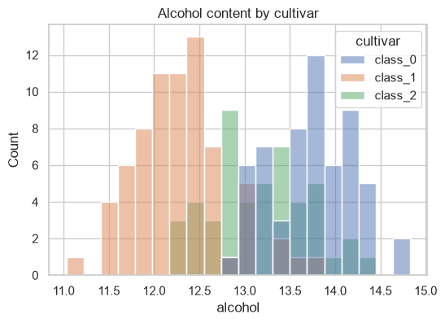
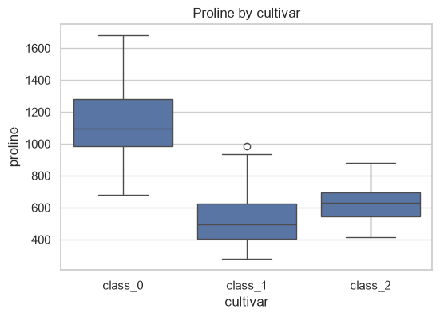
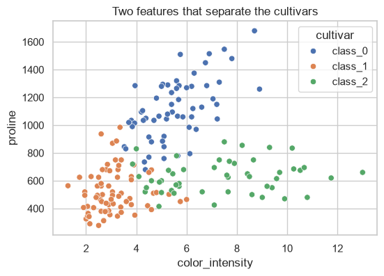
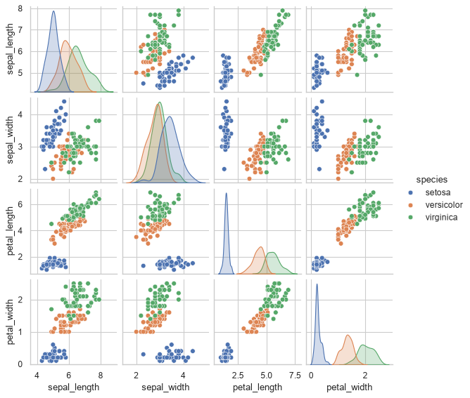
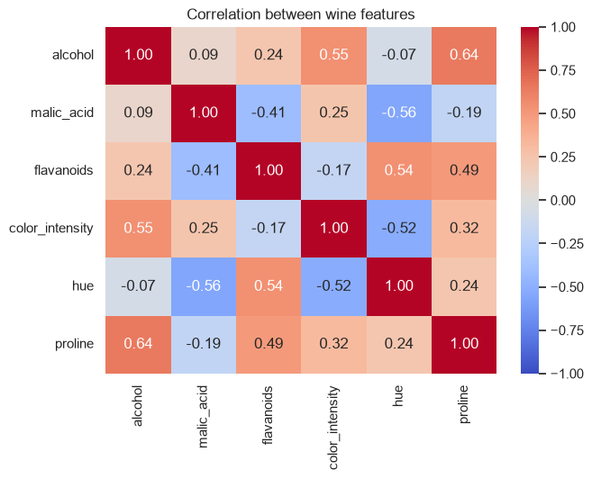

# 15-04 Statistical plots with seaborn

## What you will learn

- Load a scikit-learn dataset as a pandas DataFrame.
- Draw histograms, box plots and scatter plots straight from a DataFrame with seaborn.
- Split any plot by a category with `hue`.
- Explore every pair of features with `pairplot`, and correlations with `heatmap`.

## Why it matters

**seaborn** is a plotting library built on Matplotlib that works directly with DataFrames. One line gives you a statistical chart that would take ten lines in plain Matplotlib, with sensible colours and legends. It is the quickest way to explore a dataset before modelling it, which is exactly what you will do with the wine dataset in your Part 3 project.

## Concepts

### A dataset from scikit-learn

scikit-learn includes several small, classic datasets that load without any download. `as_frame=True` returns them as pandas objects; `.frame` is a single DataFrame with the features and the target. The **wine** dataset describes 178 wines from three **cultivars** (grape varieties) by 13 chemical measurements:

```python
import seaborn as sns
from sklearn.datasets import load_iris, load_wine

wine = load_wine(as_frame=True)
wines = wine.frame
wines["cultivar"] = wines["target"].map(dict(enumerate(wine.target_names)))
print(wines.shape)
print(wines[["alcohol", "color_intensity", "proline", "cultivar"]].head(3))
print(wines["cultivar"].value_counts().sort_index())
```

```
(178, 15)
   alcohol  color_intensity  proline cultivar
0    14.23             5.64   1065.0  class_0
1    13.20             4.38   1050.0  class_0
2    13.16             5.68   1185.0  class_0
cultivar
class_0    59
class_1    71
class_2    48
Name: count, dtype: int64
```

`target` holds the cultivar as 0, 1 or 2; `target_names` holds the matching names. `dict(enumerate(names))` builds `{0: "class_0", 1: "class_1", 2: "class_2"}` for `map`. In Part 5, predicting the cultivar from the measurements will be a classification problem.

### seaborn basics

seaborn is imported as `sns`. `sns.set_theme()` switches on its cleaner default style for every chart that follows. seaborn functions take a DataFrame as `data=` and **column names** for `x`, `y` and `hue`, and draw onto an axes you pass with `ax=`, so all of 15-01 to 15-03 still applies:

```python
sns.set_theme(style="whitegrid")

fig, ax = plt.subplots(figsize=(6, 4))
sns.histplot(data=wines, x="alcohol", hue="cultivar", bins=20, ax=ax)
ax.set_title("Alcohol content by cultivar")
```



**`hue`** splits the data by a categorical column and gives each group its own colour and a legend entry. Here, class_1 wines clearly have less alcohol than the other two.

### Box plots by group

```python
fig, ax = plt.subplots(figsize=(6, 4))
sns.boxplot(data=wines, x="cultivar", y="proline", ax=ax)
ax.set_title("Proline by cultivar")
print(wines.groupby("cultivar")["proline"].median())
```

```
cultivar
class_0    1095.0
class_1     495.0
class_2     627.5
Name: proline, dtype: float64
```



Compare this one line with the list of groups you built by hand for `ax.boxplot` in 15-02. Proline, an amino acid, separates class_0 from the others very well.

### Scatter plots with hue

A scatter plot coloured by group shows whether two features together can tell the groups apart:

```python
fig, ax = plt.subplots(figsize=(6, 4))
sns.scatterplot(data=wines, x="color_intensity", y="proline", hue="cultivar", ax=ax)
ax.set_title("Two features that separate the cultivars")
```



The three cultivars form three mostly separate clouds. A classifier would find this dataset easy using just these two features, a hint you can check in Part 5.

### pairplot

**`pairplot`** draws a scatter plot for every pair of numeric columns, with each column's distribution on the diagonal. It is a fast overview of a small dataset. The **iris** dataset, 150 flowers of three species measured in four ways, is the classic example:

```python
iris = load_iris(as_frame=True)
flowers = iris.frame.rename(columns=lambda name: name.replace(" (cm)", "").replace(" ", "_"))
flowers["species"] = flowers["target"].map(dict(enumerate(iris.target_names)))
grid = sns.pairplot(flowers.drop(columns="target"), hue="species", height=1.8)
grid.savefig(FIGURES / "pairplot.png", dpi=80)
plt.close(grid.figure)
print(flowers.columns.tolist())
```

```
['sepal_length', 'sepal_width', 'petal_length', 'petal_width', 'target', 'species']
```



`rename(columns=function)` applies a function to every column name, here tidying `"sepal length (cm)"` into `"sepal_length"`. `pairplot` makes its own figure (a "grid" object), so you save it from the grid rather than from `fig`. Setosa is separated from the others by petal size in every panel. With many columns, pairplots become too big to read; pick a handful of interesting ones.

### Correlation heatmaps

A **correlation** measures how strongly two variables move together, from −1 (one goes up as the other goes down) through 0 (no straight-line relationship) to +1 (they rise together). Module 19 explains how it is calculated. `DataFrame.corr()` computes every pair at once, and **`heatmap`** colours the resulting grid:

```python
features = ["alcohol", "malic_acid", "flavanoids", "color_intensity", "hue", "proline"]
correlations = wines[features].corr()
print(correlations.round(2))
fig, ax = plt.subplots(figsize=(7, 5))
sns.heatmap(correlations, annot=True, fmt=".2f", cmap="coolwarm", vmin=-1, vmax=1, ax=ax)
ax.set_title("Correlation between wine features")
```

```
                 alcohol  malic_acid  flavanoids  color_intensity   hue  proline
alcohol             1.00        0.09        0.24             0.55 -0.07     0.64
malic_acid          0.09        1.00       -0.41             0.25 -0.56    -0.19
flavanoids          0.24       -0.41        1.00            -0.17  0.54     0.49
color_intensity     0.55        0.25       -0.17             1.00 -0.52     0.32
hue                -0.07       -0.56        0.54            -0.52  1.00     0.24
proline             0.64       -0.19        0.49             0.32  0.24     1.00
```



- `annot=True` writes each number in its cell; `fmt=".2f"` rounds it.
- `cmap="coolwarm"` is a **diverging** colour map: blue for negative, red for positive, pale near zero. `vmin=-1, vmax=1` fixes the colour scale so that zero is always the neutral colour.
- The diagonal is always 1: every variable correlates perfectly with itself. The table is symmetric.

Alcohol and proline (0.64) move together; malic acid and hue (−0.56) move in opposite directions. Strongly correlated features carry overlapping information, which matters for some models (Module 21).

## Common mistakes

- **Passing data instead of column names.** With `data=` given, `x` and `y` should be column names as strings: `x="alcohol"`, not `x=wines["alcohol"]` (which works, but loses the automatic axis labels and `hue` grouping).
- **A numeric `hue`.** Using `hue="target"` (0, 1, 2) gives a continuous colour scale. Map to names or convert to strings for distinct colours.
- **Saving a pairplot through `fig`.** `pairplot` makes its own figure; call `grid.savefig(...)`.
- **Correlating everything.** `corr()` on columns including the target, IDs or categories gives misleading numbers. Choose the numeric features deliberately.

## Try it

Make a heatmap of the correlations between all 13 wine features plus `target`. Which features have the strongest correlation, positive or negative, with `target`? Does that agree with the box plots?

## Exercises

Open `ex_15_04.py`:

1. `wine_frame`: the wine dataset as a DataFrame with a named cultivar column.
2. `strongest_correlations`: the features most correlated with a target column.
3. `hue_scatter`: a seaborn scatter plot coloured by a category.
4. `correlation_heatmap`: an annotated heatmap of correlations.

Run the tests:

```
python -m pytest part-3-data-toolkit/15-visualisation/15-04-statistical-plots-with-seaborn
```

## Summary

- `load_wine(as_frame=True).frame` (and `load_iris`, and others) give scikit-learn datasets as DataFrames.
- seaborn plots take `data=` plus column names; `ax=` puts them on a Matplotlib axes.
- `hue=` splits a plot into colour-coded groups with a legend.
- `pairplot` shows every pair of features; save it with `grid.savefig`.
- `df.corr()` plus `sns.heatmap(..., annot=True, cmap="coolwarm", vmin=-1, vmax=1)` shows how features move together.
