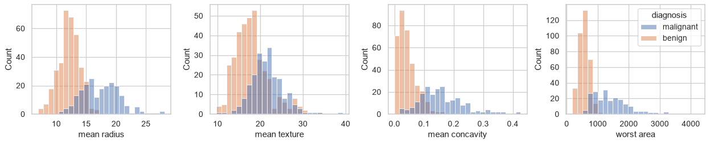
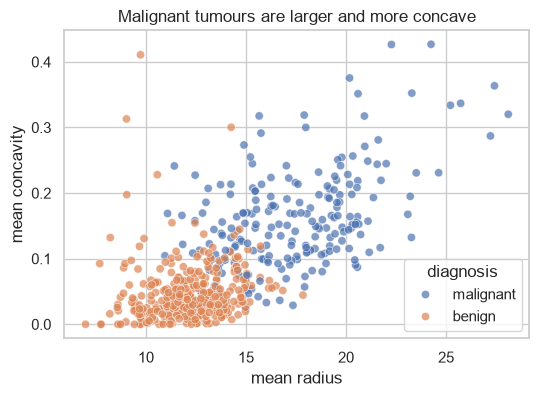

# 16-01 An EDA workflow

## What you will learn

- Follow a repeatable checklist to explore a new dataset.
- Check shape, types, missing values, duplicates and class balance.
- Explore each feature's distribution and its relationship with the target.
- Write findings down, each backed by a number or a chart.

## Why it matters

**Exploratory data analysis** (EDA) means getting to know a dataset before modelling it. Skipping it is the most common way to build a model on broken data, or to miss the one feature that answers the question. EDA also tells you what to expect: if two features separate the classes perfectly in a scatter plot, a model scoring 99% is no surprise; if nothing separates them, a model scoring 99% is suspicious. Your Part 3 project is an EDA report.

## Concepts

The examples explore the **breast cancer** dataset bundled with scikit-learn: 569 tumours, each described by 30 measurements taken from a microscope image, and labelled malignant (cancerous) or benign.

```python
dataset = load_breast_cancer(as_frame=True)
tumours = dataset.frame
tumours["diagnosis"] = tumours["target"].map({0: "malignant", 1: "benign"})
```

In this dataset, `target` is 0 for malignant and 1 for benign; mapping it to words makes plots and tables readable.

### The checklist

1. **Shape** and a first look.
2. **Types** of each column.
3. **Missing values** and **duplicates**.
4. The **target**: what are we predicting, and how balanced is it?
5. **Distributions** of individual features.
6. **Relationships**: features against the target, and features against each other.
7. **Findings**, written down with evidence.

Follow it every time. It is quick, and it stops you jumping to conclusions.

### Steps 1 to 3: structure

```python
print(tumours.shape)
print(tumours.iloc[:3, :5])
print(tumours.dtypes.value_counts())
print("missing values:", int(tumours.isna().sum().sum()))
print("duplicate rows:", int(tumours.duplicated().sum()))
```

```
(569, 32)
   mean radius  mean texture  mean perimeter  mean area  mean smoothness
0        17.99         10.38           122.8     1001.0          0.11840
1        20.57         17.77           132.9     1326.0          0.08474
2        19.69         21.25           130.0     1203.0          0.10960
float64    30
int64       1
str         1
Name: count, dtype: int64
missing values: 0
duplicate rows: 0
```

30 float features, the integer target and our text `diagnosis` column; no missing values and no duplicates. This dataset is clean, unlike the sales data. That is itself a finding worth recording, because you will not need a cleaning step.

### Step 4: the target

```python
print(tumours["diagnosis"].value_counts())
print(tumours["diagnosis"].value_counts(normalize=True).round(3))
```

```
diagnosis
benign       357
malignant    212
Name: count, dtype: int64
diagnosis
benign       0.627
malignant    0.373
Name: proportion, dtype: float64
```

The classes are **imbalanced**: 62.7% benign. This matters later: a useless model that always says "benign" would be 62.7% accurate, so accuracy alone cannot tell you a model is good (Modules 20 and 22).

### Step 5: distributions

With 30 features you cannot study every one closely. Start with a few, using `describe` and histograms split by class:

```python
features = ["mean radius", "mean texture", "mean concavity", "worst area"]
print(tumours[features].describe().round(2))
fig, axes = plt.subplots(1, 4, figsize=(14, 3))
for ax, feature in zip(axes, features):
    sns.histplot(data=tumours, x=feature, hue="diagnosis", ax=ax, bins=25, legend=(feature == features[-1]))
fig.tight_layout()
```

```
       mean radius  mean texture  mean concavity  worst area
count       569.00        569.00          569.00      569.00
mean         14.13         19.29            0.09      880.58
std           3.52          4.30            0.08      569.36
min           6.98          9.71            0.00      185.20
25%          11.70         16.17            0.03      515.30
50%          13.37         18.84            0.06      686.50
75%          15.78         21.80            0.13     1084.00
max          28.11         39.28            0.43     4254.00
```



Look for: the **range** of each feature (worst area goes into the thousands, concavity stays below 0.5, so features are on very different scales, which matters in Module 21); **skew** (worst area has a long right tail); and **separation** between the classes (radius and concavity overlap little; texture overlaps a lot). `legend=` shows the legend only on the last panel to save space.

### Step 6: relationships

Compare the classes with a group summary, rank features by their correlation with the target, and plot the most promising pair:

```python
by_class = tumours.groupby("diagnosis")[features].median().round(2)
print(by_class)
correlation_with_target = (
    tumours.drop(columns=["diagnosis"]).corr()["target"].drop("target").sort_values()
)
print(correlation_with_target.head(3).round(3))
print(correlation_with_target.tail(3).round(3))
```

```
           mean radius  mean texture  mean concavity  worst area
diagnosis                                                       
benign           12.20         17.39            0.04       547.4
malignant        17.33         21.46            0.15      1303.0
worst concave points   -0.794
worst perimeter        -0.783
mean concave points    -0.777
Name: target, dtype: float64
texture error             0.008
mean fractal dimension    0.013
smoothness error          0.067
Name: target, dtype: float64
```

The text column is dropped before `corr()`, which needs numbers. Because benign is coded as 1, a **negative** correlation means "higher values go with malignant". Concave points and perimeter are strongly related to the diagnosis; texture error and fractal dimension barely at all. Medians make the same point in plainer terms: malignant tumours have a median radius of 17.33 against 12.20.



The scatter plot shows the two classes in mostly separate regions, with some overlap in the middle. That overlap is where a model will make its mistakes.

### Step 7: findings

Write findings as short sentences, each with the number or chart that supports it. Generating them from the data, rather than typing numbers in by hand, keeps them correct when the data changes:

```python
radius_medians = by_class["mean radius"]
findings = [
    "569 tumours, 30 numeric features, no missing values or duplicates.",
    f"{(tumours['diagnosis'] == 'benign').mean():.1%} are benign: the classes are moderately imbalanced.",
    f"Median radius is {radius_medians['malignant']} for malignant vs {radius_medians['benign']} for benign.",
    f"The feature most correlated with the target is '{correlation_with_target.index[0]}' "
    f"({correlation_with_target.iloc[0]:.2f}).",
]
for number, finding in enumerate(findings, start=1):
    print(f"{number}. {finding}")
```

```
1. 569 tumours, 30 numeric features, no missing values or duplicates.
2. 62.7% are benign: the classes are moderately imbalanced.
3. Median radius is 17.33 for malignant vs 12.2 for benign.
4. The feature most correlated with the target is 'worst concave points' (-0.79).
```

Good findings are **specific** ("median radius 17.33 vs 12.20", not "radius matters"), **supported** (a number or a chart), and **useful** for the next step (the class imbalance changes how we will evaluate models).

## Common mistakes

- **Modelling before looking.** A quick `info()` and a few histograms take two minutes and catch most data problems.
- **Treating every finding as causal.** "Malignant tumours are larger" is an association in this data, not a claim about what causes cancer (16-02 discusses this).
- **Plotting every column without a question.** Thirty histograms nobody reads are not analysis. Start from the target and the features most related to it.
- **Findings without numbers.** "Some features matter" helps nobody. Say which, and by how much.

## Try it

Continue the EDA: plot a correlation heatmap of the ten "mean" features (`[c for c in tumours.columns if c.startswith("mean")]`). Which features are almost copies of each other? (Hint: radius, perimeter and area are all measures of size.) Add a finding about it.

## Exercises

Open `ex_16_01.py`. These are reusable EDA helpers you can apply to any dataset, including in your Part 3 project.

1. `overview`: rows, columns, missing values and duplicates in one dictionary.
2. `missing_report`: the count and percentage of missing values in each affected column.
3. `class_balance`: the proportion of each class.
4. `median_by_group`: the median of some columns for each group.
5. `numbered_findings`: turn a list of findings into numbered lines of text.

Run the tests:

```
python -m pytest part-3-data-toolkit/16-exploratory-data-analysis/16-01-an-eda-workflow
```

## Summary

- EDA comes before modelling; follow the same checklist every time.
- Check shape, types, missing values and duplicates first.
- Look at the target's balance: it decides how models must be evaluated.
- Study distributions (range, skew, separation by class) and relationships (group summaries, correlations, scatter plots).
- Write specific findings, each backed by a number or a chart, generated from the data where possible.
