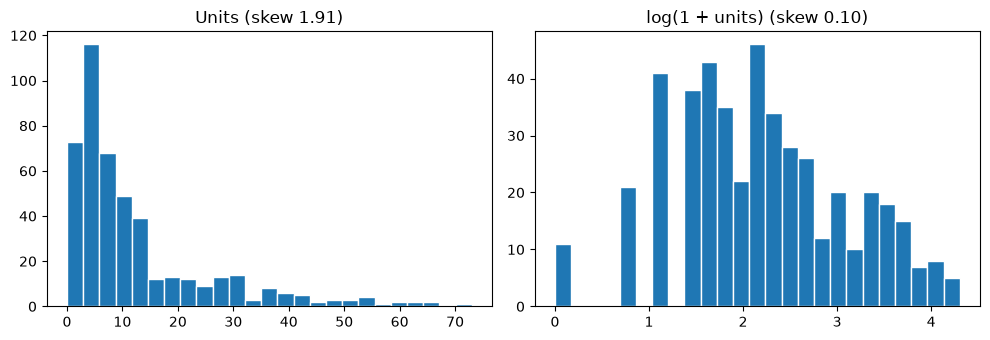

# 16-02 Outliers, skew and correlation

## What you will learn

- Find outliers with the IQR rule and with z-scores, and decide what to do about them.
- Measure skew, and reduce it with a log transform.
- Explain why correlation does not imply causation, and spot a confounding variable.
- Recognise Simpson's paradox, where a trend reverses when data is grouped.

## Why it matters

Outliers can be data-entry errors to remove, or the most important rows in the dataset (fraud, faults, record sales). Skewed features can distort averages and some models. And the most dangerous EDA mistake is believing a pattern means more than it does. This lesson gives you the tools to question what you see, before a model learns the wrong lesson from it.

## Concepts

The examples use the cleaned sales data (14-03), and its `units` column.

### Outliers by the IQR rule

An **outlier** is a value far from the others. The **interquartile range** (IQR) is the distance between the 25th percentile (Q1) and the 75th percentile (Q3): the width of the middle half of the data, which is the box in a box plot (15-02). The **IQR rule** calls a value an outlier if it lies more than 1.5 × IQR below Q1 or above Q3. These are exactly the points a box plot draws individually.

```python
q1, q3 = units.quantile([0.25, 0.75])
iqr = q3 - q1
low, high = q1 - 1.5 * iqr, q3 + 1.5 * iqr
outliers = units[(units < low) | (units > high)]
print(f"Q1={q1}, Q3={q3}, IQR={iqr}, bounds=({low}, {high})")
print(len(outliers), "outliers; smallest is", outliers.min())
```

```
Q1=4.0, Q3=14.25, IQR=10.25, bounds=(-11.375, 29.625)
56 outliers; smallest is 30.0
```

`quantile` gives percentiles as fractions (0.25 is the 25th percentile). The rule uses quartiles rather than the mean, so a few extreme values cannot drag the bounds towards themselves.

### Errors or real?

An outlier is a question, not an answer. Look at the rows before deciding anything:

```python
print(sales.loc[outliers.index, "category"].value_counts())
```

```
category
Groceries    56
Name: count, dtype: int64
```

Every "outlier" is a Groceries row. These are not errors: groceries simply sell in larger numbers. Judging each category against itself, using `transform` (14-05), tells a different story:

```python
within = sales.groupby("category")["units"].transform(
    lambda values: (values > values.quantile(0.75) + 1.5 * (values.quantile(0.75) - values.quantile(0.25)))
)
print(int(within.sum()), "outliers when judged within their own category")
```

```
7 outliers when judged within their own category
```

What to do with outliers:

- **Errors** (a negative age, a price of 99999 meaning "unknown"): fix them if you can, otherwise treat them as missing.
- **Real but extreme values**: usually keep them. Consider a transform (below), or a model that is less sensitive to them.
- **Never delete outliers just to make results look better.** Record what you removed and why.

### z-scores

A **z-score** says how many standard deviations a value is from the mean: (value − mean) / standard deviation (the same calculation as standardising in 13-03). A common rule flags |z| > 3:

```python
z_scores = (units - units.mean()) / units.std()
print(int((z_scores.abs() > 3).sum()), "rows with |z| > 3")
```

```
12 rows with |z| > 3
```

z-scores work well for roughly bell-shaped data. For skewed data like this, the mean and standard deviation are themselves pulled up by the long tail, so the IQR rule is more reliable.

### Skew

A distribution is **skewed** when one tail is much longer than the other. `skew()` measures it: 0 is symmetric, positive means a long right tail, negative a long left tail. As a rough guide, values above 1 are strongly skewed. A sign of right skew is a mean well above the median:

```python
print(round(units.skew(), 2), round(units.mean(), 2), units.median())
log_units = np.log1p(units)
print(round(log_units.skew(), 2))
```

```
1.91 12.38 7.0
0.1
```

A **log transform** compresses large values much more than small ones, pulling in a long right tail. `np.log1p(x)` computes log(1 + x), which, unlike a plain log, works for zero. The skew drops from 1.91 to 0.1:



Many models (especially linear ones) work better on less skewed features, and you will use log transforms again in Part 5. Remember to transform predictions back with `np.expm1` if you model a logged target.

### Correlation is not causation

A correlation between two variables does not mean one causes the other. Often a third variable, a **confounder**, drives both. The sales data contains a clear case:

```python
print(round(sales["unit_price"].corr(sales["units"]), 3))
for category, rows in sales.groupby("category"):
    print(f"{category:<12}{rows['unit_price'].corr(rows['units']):7.3f}")
```

```
-0.511
Clothing     -0.022
Electronics  -0.003
Groceries     0.116
Toys         -0.092
```

Overall, price and units have a correlation of −0.51, which seems to say "higher prices cause lower sales". But within every category the correlation is close to zero. The **category** is the confounder: Groceries are cheap and sell many units, Electronics are expensive and sell few. Within a category, the small price variations made no visible difference in this data. Cutting prices on Electronics would not turn them into Groceries.

Correlation also only measures **straight-line** relationships. A perfect curved relationship can have a correlation of zero:

```python
x = np.linspace(-3, 3, 61)
print(round(np.corrcoef(x, x ** 2)[0, 1], 3))
```

```
0.0
```

`y = x²` is completely determined by `x`, yet the correlation is 0, because y goes down and then up. Always plot.

### Simpson's paradox

**Simpson's paradox** is when a trend that appears in every group reverses when the groups are combined. This classic example compares two treatments for kidney stones (the numbers are from a real 1986 study):

```python
treatments = pd.DataFrame({
    "treatment": ["A"] * 2 + ["B"] * 2,
    "stone_size": ["small", "large", "small", "large"],
    "patients": [87, 263, 270, 80],
    "recovered": [81, 192, 234, 55],
})
treatments["rate"] = (treatments["recovered"] / treatments["patients"]).round(3)
print(treatments)
overall = treatments.groupby("treatment")[["patients", "recovered"]].sum()
overall["rate"] = (overall["recovered"] / overall["patients"]).round(3)
print(overall)
```

```
  treatment stone_size  patients  recovered   rate
0         A      small        87         81  0.931
1         A      large       263        192  0.730
2         B      small       270        234  0.867
3         B      large        80         55  0.688
           patients  recovered   rate
treatment                            
A               350        273  0.780
B               350        289  0.826
```

Treatment A has the better recovery rate for small stones (93.1% against 86.7%) **and** for large stones (73.0% against 68.8%). Yet overall, B looks better (82.6% against 78.0%). How? Doctors gave A mostly to the harder, large-stone cases (263 of its 350 patients), and large stones recover less often whatever the treatment. Stone size is a confounder. The grouped comparison is the fair one.

The lesson for EDA: when a comparison matters, check it within relevant groups too.

## Common mistakes

- **Removing outliers automatically.** The 56 Groceries "outliers" were the busiest days for the biggest-selling category. Inspect before removing.
- **Logging data with zeros or negatives.** `np.log(0)` is `-inf` and the log of a negative number is `nan` (with a warning). Use `np.log1p` for counts, and think carefully about negative values.
- **Reading causation into correlation.** Ask "what else could explain this?" before drawing conclusions.
- **Trusting only the combined numbers.** Simpson's paradox shows that totals can point the opposite way to every group.

## Try it

In the breast cancer data (16-01), apply the IQR rule to `worst area`. How many outliers are there, and what fraction of them are malignant? Are they errors, or the most important rows in the dataset?

## Exercises

Open `ex_16_02.py`:

1. `iqr_bounds`: the lower and upper IQR fences.
2. `iqr_outliers`: the values outside the fences.
3. `zscore_outliers`: the values with large z-scores.
4. `log_transform`: log(1 + x) of a Series, rejecting negative values.
5. `success_rates`: success rates by group, for checking Simpson's paradox.

Run the tests:

```
python -m pytest part-3-data-toolkit/16-exploratory-data-analysis/16-02-outliers-skew-and-correlation
```

## Summary

- The IQR rule flags values beyond Q1 − 1.5 × IQR and Q3 + 1.5 × IQR; z-scores flag values many standard deviations from the mean.
- Inspect outliers before acting: fix errors, usually keep real extremes, and record any removal.
- Positive skew (mean above median) can be reduced with `np.log1p`.
- Correlation is not causation; look for confounders, and plot, because correlation misses curved relationships.
- Simpson's paradox: check important comparisons within groups as well as overall.
