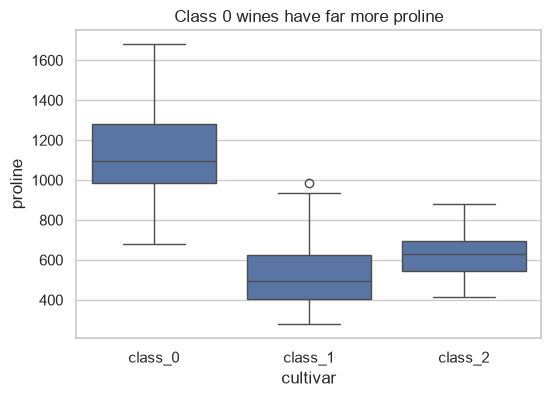
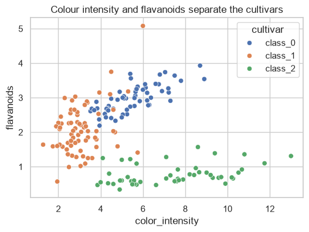
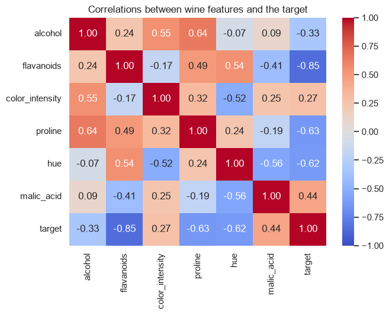
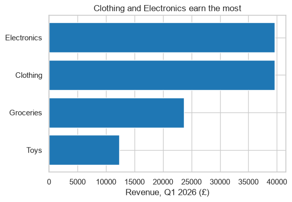
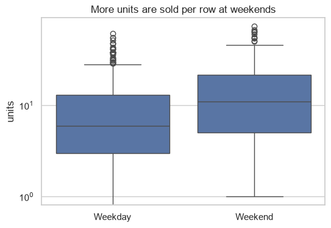
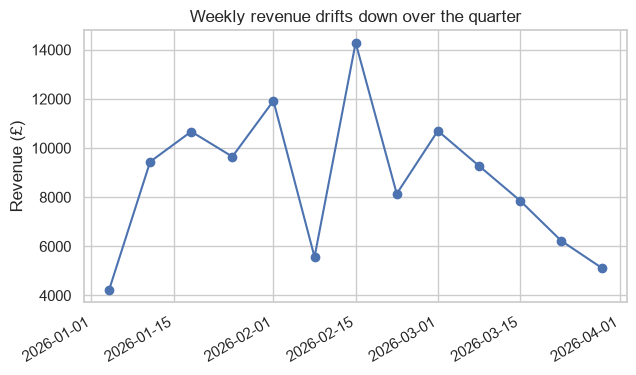
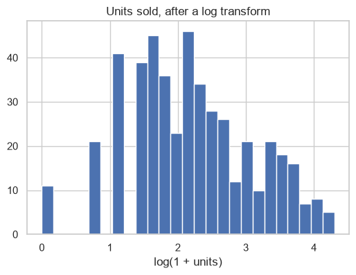

# EDA Report: Wine Cultivars and Q1 Store Sales

All numbers and figures in this report are produced by `eda.py` (run `python part-3-data-toolkit/project/solution/eda.py` from the repository root).

## Data

**Wine** (`sklearn.datasets.load_wine`): 178 wines from three cultivars (59 class_0, 71 class_1, 48 class_2), each described by 13 chemical measurements. No missing values or duplicates.

**Store sales** (`data/store_sales.csv`, `data/stores.csv`): daily sales rows for six stores and four product categories, 1 January to 31 March 2026.

## Cleaning steps (store sales)

1. Removed 6 exact duplicate rows (486 to 480 rows).
2. Tidied the category column: 7 spellings such as `" electronics"` and `"CLOTHING"` became the 4 real categories.
3. Converted `date` from text to datetimes.
4. Dropped 12 rows with no `units` value: we cannot know what was sold (480 to 468 rows).
5. Filled the remaining missing `unit_price` values with the median price **of the same category**, because prices differ about twentyfold between categories, so an overall median would be badly wrong for Electronics and Groceries.
6. Added `revenue` (units times unit price), `month`, `weekday` and `is_weekend` columns.

Store S6 appears in the sales but not in `stores.csv`, so it has no city or region. It was kept: dropping it would remove £11,456.79 of revenue.

## Findings

1. **Proline alone separates class_0 wines.** Median proline is 1,095 for class_0, against 495 for class_1 and 627.5 for class_2. See `figures/wine_proline.png`.
2. **Two features separate all three cultivars.** In a scatter plot of flavanoids against colour intensity, the cultivars form three mostly separate groups; flavanoids has the strongest correlation with the target (−0.85). A classifier should find this dataset easy. See `figures/wine_scatter.png` and `figures/wine_correlations.png`.
3. **Clothing and Electronics earn two-thirds of revenue.** Total Q1 revenue was £115,246.15: Electronics £39,618.64 and Clothing £39,611.73, against £23,674.38 for Groceries and £12,341.40 for Toys, even though Groceries sell the most units. See `figures/sales_by_category.png`.
4. **Weekends sell 58.5% more units per row than weekdays.** This holds across categories and is visible in the medians of the box plot. Weekend is a useful feature for any sales forecast. See `figures/sales_weekend.png`.
5. **Monthly revenue fell by a quarter over the quarter.** Revenue was £44,824.73 in January, £37,360.00 in February and £33,061.42 in March, a 26% fall. Three months is too short to tell a trend from seasonality, so this needs more data before acting on it. See `figures/sales_weekly.png`.

## Figures

## Limitations and next steps

- The units column is strongly right-skewed (most rows sell few units, a few sell over 60). A log transform makes it close to symmetric (`figures/sales_units_log.png`); a model predicting units should probably use it.
- Price and units are negatively correlated overall, but this is driven by category (16-02); within each category the correlation is close to zero. Do not read it as "lower prices sell more".
- Zero-unit rows cannot be shown on the log-scale weekend box plot.
- Next: confirm the wine finding by training a classifier (Part 5), and gather more months of sales data before trusting the downward trend.
