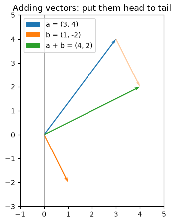

# 17-01 Vectors

## What you will learn

- Describe a vector as a point, an arrow, and a list of features.
- Add vectors and multiply them by a number.
- Compute a vector's length (its norm) and make unit vectors.
- Measure the distance between two points, and see why feature scales matter.

## Why it matters

In machine learning, every example in a dataset is a **vector**: a house is (floor area, bedrooms, age); a flower is its four measurements. Many algorithms work by measuring how far apart these vectors are: k-nearest neighbours (Module 22) predicts from the closest examples, and k-means clustering (Module 25) groups points that are close together. This lesson gives you the vocabulary and the NumPy tools.

## Concepts

### What a vector is

A **vector** is an ordered list of numbers, called its **components**. In NumPy it is a 1-D array. The number of components is its **dimension**.

```python
house = np.array([120.0, 3.0, 15.0])   # floor area, bedrooms, age
point = np.array([3.0, 4.0])
print(house, house.shape, point.shape)
```

```
[120.   3.  15.] (3,) (2,)
```

Three ways to picture the same thing:

- A **list of features**: this house has area 120, 3 bedrooms and is 15 years old.
- A **point** in space: `point` sits at x = 3, y = 4. A house is a point in 3-dimensional space; a wine from 15-04 is a point in 13 dimensions.
- An **arrow** from the origin (0, 0) to that point, with a length and a direction.

We can only draw 2 or 3 dimensions, but everything in this lesson works the same way in any number.

### Adding and scaling

Vectors of the same dimension add **component by component**, which NumPy does for you:

```python
move = np.array([1.0, -2.0])
print(point + move)
```

```
[4. 2.]
```

Multiplying a vector by a number, called **scaling**, multiplies every component. A negative number reverses the direction:

```python
print(2 * point, -0.5 * point)
```

```
[6. 8.] [-1.5 -2. ]
```

As arrows, adding means "follow one arrow, then the other": put them head to tail.



(The figure is drawn with `ax.quiver`, which draws arrows; see `examples.py`.)

### Length: the norm

The **length** (or **norm**, or **magnitude**) of a vector is how long its arrow is. In two dimensions this is Pythagoras' theorem: the length of (3, 4) is √(3² + 4²) = √25 = 5. In words: **square each component, add them up, and take the square root**. The same rule works in any dimension. NumPy has it built in as `np.linalg.norm`:

```python
print(np.sqrt((point ** 2).sum()))
print(np.linalg.norm(point))
print(round(np.linalg.norm(house), 2))
```

```
5.0
5.0
120.97
```

Mathematicians write the norm of a vector **v** as ‖**v**‖.

### Unit vectors

Dividing a vector by its own length gives a **unit vector**: length 1, same direction. It captures direction alone:

```python
unit = point / np.linalg.norm(point)
print(unit, np.linalg.norm(unit))
```

```
[0.6 0.8] 1.0
```

### Distance between points

The **distance** between two points is the length of the vector from one to the other, that is, the norm of their difference. This is called the **Euclidean distance**:

```python
a = np.array([1.0, 2.0])
b = np.array([4.0, 6.0])
print(np.linalg.norm(b - a))
```

```
5.0
```

In words: subtract the points, square each difference, add them up, take the square root. You wrote this with loops in 05-02, and with broadcasting in 13-03.

### Distance and feature scales

Here are three houses. Which is most similar to the first?

```python
houses = np.array([
    [120.0, 3.0, 15.0],
    [118.0, 1.0, 80.0],
    [160.0, 3.0, 14.0],
])
print(np.round(np.linalg.norm(houses - houses[0], axis=1), 2))
```

```
[ 0.   65.06 40.01]
```

`axis=1` takes one norm per row. By this measure, the third house is closer to the first (40.01) than the second is (65.06). But is a house 40 m² bigger really more similar than a house the same size with 2 fewer bedrooms and 65 years older? The answer depends entirely on **units**: one extra year counts as much as one extra square metre, and bedrooms barely count at all because their numbers are small. Distance-based methods are only meaningful once features are put on comparable scales, which is why standardising (13-03) is essential before k-nearest neighbours and k-means. Module 21 returns to this.

## Common mistakes

- **Adding vectors of different dimensions.** `np.array([1, 2]) + np.array([1, 2, 3])` raises a broadcasting `ValueError`. Vectors must have the same number of components.
- **Forgetting the square root.** The sum of squared differences is the **squared** distance. It ranks points in the same order, but the value is different.
- **Dividing by a zero length.** The zero vector has no direction, so making it a unit vector divides by zero and gives `nan` with a warning. Check the norm first.
- **Comparing distances across unscaled features.** As shown above, the feature with the biggest numbers dominates. Scale first.

## Try it

Standardise the three houses column by column (subtract each column's mean and divide by its standard deviation, as in 13-03), then recompute the distances from the first house. Does the answer to "which house is most similar?" change?

## Exercises

Open `ex_17_01.py`. Use NumPy, but compute norms yourself (no `np.linalg.norm`), so you see the formula at work.

1. `norm`: the length of a vector.
2. `unit_vector`: a vector scaled to length 1.
3. `distance`: the Euclidean distance between two points.
4. `nearest_index`: which of several points is closest to a target.

Run the tests:

```
python -m pytest part-4-maths-for-ml/17-linear-algebra/17-01-vectors
```

## Summary

- A vector is an ordered list of numbers: a list of features, a point, or an arrow.
- Vectors add component by component; scaling multiplies every component.
- The norm ‖**v**‖ is the square root of the sum of squared components; `np.linalg.norm` computes it.
- A unit vector is a vector divided by its norm; it keeps only the direction.
- Euclidean distance is the norm of the difference; it depends on feature scales, so standardise before comparing.
