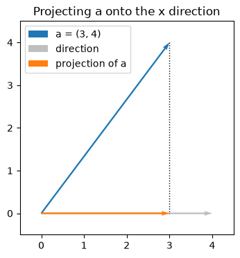

# 17-02 Dot product and similarity

## What you will learn

- Compute the dot product and explain what its sign and size mean.
- Find the angle between two vectors.
- Measure similarity of direction with cosine similarity.
- Project one vector onto another.

## Why it matters

The dot product is the single most important operation in machine learning. A linear model's prediction is a dot product of features and weights (17-04); a neural network is layers of dot products; recommendation systems and search engines rank items by cosine similarity, a dot product of unit vectors. Understanding it geometrically makes all of those easier to follow.

## Concepts

### The dot product

The **dot product** of two vectors of the same dimension multiplies matching components and adds the results. For **a** = (3, 4) and **b** = (2, 1), it is 3 × 2 + 4 × 1 = 10. It is written **a** · **b**, and in NumPy as `a @ b` or `np.dot(a, b)`:

```python
a = np.array([3.0, 4.0])
b = np.array([2.0, 1.0])
print(a[0] * b[0] + a[1] * b[1], a @ b, np.dot(a, b))
```

```
10.0 10.0 10.0
```

The result is a single number, not a vector. A vector dotted with itself gives its length squared, because that is exactly the sum of squared components from 17-01:

```python
print(a @ a, np.linalg.norm(a) ** 2)
```

```
25.0 25.0
```

### What the sign means

Geometrically, the dot product measures how much two vectors point the **same way**:

- **positive**: they point in broadly the same direction (angle under 90°);
- **zero**: they are at right angles, called **orthogonal**;
- **negative**: they point in broadly opposite directions (angle over 90°).

```python
right = np.array([1.0, 0.0])
for other in [np.array([2.0, 1.0]), np.array([0.0, 3.0]), np.array([-2.0, 1.0])]:
    print(other, right @ other)
```

```
[2. 1.] 2.0
[0. 3.] 0.0
[-2.  1.] -2.0
```

### The angle between vectors

The dot product is connected to the angle θ (theta) between the vectors by **a** · **b** = ‖**a**‖ ‖**b**‖ cos θ. In words: the dot product equals the two lengths multiplied together, multiplied by the cosine of the angle. Rearranging gives the angle:

```python
def angle_degrees(first, second):
    cosine = first @ second / (np.linalg.norm(first) * np.linalg.norm(second))
    return np.degrees(np.arccos(np.clip(cosine, -1, 1)))


print(round(angle_degrees(a, b), 1))
print(angle_degrees(right, np.array([0.0, 3.0])))
```

```
26.6
90.0
```

`np.arccos` turns a cosine back into an angle (in radians); `np.degrees` converts it. `np.clip` keeps the cosine between −1 and 1, because float rounding can push it to 1.0000000002, which `arccos` cannot handle.

### Cosine similarity

The middle part of that calculation, the dot product divided by both lengths, is called **cosine similarity**. It measures how alike two vectors are in **direction**, ignoring their lengths. It ranges from 1 (same direction) through 0 (unrelated) to −1 (opposite):

```python
def cosine_similarity(first, second):
    return first @ second / (np.linalg.norm(first) * np.linalg.norm(second))


print(round(cosine_similarity(a, 10 * a), 3))
print(round(cosine_similarity(a, -a), 3))
```

```
1.0
-1.0
```

**a** and 10**a** are very different lengths but have similarity 1: same direction.

This is how text is often compared. Represent each document as a vector of word counts, where each component counts one word:

```python
words = ["goal", "match", "team", "vote", "election"]
football = np.array([3, 2, 4, 0, 0])
match_report = np.array([6, 5, 7, 0, 1])
politics = np.array([0, 0, 1, 4, 5])
print(round(cosine_similarity(football, match_report), 3))
print(round(cosine_similarity(football, politics), 3))
print(round(np.linalg.norm(football - match_report), 2), round(np.linalg.norm(football - politics), 2))
```

```
0.987
0.115
5.29 7.94
```

The match report is about twice as long as the football article, so their Euclidean distance (5.29) is fairly large. But they use the same words in similar proportions, so their cosine similarity is 0.987. Cosine similarity says "same topic"; distance is confused by length. That is why search engines and recommendation systems often use cosine similarity.

### Projection

The **projection** of **a** onto a direction **d** is the "shadow" that **a** casts on the line through **d**. Its length is **a** · **d** / ‖**d**‖: how far **a** goes in the direction of **d**.

```python
direction = np.array([1.0, 0.0])
shadow_length = a @ direction / np.linalg.norm(direction)
projection = shadow_length * direction / np.linalg.norm(direction)
print(shadow_length, projection)
```

```
3.0 [3. 0.]
```



The projection of (3, 4) onto the x direction is (3, 0): the part of **a** that goes along x. The dotted line from **a** to its projection is at a right angle to the direction. Projections are at the heart of principal component analysis (Module 26), which finds the directions that capture the most variation in data and projects every point onto them.

## Common mistakes

- **Confusing `*` with `@`.** `a * b` gives the vector of products `[6, 4]`; `a @ b` adds them up to `10`.
- **Dot products of different dimensions.** `np.array([1, 2]) @ np.array([1, 2, 3])` raises `ValueError: matmul: Input operand 1 has a mismatch in its core dimension...`.
- **Cosine similarity with a zero vector.** Dividing by a zero length gives `nan` (with a `RuntimeWarning`). An all-zero vector has no direction; handle it separately.
- **`arccos` of a value just outside −1 to 1.** Float rounding can produce `1.0000000000000002`, and `np.arccos` returns `nan`. Clip first, as above.

## Try it

Add a fourth document, `["goal", "match", "team", "vote", "election"]` counts `[1, 0, 1, 3, 3]` (a sports story about a club election). Which existing document is it most similar to by cosine similarity? By Euclidean distance?

## Exercises

Open `ex_17_02.py`:

1. `cosine_similarity`: similarity of direction, with a clear error for zero vectors.
2. `angle_between`: the angle in degrees.
3. `most_similar`: the row of a matrix most similar in direction to a query.
4. `project`: the projection of one vector onto another.
5. `are_orthogonal`: whether two vectors are at right angles.

Run the tests:

```
python -m pytest part-4-maths-for-ml/17-linear-algebra/17-02-dot-product-and-similarity
```

## Summary

- **a** · **b** multiplies matching components and adds them; `a @ b` in NumPy. **a** · **a** = ‖**a**‖².
- Positive means broadly the same direction, zero means at right angles, negative means opposite.
- **a** · **b** = ‖**a**‖ ‖**b**‖ cos θ gives the angle between vectors.
- Cosine similarity, **a** · **b** / (‖**a**‖ ‖**b**‖), compares direction and ignores length; it is ideal for comparing documents.
- The projection of **a** onto **d** has length **a** · **d** / ‖**d**‖.
