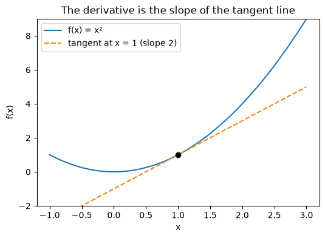

# 18-01 Functions, slopes and derivatives

## What you will learn

- Compute the slope of a straight line between two points.
- Explain the derivative as the slope of a curve at a single point.
- Estimate a derivative numerically with a small step.
- Use the sign of the derivative to tell which way is downhill.

## Why it matters

Training a model means adjusting its parameters to make its errors smaller. To know which way to adjust, you need to know how the error changes when a parameter changes, and that is exactly what a **derivative** measures. You do not need to master calculus for this course: this lesson gives the one idea you need, computed with NumPy rather than with algebra, and gradient descent (18-04) is built directly on it.

## Concepts

### Slope of a straight line

The **slope** of a line says how much it goes up for each step to the right: **rise over run**, the change in y divided by the change in x.

```python
def slope(point_a, point_b):
    (x1, y1), (x2, y2) = point_a, point_b
    return (y2 - y1) / (x2 - x1)


print(slope((1, 3), (4, 9)))
print(slope((0, 5), (2, 1)))
```

```
2.0
-2.0
```

From (1, 3) to (4, 9), y rises 6 while x moves 3: slope 2. A negative slope means the line goes down to the right. A straight line has the same slope everywhere.

### Curves have changing slopes

A curve such as f(x) = x² is steeper in some places than others. Take the slope between x = 1 and a second point, and move the second point closer and closer:

```python
def f(x):
    return x ** 2


for x1, x2 in [(1, 3), (1, 2), (1, 1.1), (1, 1.001)]:
    print(f"slope between x={x1} and x={x2}: {slope((x1, f(x1)), (x2, f(x2))):.4f}")
```

```
slope between x=1 and x=3: 4.0000
slope between x=1 and x=2: 3.0000
slope between x=1 and x=1.1: 2.1000
slope between x=1 and x=1.001: 2.0010
```

The slopes settle down towards 2. That limiting value, the slope of the curve **at exactly x = 1**, is the **derivative** of f at 1.

### The derivative

The **derivative** of a function at a point is its slope at that point: how fast the output changes as the input changes, right there. It is written f′(x) ("f prime of x") or df/dx. For f(x) = x², calculus gives the formula f′(x) = 2x, so f′(1) = 2, matching the numbers above.

You will not need to derive formulas by hand. You can always **estimate** a derivative numerically: take a tiny step either side of x and compute the slope between the two points. This is called a **central difference**:

f′(x) ≈ (f(x + h) − f(x − h)) / (2h), for a small step h.

```python
def derivative(function, x, step=1e-5):
    return (function(x + step) - function(x - step)) / (2 * step)


for x in [-2, 0, 1, 3]:
    print(x, round(derivative(f, x), 6))
```

```
-2 -4.0
0 0.0
1 2.0
3 6.0
```

The results match 2x at every point. (`1e-5` means 0.00001. The step must be small, but not so small that float rounding (02-01) swamps the difference.)

### The tangent line

The **tangent line** at a point touches the curve there and has the same slope as the curve, the derivative:



Near x = 1, the curve and the tangent line are almost the same. That is what the derivative tells you: **near this point, the function behaves like a straight line with this slope**.

### Which way is downhill?

The sign of the derivative tells you whether the function is going up or down:

- **negative derivative**: the function decreases as x increases, so moving **right** goes downhill;
- **positive derivative**: the function increases, so moving **left** goes downhill;
- **zero derivative**: the function is flat here, often at a minimum or maximum.

```python
def g(x):
    return (x - 3) ** 2 + 1


for x in [0, 2, 3, 5]:
    d = derivative(g, x)
    direction = "decreasing" if d < 0 else "increasing" if d > 0 else "flat (minimum)"
    print(f"x={x}: derivative {d:+.3f}, function is {direction}")
```

```
x=0: derivative -6.000, function is decreasing
x=2: derivative -2.000, function is decreasing
x=3: derivative +0.000, function is flat (minimum)
x=5: derivative +4.000, function is increasing
```

g has its lowest point at x = 3, where the derivative is 0. The further from the minimum, the larger the derivative. This is the whole idea behind gradient descent: **to go downhill, step in the opposite direction to the derivative**, and take bigger steps where it is steep.

### A rule worth knowing

For reference, the **power rule** says the derivative of xⁿ is n xⁿ⁻¹. So the derivative of x² is 2x, and of x³ is 3x². The numerical method agrees:

```python
cube = lambda x: x ** 3
print(round(derivative(cube, 2.0), 4), 3 * 2.0 ** 2)
```

```
12.0 12.0
```

Two more facts, used in 18-03 and 18-04: the derivative of a constant is 0, and the derivative of (x − c)² is 2(x − c).

## Common mistakes

- **Using a step that is too large.** With h = 1, the estimate for x² at x = 1 is still exact only because x² is a simple curve; for most functions, a large step gives the slope over a wide region, not at the point.
- **Using a step that is too small.** With h = 1e-15, `f(x + h) - f(x - h)` is mostly float rounding error. Values around 1e-5 to 1e-7 work well.
- **Forward differences.** (f(x + h) − f(x)) / h works, but is less accurate than the central difference for the same h.
- **Reading a zero derivative as "minimum".** A zero derivative can also be a maximum, or a flat spot. Check the values either side.

## Try it

Use `derivative` on `np.sin` at x = 0 and x = π/2 (`np.pi / 2`). Compare with `np.cos` at the same points. Then plot sin(x) and your numerical derivative of it on the same axes for x from 0 to 2π.

## Exercises

Open `ex_18_01.py`:

1. `slope_between`: the slope of the line through two points.
2. `numerical_derivative`: a central-difference estimate of a derivative.
3. `tangent_line`: the slope and intercept of the tangent line at a point.
4. `downhill_direction`: whether to move left or right to go downhill.

Run the tests:

```
python -m pytest part-4-maths-for-ml/18-calculus-and-optimisation/18-01-functions-slopes-and-derivatives
```

## Summary

- Slope is rise over run; a straight line has the same slope everywhere.
- The derivative f′(x) is the slope of a curve at one point: how fast the output changes there.
- Estimate it with a central difference: (f(x + h) − f(x − h)) / (2h) with a small h.
- Near a point, a function behaves like its tangent line.
- Negative derivative: go right to go downhill; positive: go left; zero: flat, often a minimum.
