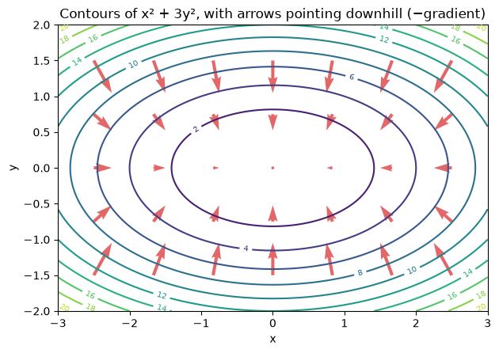

# 18-02 Gradients

## What you will learn

- Work with functions of several inputs.
- Compute partial derivatives by changing one input at a time.
- Collect partial derivatives into the gradient vector.
- Explain why the gradient points uphill, and its negative downhill.

## Why it matters

A model has many parameters: a linear model has one weight per feature plus a bias, and a neural network can have millions. Its error is a function of all of them at once. The **gradient** tells you how the error changes with each parameter, all in one vector, and therefore which direction to move every parameter to reduce the error. Every training method in this course that "learns" by small steps uses it.

## Concepts

### Functions of several inputs

A function can take several inputs. A simple example is a "bowl", f(x, y) = x² + 3y², which is lowest at (0, 0) and rises in every direction, more steeply along y. We pass the inputs as one NumPy vector, the same way a model's parameters are stored:

```python
def bowl(point):
    x, y = point
    return x ** 2 + 3 * y ** 2


print(bowl(np.array([1.0, 1.0])), bowl(np.array([0.0, 0.0])), bowl(np.array([2.0, -1.0])))
```

```
4.0 0.0 7.0
```

### Partial derivatives

A **partial derivative** measures how a function changes when **one** input changes and all the others are held fixed. It is the ordinary derivative from 18-01, taken along one input. The partial derivative with respect to x is written ∂f/∂x. Numerically, nudge just that one input up and down by a small step:

```python
def partial_derivative(function, point, index, step=1e-5):
    forward = point.astype(float).copy()
    backward = point.astype(float).copy()
    forward[index] += step
    backward[index] -= step
    return (function(forward) - function(backward)) / (2 * step)


point = np.array([1.0, 1.0])
print(round(partial_derivative(bowl, point, 0), 6), round(partial_derivative(bowl, point, 1), 6))
```

```
2.0 6.0
```

At (1, 1), increasing x raises the bowl at a rate of 2; increasing y raises it at 6. The `.copy()` calls matter: without them, nudging `forward` would also change `point` (05-05).

### The gradient

The **gradient** is the vector of all the partial derivatives, one per input. It is written ∇f ("del f" or "grad f"):

∇f = (∂f/∂x, ∂f/∂y, ...)

```python
def gradient(function, point):
    return np.array([partial_derivative(function, point, i) for i in range(len(point))])


print(np.round(gradient(bowl, point), 6))
print(np.round(gradient(bowl, np.array([2.0, -1.0])), 6))
print(np.round(gradient(bowl, np.array([0.0, 0.0])), 6))
```

```
[2. 6.]
[ 4. -6.]
[0. 0.]
```

For this bowl, the exact gradient is (2x, 6y), using the power rule on each term separately:

```python
exact = lambda p: np.array([2 * p[0], 6 * p[1]])
print(exact(point), exact(np.array([2.0, -1.0])))
```

```
[2. 6.] [ 4. -6.]
```

The numerical and exact gradients agree. At the bottom of the bowl, (0, 0), the gradient is the zero vector: flat in every direction.

### The gradient points uphill

The key fact: **the gradient points in the direction in which the function increases fastest**. So the **negative** gradient points in the direction of steepest **decrease**: straight downhill. Take a small step each way and compare:

```python
step = 0.1
uphill = point + step * gradient(bowl, point)
downhill = point - step * gradient(bowl, point)
print(round(bowl(point), 3), round(bowl(uphill), 3), round(bowl(downhill), 3))
```

```
4.0 9.12 1.12
```

From a height of 4, stepping along the gradient climbs to 9.12; stepping against it descends to 1.12.

### Picturing it

A **contour plot** shows a function of two inputs from above, like a hill-walking map: each ring joins points of equal height. Here the arrows show the negative gradient, the downhill direction, at several points:



Three things to notice:

- The arrows always cross the contour lines at right angles: downhill is straight down the slope, never along it.
- The arrows are longer far from the centre, where the bowl is steeper. The **size** of the gradient measures steepness.
- The arrows lean more along y than x, because the bowl is three times steeper in that direction (the 3y² term).

The plot is drawn with `np.meshgrid`, which makes a grid of x and y coordinates, `ax.contour` for the rings and `ax.quiver` for the arrows; see `examples.py`.

### Steepness

The length of the gradient (17-01) tells you how steep the function is at a point:

```python
for p in [np.array([0.1, 0.1]), np.array([1.0, 1.0]), np.array([3.0, 2.0])]:
    print(p, round(float(np.linalg.norm(exact(p))), 3))
```

```
[0.1 0.1] 0.632
[1. 1.] 6.325
[3. 2.] 13.416
```

Near the minimum the gradient is small, so gradient descent naturally takes smaller steps as it gets close.

## Common mistakes

- **Changing more than one input at once.** A partial derivative moves one input only; nudging all of them gives a slope along a diagonal, not a partial derivative.
- **Modifying the original point.** Nudging `point[index]` in place changes the caller's array. Work on copies.
- **Integer arrays.** Adding `1e-5` to an `int` array silently does nothing, because the result is stored back as an integer. Convert to float first, as `point.astype(float)` does.
- **Stepping along the gradient to minimise.** The gradient points uphill. To make a loss smaller, subtract it.

## Try it

Write a function for f(x, y) = (x − 1)² + (y + 2)² and use `gradient` at a few points. Where is the gradient zero? Start at (4, 4) and repeat `point = point - 0.1 * gradient(f, point)` twenty times, printing f each time. You have just run gradient descent.

## Exercises

Open `ex_18_02.py`:

1. `partial_derivative`: the rate of change along one input.
2. `numerical_gradient`: all the partial derivatives as a vector.
3. `steepest_descent_direction`: the unit vector pointing downhill.
4. `is_near_minimum`: whether the gradient is close to zero.

Run the tests:

```
python -m pytest part-4-maths-for-ml/18-calculus-and-optimisation/18-02-gradients
```

## Summary

- A partial derivative measures change along one input with the others held fixed.
- The gradient ∇f collects all partial derivatives into a vector, one per input.
- The gradient points in the direction of steepest increase; its negative points straight downhill.
- Its length measures steepness; at a minimum it is the zero vector.
- Estimate partial derivatives numerically by nudging one input at a time, on a float copy of the point.
