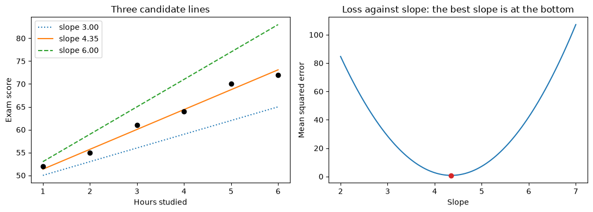

# 18-03 Loss functions

## What you will learn

- Measure a model's errors as residuals.
- Summarise them with mean squared error, root mean squared error and mean absolute error.
- Explain why squared error punishes large mistakes heavily.
- See a loss as a function of a model's parameters, with its best value at the bottom.

## Why it matters

To improve a model, you first need a single number that says how bad it is. That number is the **loss** (also called the **cost** or **error function**). Training a model means finding the parameters that make the loss as small as possible, and gradient descent (18-04) needs a loss to go downhill on. The same measures reappear in Module 21 as the standard regression metrics.

## Concepts

The examples use a tiny dataset: hours studied and exam scores for six students.

```python
hours = np.array([1.0, 2.0, 3.0, 4.0, 5.0, 6.0])
scores = np.array([52.0, 55.0, 61.0, 64.0, 70.0, 72.0])
```

### Residuals

Suppose a model predicts score = 50 + 4 × hours. The **residual** (or error) for each student is the true value minus the prediction:

```python
predictions = 50 + 4 * hours
errors = scores - predictions
print(predictions)
print(errors)
```

```
[54. 58. 62. 66. 70. 74.]
[-2. -3. -1. -2.  0. -2.]
```

A negative residual means the model predicted too high. This model overestimates almost everyone.

### Why not just add them up?

Adding the residuals sounds natural, but positive and negative errors cancel out:

```python
print(errors.sum())
```

```
-10.0
```

A model that is 10 too high for one student and 10 too low for another would have a total of 0, as if it were perfect. We need a measure that counts every error as bad, whichever direction it goes.

### MSE, RMSE and MAE

Three standard ways to do that:

- **Mean squared error (MSE)**: square each residual, then average. Squaring makes every error positive.
- **Root mean squared error (RMSE)**: the square root of the MSE. It is back in the original units (exam points), so it is easier to interpret.
- **Mean absolute error (MAE)**: average the absolute values (sizes) of the residuals.

As formulas, for n samples with true values yᵢ and predictions ŷᵢ: MSE = (1/n) Σ (yᵢ − ŷᵢ)². In words: for each sample, take the difference, square it, then average over all samples. (Σ, "sigma", means "add up over all i".) MAE = (1/n) Σ |yᵢ − ŷᵢ|: the same, but with sizes instead of squares.

```python
mse = np.mean(errors ** 2)
mae = np.mean(np.abs(errors))
print(round(mse, 3), round(mae, 3), round(np.sqrt(mse), 3))
```

```
3.667 1.667 1.915
```

The model is typically about 1.7 to 1.9 points off. Lower is better for all three.

### Comparing models

The point of a loss is to compare candidate models. A different line, 47 + 4.3 × hours, does much better:

```python
for intercept, slope in [(50, 4), (47, 4.3)]:
    candidate = intercept + slope * hours
    print(intercept, slope, round(np.mean((scores - candidate) ** 2), 3))
```

```
50 4 3.667
47 4.3 0.832
```

### Squared error punishes big mistakes

Two sets of errors with the same MAE:

```python
small_errors = np.array([2.0, 2.0, 2.0, 2.0])
one_big_error = np.array([0.0, 0.0, 0.0, 8.0])
for errs in [small_errors, one_big_error]:
    print(np.mean(np.abs(errs)), np.mean(errs ** 2))
```

```
2.0 4.0
2.0 16.0
```

Both have MAE 2, but the single error of 8 gives an MSE four times larger, because 8² = 64. MSE strongly prefers many small errors to a few large ones. That is often what you want (one huge mistake can be very costly), but it also makes MSE sensitive to outliers (16-02): a single wild value can drag the whole model towards it. MAE treats all errors in proportion to their size.

MSE is the most common loss for regression, partly because its derivative is simple, which makes gradient descent easy (18-04).

### The loss as a function of the parameters

Here is the key shift in thinking. For a fixed dataset, the loss depends only on the model's parameters. Fix the intercept at 47 and try many slopes:

```python
slopes = np.linspace(2, 7, 101)
losses = np.array([np.mean((scores - (47 + s * hours)) ** 2) for s in slopes])
best = slopes[losses.argmin()]
print(round(best, 2), round(losses.min(), 3))
```

```
4.35 0.791
```



On the left, three candidate lines; on the right, the loss for every slope. The loss curve is a bowl, and the best slope sits at its bottom, where the curve is flat: where its **derivative** is zero (18-01). With both slope and intercept free, the loss is a bowl in two dimensions, like the one in 18-02.

Trying every value on a grid works for one or two parameters, but a model with 100 parameters and 100 values each would need 100¹⁰⁰ evaluations. Gradient descent finds the bottom by walking downhill instead.

## Common mistakes

- **Summing raw residuals.** Positive and negative errors cancel. Square them or take absolute values.
- **Comparing MSE across datasets with different units.** An MSE of 100 might be excellent for house prices in pounds and terrible for exam scores. Use RMSE, in the target's units, to judge size.
- **Mixing up the order.** `predictions - scores` and `scores - predictions` give opposite signs; MSE and MAE are the same either way, but residual plots (Module 21) are not.
- **Forgetting the square root.** MSE is in squared units ("points squared"), which are hard to interpret. Report RMSE or MAE to humans.

## Try it

Add a seventh student who studied 2 hours and scored 90. Recompute the best slope (intercept fixed at 47) using MSE, and then using MAE (replace the squares with absolute values). Which loss moves the best slope more?

## Exercises

Open `ex_18_03.py`:

1. `mean_squared_error`
2. `root_mean_squared_error`
3. `mean_absolute_error`
4. `loss_curve`: the MSE for each of many candidate slopes.
5. `best_parameter`: the candidate with the smallest loss.

Run the tests:

```
python -m pytest part-4-maths-for-ml/18-calculus-and-optimisation/18-03-loss-functions
```

## Summary

- A residual is the true value minus the prediction; raw residuals cancel out when summed.
- MSE averages squared residuals; RMSE is its square root, in the target's units; MAE averages absolute residuals.
- Squared error punishes large mistakes far more, which also makes it sensitive to outliers.
- For fixed data, the loss is a function of the parameters; the best parameters are at its minimum, where the derivative is zero.
