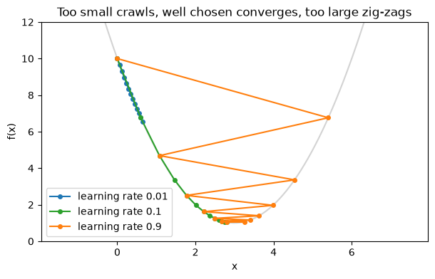
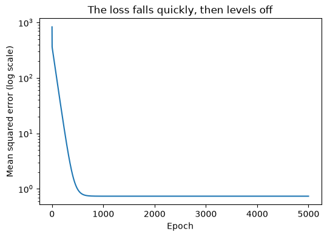

# 18-04 Gradient descent

## What you will learn

- State the gradient descent update rule and apply it to a function of one variable.
- Explain what happens when the learning rate is too small or too large.
- Derive and use the gradient of the mean squared error for a straight-line model.
- Fit a line by gradient descent, and check the result against least squares.

## Why it matters

**Gradient descent** is the algorithm that trains most of machine learning, from logistic regression to the largest neural networks. The idea is simple: start somewhere, look at the slope of the loss, take a small step downhill, and repeat. In the Part 4 project you will build a linear regression model that learns this way, and in Part 5 you will meet it inside scikit-learn's models and their learning-rate and iteration settings.

## Concepts

### The update rule

To minimise a function, repeat:

**new parameter = old parameter − learning rate × derivative**

In words: work out the slope where you are, and move a small amount in the opposite direction. The **learning rate** (often written η, "eta") controls the size of each step. Each repetition is called a **step**, or an **epoch** when it uses the whole dataset.

Here it is minimising f(x) = (x − 3)² + 1, whose derivative is 2(x − 3) (18-01), starting from x = 0:

```python
def f(x):
    return (x - 3) ** 2 + 1


def f_derivative(x):
    return 2 * (x - 3)


x = 0.0
learning_rate = 0.1
for step in range(1, 26):
    x = x - learning_rate * f_derivative(x)
    if step in (1, 2, 3, 10, 25):
        print(f"step {step:>2}: x = {x:.4f}, f(x) = {f(x):.4f}")
```

```
step  1: x = 0.6000, f(x) = 6.7600
step  2: x = 1.0800, f(x) = 4.6864
step  3: x = 1.4640, f(x) = 3.3593
step 10: x = 2.6779, f(x) = 1.1038
step 25: x = 2.9887, f(x) = 1.0001
```

At x = 0 the derivative is −6, so the first step moves right by 0.1 × 6 = 0.6. As x approaches 3, the derivative shrinks and so do the steps. The method closes in on the minimum at x = 3 without ever knowing where it is: it only ever looks at the local slope.

### The learning rate

The learning rate is a **hyperparameter** (09-05): you choose it; it is not learned.

```python
def run(learning_rate, steps=20, start=0.0):
    xs = [start]
    for _ in range(steps):
        xs.append(xs[-1] - learning_rate * f_derivative(xs[-1]))
    return np.array(xs)


for rate in [0.01, 0.1, 0.9, 1.1]:
    path = run(rate)
    print(f"learning rate {rate}: x after 20 steps = {path[-1]:.4f}")
```

```
learning rate 0.01: x after 20 steps = 0.9972
learning rate 0.1: x after 20 steps = 2.9654
learning rate 0.9: x after 20 steps = 2.9654
learning rate 1.1: x after 20 steps = -112.0128
```



- **Too small** (0.01): every step is tiny; after 20 steps it has barely moved.
- **Well chosen** (0.1): steady progress straight down the slope.
- **Large** (0.9): each step overshoots the minimum and lands on the other side, zig-zagging inwards. Here it happens to end exactly as close as 0.1 does: each step multiplies the distance from 3 by −0.8 instead of 0.8.
- **Too large** (1.1): each overshoot is bigger than the last, and x flies off to −112. This is called **diverging**.

Choosing a learning rate is a matter of experiment: try values such as 0.001, 0.01, 0.1 and watch the loss.

### Fitting a line: the gradient of the MSE

Now the real use: finding a model's parameters. For a line ŷ = w × x + b, the loss is the MSE (18-03), a function of two parameters, w and b. Its partial derivatives (18-02) are:

- ∂MSE/∂w = (2/n) Σ (ŷᵢ − yᵢ) xᵢ: twice the average of each error times its x value;
- ∂MSE/∂b = (2/n) Σ (ŷᵢ − yᵢ): twice the average error.

In words: if the predictions are too high on average, the derivative with respect to b is positive, so the update lowers b. If the predictions are too high where x is large, the derivative with respect to w is positive, so the update lowers the slope. In NumPy:

```python
hours = np.array([1.0, 2.0, 3.0, 4.0, 5.0, 6.0])
scores = np.array([52.0, 55.0, 61.0, 64.0, 70.0, 72.0])


def mse(w, b):
    return np.mean((scores - (w * hours + b)) ** 2)


def mse_gradient(w, b):
    errors = (w * hours + b) - scores
    return 2 * np.mean(errors * hours), 2 * np.mean(errors)
```

### The training loop

Start from w = 0, b = 0, and update both parameters at every epoch, keeping a **history** of the loss:

```python
w, b = 0.0, 0.0
learning_rate = 0.02
history = []
for epoch in range(5001):
    dw, db = mse_gradient(w, b)
    w -= learning_rate * dw
    b -= learning_rate * db
    history.append(mse(w, b))
    if epoch in (0, 10, 100, 1000, 5000):
        print(f"epoch {epoch:>4}: w = {w:.3f}, b = {b:.3f}, loss = {history[-1]:.3f}")
```

```
epoch    0: w = 9.220, b = 2.493, loss = 833.508
epoch   10: w = 13.740, b = 6.813, loss = 319.810
epoch  100: w = 9.148, b = 26.472, loss = 86.090
epoch 1000: w = 4.235, b = 47.504, loss = 0.737
epoch 5000: w = 4.229, b = 47.533, loss = 0.737
```

Early on, w overshoots to almost 14, because a steep line is the quickest way to reduce the huge initial errors; then b grows and w settles back. By epoch 1,000 the loss has stopped improving: the method has **converged**.

### Checking the answer

Least squares (17-04) gives the exact best line directly, so we can check:

```python
X = np.column_stack([np.ones_like(hours), hours])
exact, *_ = np.linalg.lstsq(X, scores, rcond=None)
print("least squares: b = %.3f, w = %.3f" % (exact[0], exact[1]))
```

```
least squares: b = 47.533, w = 4.229
```

Identical. (`"%.3f" % value` is an older way of formatting numbers, which you will see in other people's code.) Why use gradient descent when an exact formula exists? Because for most models (logistic regression, neural networks) there **is** no exact formula, and for huge datasets the exact method is too slow. Gradient descent works for any loss whose gradient you can compute.

### The loss curve

Plotting the loss history is the standard way to check training:



A healthy curve falls quickly, then flattens. A flat line from the start means the learning rate is too small; a curve that rises means it is too large:

```python
w, b = 0.0, 0.0
for epoch in range(6):
    dw, db = mse_gradient(w, b)
    w -= 0.1 * dw
    b -= 0.1 * db
    print(f"epoch {epoch}: loss = {mse(w, b):.3e}")
```

```
epoch 0: loss = 1.754e+04
epoch 1: loss = 8.330e+04
epoch 2: loss = 4.008e+05
epoch 3: loss = 1.933e+06
epoch 4: loss = 9.328e+06
epoch 5: loss = 4.502e+07
```

With a learning rate of 0.1, the loss grows about five times every epoch: divergence. (`.3e` formats numbers in scientific notation: `1.754e+04` means 1.754 × 10⁴.)

## Common mistakes

- **Adding the gradient instead of subtracting it.** That is gradient **ascent**: the loss rises.
- **Updating w before computing b's gradient.** Compute both gradients from the same (old) parameters, then update both.
- **A diverging loss.** If the loss grows or becomes `nan`/`inf`, reduce the learning rate. Features on very different scales make this much worse; standardising them (Module 21) helps.
- **Stopping too early.** Check the loss curve has flattened before trusting the parameters.

## Try it

Run the line-fitting loop with learning rates 0.001, 0.01, 0.02 and 0.05 for 5,000 epochs each, and plot all four loss histories on one log-scale chart. Which converges fastest? Which diverges?

## Exercises

Open `ex_18_04.py`:

1. `gradient_descent_1d`: minimise a function of one variable, keeping the path.
2. `mse_gradient`: the gradient of the MSE for a line, for any data.
3. `fit_line`: fit w and b by gradient descent, returning the loss history.
4. `has_diverged`: detect a loss that is growing out of control.

Run the tests:

```
python -m pytest part-4-maths-for-ml/18-calculus-and-optimisation/18-04-gradient-descent
```

## Summary

- Gradient descent repeats: parameter = parameter − learning rate × gradient.
- Too small a learning rate is slow; too large overshoots or diverges.
- For a line, ∂MSE/∂w = (2/n) Σ (ŷ − y) x and ∂MSE/∂b = (2/n) Σ (ŷ − y).
- Gradient descent on the MSE reaches the same line as least squares, and also works where no exact formula exists.
- Always plot the loss history: it should fall and then flatten.
