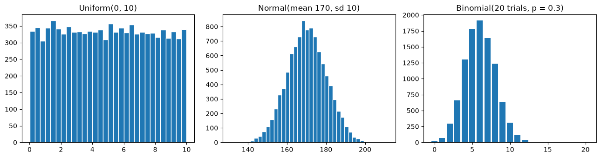
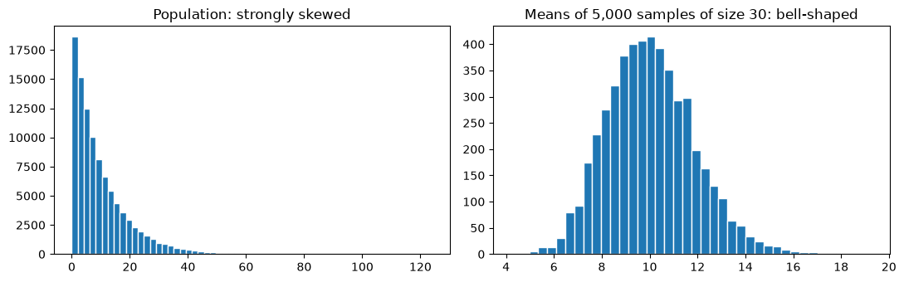

# 19-03 Distributions and sampling

## What you will learn

- Describe and simulate the uniform, normal and binomial distributions.
- Use the 68-95-99.7 rule for normal data.
- Explain why the mean of a sample varies from sample to sample.
- Demonstrate the central limit theorem by simulation.

## Why it matters

A **distribution** describes how likely each possible value is. Knowing a few standard shapes lets you recognise them in data, simulate realistic test data, and understand the assumptions inside models such as Gaussian Naive Bayes (Module 22) and Gaussian mixture models (Module 25). And the central limit theorem explains why averages, including the average error of a model on a test set, behave predictably even when the data itself does not.

## Concepts

### Three common distributions

- **Uniform**: every value in a range is equally likely, like a random number between 0 and 10.
- **Normal** (or **Gaussian**): the bell curve. Values cluster around the mean and become rarer further away, symmetrically. Heights, measurement errors and many sums of small effects look like this. It is described by its mean and standard deviation.
- **Binomial**: the number of successes in a fixed number of yes/no trials, each with the same probability of success, like the number of heads in 20 coin flips, or the number of 20 customers who buy.

NumPy's random generator (13-05) draws from all of them:

```python
rng = np.random.default_rng(42)
uniform = rng.uniform(0, 10, size=10_000)
normal = rng.normal(loc=170, scale=10, size=10_000)
binomial = rng.binomial(n=20, p=0.3, size=10_000)
for name, sample in [("uniform", uniform), ("normal", normal), ("binomial", binomial)]:
    print(f"{name:<9} mean {sample.mean():8.3f}  std {sample.std():6.3f}")
```

```
uniform   mean    4.971  std  2.882
normal    mean  170.140  std 10.020
binomial  mean    6.016  std  2.050
```



For the normal, `loc` is the mean and `scale` the standard deviation. For the binomial, `n` is the number of trials and `p` the probability of success. The bar chart uses `np.bincount`, which counts how often each whole number appears.

### The 68-95-99.7 rule

For normal data, about 68% of values lie within 1 standard deviation of the mean, about 95% within 2, and about 99.7% within 3:

```python
for k in [1, 2, 3]:
    within = np.mean(np.abs(normal - 170) <= k * 10)
    print(f"within {k} sd: {within:.3f}")
```

```
within 1 sd: 0.677
within 2 sd: 0.955
within 3 sd: 0.997
```

This is why |z| > 3 (16-02) is a common outlier rule: for normal data, only 0.3% of values are that far out. But beware: for skewed data, many more values fall far from the mean, and the rule does not apply.

### Binomial probabilities

The probability of an exact count can be estimated by counting simulated results. The binomial's mean is n × p and its standard deviation is √(n p (1 − p)):

```python
print(round(np.mean(binomial == 6), 4), round(np.mean(binomial >= 10), 4))
print(20 * 0.3, round(np.sqrt(20 * 0.3 * 0.7), 3))
```

```
0.1911 0.0476
6.0 2.049
```

With a 30% success rate, exactly 6 successes out of 20 happens about 19% of the time, and 10 or more less than 5% of the time. The formulas match the simulated mean (6.016) and standard deviation (2.050).

### Samples vary

In practice we rarely see a whole **population**; we see a **sample** and compute a **statistic** from it, such as the mean. Different samples give different answers. Take a strongly skewed population: the **exponential** distribution, typical of waiting times, where most values are small and a few are large:

```python
population = rng.exponential(scale=10, size=100_000)
print(round(population.mean(), 3), round(np.median(population), 3))
for _ in range(3):
    sample = rng.choice(population, size=30)
    print(round(sample.mean(), 2))
```

```
10.026 6.935
8.42
9.87
13.2
```

The population mean is about 10, but three samples of 30 gave 8.42, 9.87 and 13.2. This variation is called **sampling variability**, and it is why a model's score on one test set is only an estimate (Module 20).

### The central limit theorem

Now take the mean of **many** samples of 30 and look at how those means are distributed:

```python
sample_means = np.array([rng.choice(population, size=30).mean() for _ in range(5_000)])
print(round(sample_means.mean(), 3), round(sample_means.std(), 3))
print(round(population.std() / np.sqrt(30), 3))
```

```
10.03 1.826
1.833
```



The **central limit theorem** says that the means of reasonably large samples are approximately **normally** distributed, whatever the shape of the population, and that:

- they are centred on the population mean (10.03 against 10.026);
- their standard deviation, called the **standard error**, is the population SD divided by √n (1.826 simulated against 1.833 from the formula).

The population is very skewed, yet the sample means form a symmetric bell. This is why the normal distribution appears so often: many quantities we care about are averages or sums.

### Bigger samples, more precise means

Because the standard error shrinks with √n, larger samples give more reliable means:

```python
for size in [5, 30, 200]:
    means = np.array([rng.choice(population, size=size).mean() for _ in range(2_000)])
    print(f"sample size {size:>3}: spread of means {means.std():.3f}")
```

```
sample size   5: spread of means 4.629
sample size  30: spread of means 1.878
sample size 200: spread of means 0.700
```

Note the square root: to halve the error you need **four times** as much data. This is the core reason that more data helps, and why the gains slow down.

## Common mistakes

- **Assuming everything is normal.** Incomes, waiting times and sales are often skewed; the 68-95-99.7 rule does not hold for them. Plot first.
- **Confusing the SD with the standard error.** The SD describes the spread of individual values; the standard error describes the spread of a sample **mean**. The standard error is much smaller.
- **Trusting a single small sample.** A sample of 5 can easily be far from the truth, as shown above.
- **Expecting the central limit theorem to fix tiny samples of very skewed data.** It is an approximation that improves with sample size; for heavy tails you may need much more than 30.

## Try it

Simulate rolling 10 dice and taking their mean, 10,000 times. Plot a histogram of the means. A single die is uniform (flat), so why is the histogram bell-shaped? Compare its standard deviation with the formula: single-die SD (about 1.708) divided by √10.

## Exercises

Open `ex_19_03.py`. Use `np.random.default_rng(seed)` wherever randomness is needed.

1. `fraction_within`: the fraction of values within k standard deviations of the mean.
2. `binomial_probability`: estimate the probability of exactly k successes by simulation.
3. `sample_means`: the means of many random samples.
4. `standard_error`: the standard deviation divided by the square root of n.

Run the tests:

```
python -m pytest part-4-maths-for-ml/19-probability-and-statistics/19-03-distributions-and-sampling
```

## Summary

- Uniform: all values equally likely. Normal: a symmetric bell with a mean and SD. Binomial: number of successes in n trials with probability p.
- For normal data, about 68%, 95% and 99.7% of values lie within 1, 2 and 3 SDs of the mean.
- Statistics such as the mean vary from sample to sample.
- Central limit theorem: means of large samples are approximately normal, centred on the population mean, with standard error SD / √n.
- Quadrupling the sample size halves the standard error.
