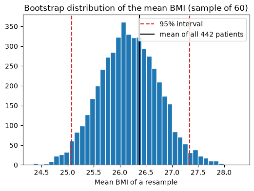

# 19-04 Covariance, correlation and sampling error

## What you will learn

- Compute covariance and explain why its size is hard to interpret.
- Compute the Pearson correlation and read its value.
- Explain the difference between a population value and a sample estimate.
- Use the bootstrap to measure how uncertain an estimate is, and build a confidence interval.

## Why it matters

Correlation has appeared throughout the course: in heatmaps (15-04), in EDA (16-01) and in the warning that it is not causation (16-02). This lesson defines it properly. Then it tackles a question every data scientist must ask of every number: **how sure am I?** A correlation of 0.64 from 60 patients, or an accuracy of 92% from 100 test examples, could easily have come out differently with other data. The bootstrap lets you measure that uncertainty with nothing but resampling.

## Concepts

The examples use the diabetes dataset: body mass index (BMI) and a measure of disease progression one year later, for 442 patients.

```python
diabetes = load_diabetes(as_frame=True, scaled=False).frame
bmi = diabetes["bmi"].to_numpy()
progression = diabetes["target"].to_numpy()
```

### Covariance

**Covariance** measures whether two variables move together. For each sample, multiply its distance from the mean of x by its distance from the mean of y, then average:

cov(x, y) = (1/n) Σ (xᵢ − x̄)(yᵢ − ȳ)

In words: when both are above their means (or both below), the product is positive; when one is above and the other below, it is negative. (x̄, "x-bar", is the mean of x.)

```python
products = (bmi - bmi.mean()) * (progression - progression.mean())
print(round(products.mean(), 2))
print(round(np.cov(bmi, progression, ddof=0)[0, 1], 2))
```

```
199.3
199.3
```

Positive: patients with higher BMI tend to have higher progression. `np.cov` returns a 2 × 2 matrix of all the covariances; the off-diagonal entry `[0, 1]` is the one we want. (The diagonal holds each variable's variance: the covariance of a variable with itself.)

### Why covariance is hard to read

Covariance depends on the units. Measure BMI in different units, here times 10, and the covariance is ten times bigger, though the relationship has not changed at all:

```python
print(round(np.cov(bmi * 10, progression, ddof=0)[0, 1], 2))
```

```
1992.97
```

So is 199.3 strong or weak? You cannot tell.

### Pearson correlation

The **Pearson correlation coefficient**, r, fixes this by dividing the covariance by both standard deviations:

r = cov(x, y) / (SD of x × SD of y)

This removes the units and always gives a value between −1 and 1 (equivalently, r is the covariance of the two variables' z-scores):

```python
correlation = products.mean() / (bmi.std() * progression.std())
print(round(correlation, 3), round(np.corrcoef(bmi, progression)[0, 1], 3))
print(round(np.corrcoef(bmi * 10, progression)[0, 1], 3))
```

```
0.586 0.586
0.586
```

Rescaling BMI no longer changes anything. As rough guides: around ±0.1 is weak, ±0.3 moderate, ±0.5 and beyond strong. An r of 0.586 means a fairly strong positive straight-line relationship. pandas computes a whole correlation matrix at once:

```python
print(diabetes[["bmi", "bp", "s5", "target"]].corr().round(2))
```

```
         bmi    bp    s5  target
bmi     1.00  0.40  0.45    0.59
bp      0.40  1.00  0.39    0.44
s5      0.45  0.39  1.00    0.57
target  0.59  0.44  0.57    1.00
```

(`bp` is blood pressure and `s5` a blood serum measurement.) Remember the 16-02 warnings: correlation only measures straight-line relationships, and it is not causation.

### Population versus sample

Those 442 patients are themselves a sample of all possible patients, but suppose for a moment they were the whole population. Taking samples of 40 patients from them gives quite different correlations:

```python
rng = np.random.default_rng(42)
for _ in range(3):
    rows = rng.choice(len(bmi), size=40, replace=False)
    print(round(np.corrcoef(bmi[rows], progression[rows])[0, 1], 3))
```

```
0.386
0.743
0.767
```

From the same population, one sample suggests a moderate relationship (0.386) and another a very strong one (0.767). Any statistic from a sample is an **estimate** with **sampling error**. The question is how large that error is likely to be, when you only have one sample.

### The bootstrap

The **bootstrap** answers it by treating your sample as a stand-in for the population. Draw a new sample of the same size from your sample **with replacement** (so some rows appear twice and some not at all), compute the statistic, and repeat thousands of times. The spread of those results shows how much the statistic would vary between samples.

Here we pretend we only have 60 patients and estimate their mean BMI:

```python
rng = np.random.default_rng(42)
sample_rows = rng.choice(len(bmi), size=60, replace=False)
sample_bmi = bmi[sample_rows]
print(round(sample_bmi.mean(), 3))
boot_means = np.array([rng.choice(sample_bmi, size=len(sample_bmi), replace=True).mean() for _ in range(5_000)])
print(round(boot_means.std(), 3), round(sample_bmi.std(ddof=1) / np.sqrt(len(sample_bmi)), 3))
```

```
26.168
0.575 0.577
```

The spread of the bootstrap means, 0.575, matches the standard error formula from 19-03 (0.577). But the bootstrap works for **any** statistic (a median, a correlation, a model's accuracy), including ones with no simple formula.

### Confidence intervals

The middle 95% of the bootstrap results gives a **95% confidence interval**: a range of plausible values for the true number, taking sampling error into account. Take the 2.5th and 97.5th percentiles:

```python
low, high = np.percentile(boot_means, [2.5, 97.5])
print(round(low, 3), round(high, 3), round(bmi.mean(), 3))
```

```
25.078 27.337 26.376
```



From just 60 patients, we can say the mean BMI is probably between about 25.1 and 27.3. The mean of all 442 patients, 26.38, is indeed inside. A wide interval means "this estimate is not precise"; it is far more honest than a single number.

The same method works for the correlation:

```python
sample_progression = progression[sample_rows]
boot_corrs = []
for _ in range(5_000):
    rows = rng.choice(len(sample_bmi), size=len(sample_bmi), replace=True)
    boot_corrs.append(np.corrcoef(sample_bmi[rows], sample_progression[rows])[0, 1])
print(round(np.corrcoef(sample_bmi, sample_progression)[0, 1], 3))
print(np.round(np.percentile(boot_corrs, [2.5, 97.5]), 3))
```

```
0.642
[0.469 0.776]
```

The sample of 60 gives r = 0.642, but the interval runs from 0.469 to 0.776. Notice that we resample **rows** (pairs), keeping each patient's BMI and progression together. You will use exactly this idea to put error bars on model scores later in the course.

## Common mistakes

- **Comparing covariances across different units.** Use correlation.
- **Resampling without replacement.** A bootstrap sample drawn without replacement is just the original sample shuffled, with the same mean every time. Use `replace=True`.
- **Resampling columns separately.** Bootstrapping x and y independently destroys their relationship; resample whole rows.
- **Treating a confidence interval as certainty.** A 95% interval will miss the true value about 1 time in 20. And it only covers sampling error, not biased data.

## Try it

Bootstrap a 95% confidence interval for the **median** BMI from the same 60-patient sample. Is it wider or narrower than the interval for the mean? Then repeat with a sample of 240 patients. By roughly how much does the interval shrink?

## Exercises

Open `ex_19_04.py`:

1. `covariance`: the population covariance of two arrays.
2. `pearson_correlation`: covariance divided by both standard deviations.
3. `bootstrap_statistic`: many bootstrap values of any statistic.
4. `confidence_interval`: a percentile bootstrap confidence interval.

Run the tests:

```
python -m pytest part-4-maths-for-ml/19-probability-and-statistics/19-04-covariance-correlation-and-sampling-error
```

## Summary

- Covariance averages the products of deviations from the means; its size depends on the units.
- Pearson correlation divides by both SDs, giving a unit-free value from −1 to 1.
- A statistic computed from a sample is an estimate; different samples give different values.
- The bootstrap resamples the data with replacement to show how much a statistic varies; resample whole rows.
- The 2.5th and 97.5th percentiles of bootstrap results give a 95% confidence interval.
