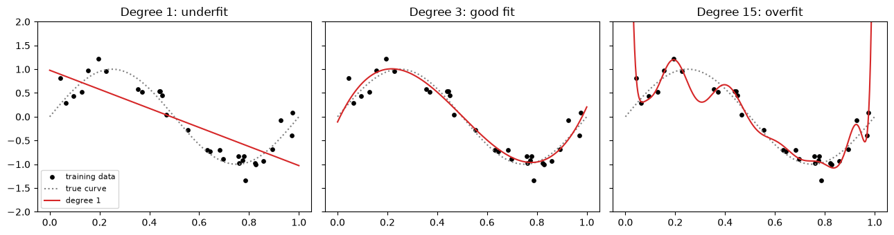
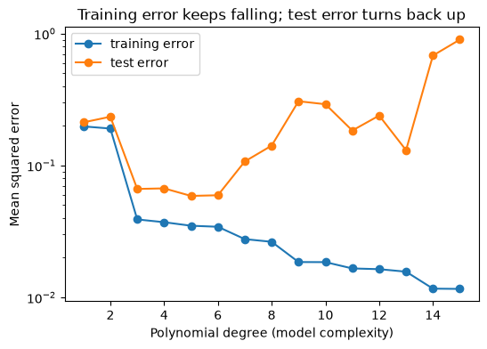
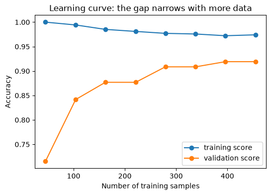

# 20-04 Overfitting and underfitting

## What you will learn

- Recognise underfitting and overfitting from training and test scores.
- Explain the bias-variance trade-off in plain terms.
- See how model complexity affects both, using polynomial fits and decision trees.
- Read a learning curve to decide whether more data would help.

## Why it matters

Every model faces the same tension: too simple, and it misses real patterns; too flexible, and it memorises noise. Almost every hyperparameter you will tune in the rest of Part 5 (tree depth, number of neighbours, regularisation strength) is a dial between these two extremes. Learning to diagnose which side of the line a model is on tells you what to change.

## Concepts

### The two ways to fail

- **Underfitting**: the model is too simple to capture the real pattern. It does badly on the training data **and** the test data.
- **Overfitting**: the model is so flexible that it fits the noise in the training data as if it were pattern. It does very well on the training data but badly on new data.

A good model sits between: it captures the pattern but not the noise, so its training and test scores are both good and fairly close.

### A clear example: polynomial fits

We generate 30 noisy points from a smooth curve (a sine wave), plus a separate test set from the same curve:

```python
rng = np.random.default_rng(42)
x = np.sort(rng.uniform(0, 1, 30))
y = np.sin(2 * np.pi * x) + rng.normal(0, 0.25, size=30)
x_test = np.sort(rng.uniform(0, 1, 30))
y_test = np.sin(2 * np.pi * x_test) + rng.normal(0, 0.25, size=30)
```

`np.polyfit(x, y, degree)` fits a **polynomial** of a given degree by least squares (17-04): degree 1 is a straight line, degree 3 a curve with two bends, and higher degrees are ever more flexible. `np.polyval` evaluates it.

```python
for degree in [1, 3, 15]:
    coefficients = np.polyfit(x, y, degree)
    train_error = np.mean((np.polyval(coefficients, x) - y) ** 2)
    test_error = np.mean((np.polyval(coefficients, x_test) - y_test) ** 2)
    print(f"degree {degree:>2}: train MSE {train_error:.3f}, test MSE {test_error:.3f}")
```

```
degree  1: train MSE 0.198, test MSE 0.212
degree  3: train MSE 0.039, test MSE 0.066
degree 15: train MSE 0.012, test MSE 0.900
```



- **Degree 1** (a straight line) cannot bend to follow the wave: high error on both sets. **Underfitting.**
- **Degree 3** follows the true curve closely: low error on both sets. **A good fit.**
- **Degree 15** wiggles through almost every training point, giving the lowest training error, but swings wildly between them: its test error is 14 times worse than degree 3's. **Overfitting.**

### Error against complexity

Plotting training and test error for every degree shows the classic pattern:

```python
degrees = range(1, 16)
train_errors, test_errors = [], []
for degree in degrees:
    coefficients = np.polyfit(x, y, degree)
    train_errors.append(np.mean((np.polyval(coefficients, x) - y) ** 2))
    test_errors.append(np.mean((np.polyval(coefficients, x_test) - y_test) ** 2))
best_degree = degrees[int(np.argmin(test_errors))]
print("best degree on test data:", best_degree)
```

```
best degree on test data: 5
```



Training error falls steadily as complexity grows: a more flexible model can always fit its own training data better. Test error falls at first, reaches a minimum, then rises again. The best model is at the bottom of the **test** curve. (Choosing the degree by looking at the test set, as here, is fine for a demonstration; in practice you choose with a validation set or cross-validation, 24-03.)

### The bias-variance trade-off

The two failure modes have names:

- **Bias** is error from wrong assumptions: a straight line assumes the world is straight. High-bias models underfit, and their errors are consistent, the same mistakes on any training set.
- **Variance** is error from sensitivity to the particular training data: the degree-15 curve would come out completely different with 30 new points. High-variance models overfit.

Making a model more flexible lowers bias but raises variance. The best model balances the two. In practice:

| Symptom | Diagnosis | What helps |
|---------|-----------|------------|
| Low training score, low test score | Underfitting (high bias) | A more flexible model, better features |
| High training score, much lower test score | Overfitting (high variance) | A simpler model, regularisation (21-03), more data |
| Both high and close together | A good fit | Nothing urgent |

### The same pattern with real data

A decision tree's `max_depth` limits how many questions it can ask (Module 23). Deeper trees are more flexible:

```python
for depth in [1, 3, 5, None]:
    tree = DecisionTreeClassifier(max_depth=depth, random_state=42).fit(X_train, y_train)
    print(f"max_depth {str(depth):>4}: train {tree.score(X_train, y_train):.3f}, test {tree.score(X_test, y_test):.3f}")
```

```
max_depth    1: train 0.923, test 0.923
max_depth    3: train 0.977, test 0.944
max_depth    5: train 0.995, test 0.937
max_depth None: train 1.000, test 0.923
```

`None` means no limit. Depth 3 gives the best test accuracy; the unlimited tree memorises the training set (1.000) but tests no better than a single question (depth 1).

### Learning curves

A **learning curve** shows training and validation scores as the amount of training data grows. scikit-learn's `learning_curve` computes one; it uses **cross-validation** (24-03) internally, which you can think of as averaging the test score over 5 different splits:

```python
sizes, train_scores, validation_scores = learning_curve(
    DecisionTreeClassifier(max_depth=3, random_state=42),
    data.data, data.target, train_sizes=np.linspace(0.1, 1.0, 8), cv=5,
)
print(sizes)
print(np.round(validation_scores.mean(axis=1), 3))
```

```
[ 45 104 162 221 279 338 396 455]
[0.715 0.842 0.877 0.877 0.909 0.909 0.919 0.919]
```



With only 45 training samples, validation accuracy is 0.715; with 455 it reaches 0.919. How to read it:

- A big gap between the curves that is still shrinking means the model is overfitting, and **more data would help**.
- Two curves that have met at a low score mean the model is underfitting: more data will **not** help; a more flexible model might.
- Here the gap is narrowing and the validation curve is flattening out, so more data would help a little, but not much.

## Common mistakes

- **Judging a model by its training score.** A perfect training score is more often a warning than a success.
- **Adding complexity to fix overfitting.** If the test score is much lower than the training score, simplify, regularise or get more data.
- **Collecting more data to fix underfitting.** If both scores are low and close, more of the same data will not help.
- **Choosing complexity with the test set.** Tune on validation data or with cross-validation; keep the test set for the final check.

## Try it

Rerun the polynomial example with 300 training points instead of 30 (keep the noise the same). How do the training and test errors of degree 15 change? Why does more data reduce overfitting?

## Exercises

Open `ex_20_04.py`:

1. `polynomial_errors`: training and test MSE for a polynomial of a given degree.
2. `best_degree`: the degree with the lowest test error.
3. `depth_scores`: training and test accuracy for several tree depths.
4. `diagnose`: label a model as underfitting, overfitting or a good fit from its scores.

Run the tests:

```
python -m pytest part-5-supervised-learning/20-machine-learning-foundations/20-04-overfitting-and-underfitting
```

## Summary

- Underfitting: too simple, poor on training and test data. Overfitting: memorises noise, good on training data but poor on test data.
- As complexity grows, training error keeps falling while test error falls, then rises.
- Bias is error from over-simple assumptions; variance is error from sensitivity to the training set. Flexibility trades one for the other.
- Fix overfitting by simplifying, regularising or adding data; fix underfitting with a more flexible model or better features.
- Learning curves show whether more data would help.
