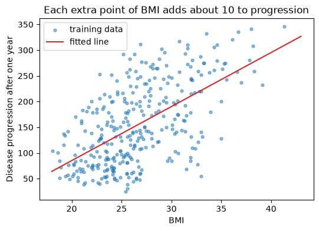

# 21-01 Linear regression

## What you will learn

- Fit a straight line, a plane and a multi-feature linear model with `LinearRegression`.
- Read and interpret the coefficients and the intercept.
- Explain the "holding everything else constant" meaning of a coefficient, and its limits.
- Compute residuals and see what they tell you.

## Why it matters

**Linear regression** is the most widely used model in statistics and a strong starting point for any regression problem. It is fast, it needs little data, and, unlike most models, you can read it: each coefficient says how much the prediction moves when a feature changes. You have already built it twice, with least squares (17-04) and gradient descent (Part 4); now you will use scikit-learn's version and learn to interpret it.

## Concepts

The examples use the diabetes data with its original units (`scaled=False`): age, sex, BMI, blood pressure (bp) and six blood serum measurements (s1 to s6), with disease progression after one year as the target. The data is split into training and test sets as in 20-03.

### A line: one feature

With one feature, linear regression fits a straight line: prediction = coefficient × feature + intercept. scikit-learn's **`LinearRegression`** finds the least-squares line (17-04):

```python
from sklearn.linear_model import LinearRegression

line = LinearRegression().fit(X_train[["bmi"]], y_train)
print(round(line.coef_[0], 3), round(line.intercept_, 3))
print(np.round(line.predict(pd.DataFrame({"bmi": [20.0, 30.0]})), 1))
```

```
10.512 -125.177
[ 85.1 190.2]
```

`X_train[["bmi"]]`, with double brackets, keeps a one-column DataFrame, because scikit-learn needs 2-D input (20-02). The model says progression = 10.512 × BMI − 125.177. A patient with BMI 20 is predicted 85.1; with BMI 30, 190.2: ten points of BMI add about 105.



The intercept, −125, is the prediction at BMI 0. It is needed to position the line but has no real meaning, since nobody has a BMI of 0. Do not interpret an intercept far outside the range of the data.

### A plane: two features

With two features, the model is a flat **plane** in 3-D space: prediction = c₁ × BMI + c₂ × bp + intercept.

```python
plane = LinearRegression().fit(X_train[["bmi", "bp"]], y_train)
print(np.round(plane.coef_, 3), round(plane.intercept_, 3))
```

```
[8.806 1.432] -215.896
```

The BMI coefficient fell from 10.5 to 8.8 once blood pressure was added. Why? BMI and blood pressure are correlated (19-04), so on its own, BMI was partly standing in for blood pressure. With both in the model, each coefficient measures only its own share.

### Many features

The same model works with any number of features; it is called **multiple linear regression**:

```python
model = LinearRegression().fit(X_train, y_train)
coefficients = pd.Series(model.coef_, index=X_train.columns).round(3)
print(coefficients)
print(round(model.intercept_, 2))
```

```
age     0.173
sex   -23.067
bmi     5.734
bp      1.314
s1     -1.264
s2      0.796
s3      0.431
s4      9.945
s5     63.427
s6      0.109
dtype: float64
-317.53
```

Putting the coefficients in a Series labelled with the feature names makes them readable. This is the same `X @ w + b` from 17-04, with scikit-learn finding `w` and `b`.

### Interpreting a coefficient

The BMI coefficient is now 5.734. It means: **with all the other features held constant**, one more point of BMI goes with 5.734 more progression, on average, in this model.

Three cautions:

- **Units matter.** s5 has a coefficient of 63.4 and age of 0.173, but s5 is measured on a scale of about 3 to 6.1 while age runs from 19 to 79. A big coefficient on a small-range feature is not necessarily more important. Standardise features first (21-04) to compare sizes.
- **Correlated features share credit.** When features move together (BMI and blood pressure, or the serum measurements s1 and s2, which are strongly correlated), their individual coefficients become unstable and hard to interpret, even though the predictions are fine.
- **Association, not causation.** The model says patients with higher BMI tend to progress more. It does not say that lowering a patient's BMI would lower their progression by 5.734 per point (16-02).

### More features, better predictions?

```python
for name, fitted, columns in [("bmi only", line, ["bmi"]), ("bmi + bp", plane, ["bmi", "bp"]),
                              ("all ten", model, list(X_train.columns))]:
    print(f"{name:<9} R squared {fitted.score(X_test[columns], y_test):.3f}")
```

```
bmi only  R squared 0.317
bmi + bp  R squared 0.355
all ten   R squared 0.485
```

On the test set, each step helps. BMI alone explains about 32% of the variation in progression; all ten features about 49%. More features do not always help on test data, as 21-03 shows.

### Residuals

A **residual** is the actual value minus the prediction (18-03). Residuals are what the model failed to explain:

```python
predictions = model.predict(X_test)
residuals = y_test - predictions
print(np.round(residuals[:5].to_numpy(), 1))
print(round(residuals.mean(), 2), round(residuals.std(), 2))
```

```
[  81.1 -112.5   72.1  -62.6  -13.9]
1.86 53.58
```

The test residuals average close to 0 (the model is not systematically too high or too low) but typically miss by about 54. Residuals of over 100 show that some patients progress very differently from what these ten measurements suggest. Lesson 21-02 shows how to plot residuals to find problems with a model.

### When linear regression fits well

Linear regression assumes the target changes in a straight-line way with each feature. It works well when that is roughly true, and when you want a model you can explain. It struggles with curved relationships (21-03 shows a fix), with interactions (where one feature's effect depends on another), and with strongly correlated features.

## Common mistakes

- **Passing a Series instead of a DataFrame.** `X_train["bmi"]` is 1-D; scikit-learn needs `X_train[["bmi"]]`.
- **Comparing raw coefficient sizes.** A coefficient's size depends on its feature's units. Standardise to compare importance.
- **Reading coefficients as causes.** They describe associations in the data the model saw.
- **Interpreting the intercept outside the data.** The prediction for "BMI 0, age 0" is meaningless.

## Try it

Fit a model on `bmi` and `s5` only, then on `s1` and `s2` only, and then on all four. Look at how the `s1` and `s2` coefficients change between the second and third models. What does that tell you about interpreting coefficients of correlated features? (Check their correlation with `X_train[["s1", "s2"]].corr()`.)

## Exercises

Open `ex_21_01.py`:

1. `fit_line`: the slope and intercept of a one-feature linear regression.
2. `coefficient_table`: a model's coefficients labelled by feature and sorted by size.
3. `predict_from_dict`: predict one sample given as a dictionary of feature values.
4. `residuals`: actual minus predicted, for any fitted model.

Run the tests:

```
python -m pytest part-5-supervised-learning/21-regression/21-01-linear-regression
```

## Summary

- `LinearRegression().fit(X, y)` finds the least-squares coefficients (`coef_`) and intercept (`intercept_`).
- One feature gives a line, two a plane, more a multiple linear regression; all are `X @ w + b`.
- A coefficient is the change in prediction per unit of its feature, with the other features held constant.
- Coefficient sizes depend on units, become unstable with correlated features, and describe association, not cause.
- Residuals (actual minus predicted) show what the model failed to explain.
