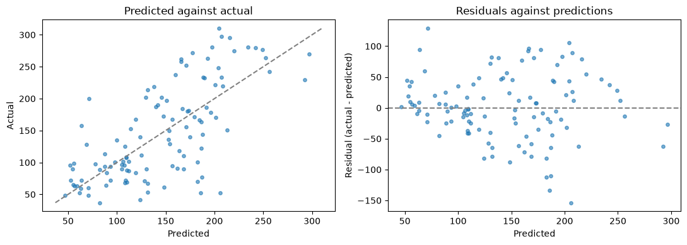
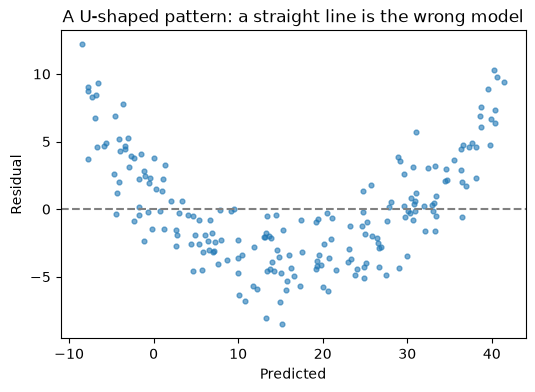

# 21-02 Regression metrics

## What you will learn

- Compute MAE, MSE, RMSE and R² with `sklearn.metrics`.
- Explain what R² means, and why it can be negative.
- Choose a metric that matches what a mistake costs.
- Use residual plots to spot problems a single number hides.

## Why it matters

A regression model is only as good as the measure you judge it by. Different metrics reward different behaviour: some punish a few large errors hard, others treat all errors equally. And a single number can hide a model that is systematically wrong in places. Every regression result in the projects and capstone needs a well-chosen metric and a residual plot.

## Concepts

The examples evaluate a linear regression on the diabetes test set (20-03).

### The standard metrics

scikit-learn's `sklearn.metrics` module has a function for each metric. They all take the true values first, then the predictions:

```python
from sklearn.metrics import mean_absolute_error, mean_squared_error, r2_score, root_mean_squared_error

print(round(mean_absolute_error(y_test, predictions), 2))
print(round(mean_squared_error(y_test, predictions), 2))
print(round(root_mean_squared_error(y_test, predictions), 2))
print(round(r2_score(y_test, predictions), 3))
```

```
41.55
2848.31
53.37
0.485
```

You met the first three in 18-03:

- **MAE** (mean absolute error): the average size of the errors, in the target's units. "Predictions are off by about 42 on average."
- **MSE** (mean squared error): the average squared error, in squared units, which makes it hard to read.
- **RMSE** (root mean squared error): the square root of the MSE, back in the target's units. Always at least as large as the MAE.

### R squared

**R²** (the **coefficient of determination**) compares the model with the simplest possible model: predicting the mean for everyone.

R² = 1 − (sum of squared residuals) / (sum of squared differences from the mean)

In words: one minus the fraction of the target's variation that the model **failed** to explain.

```python
ss_residual = np.sum((y_test - predictions) ** 2)
ss_total = np.sum((y_test - y_test.mean()) ** 2)
print(round(1 - ss_residual / ss_total, 3), round(model.score(X_test, y_test), 3))
```

```
0.485 0.485
```

`model.score` for a regressor is R² (20-02). How to read it:

- **1**: perfect predictions.
- **0**: no better than predicting the mean.
- **Negative**: worse than predicting the mean. This happens on test data with badly overfitted models (21-03 shows an R² of −41).

R² has no units, so it is handy for comparing models on the same data, but it does not tell you how big the errors are in practice. Report it with MAE or RMSE.

### Compare with a baseline

As always (20-05), the numbers mean more next to a baseline:

```python
baseline = DummyRegressor().fit(X_train, y_train).predict(X_test)
for name, metric in [("MAE", mean_absolute_error), ("RMSE", root_mean_squared_error), ("R2", r2_score)]:
    print(f"{name:<5} model {metric(y_test, predictions):8.3f}   baseline {metric(y_test, baseline):8.3f}")
```

```
MAE   model   41.549   baseline   65.527
RMSE  model   53.370   baseline   74.881
R2    model    0.485   baseline   -0.014
```

### Choosing a metric

The difference between MAE and RMSE is how they treat large errors. Two sets of predictions, both off by 10 on average:

```python
truth = np.array([100.0, 100.0, 100.0, 100.0])
even = np.array([110.0, 90.0, 110.0, 90.0])
one_big = np.array([100.0, 100.0, 100.0, 140.0])
for name, guess in [("even errors", even), ("one big error", one_big)]:
    print(f"{name:<14} MAE {mean_absolute_error(truth, guess):5.1f}  RMSE {root_mean_squared_error(truth, guess):5.1f}")
```

```
even errors    MAE  10.0  RMSE  10.0
one big error  MAE  10.0  RMSE  20.0
```

MAE cannot tell them apart; RMSE doubles for the single large error. Choose by asking what a mistake costs:

- If an error of 40 is **exactly four times** as bad as an error of 10 (say, ordering too much stock), use **MAE**. It is also less sensitive to outliers.
- If large errors are **disproportionately** bad (a bridge load estimate, a dosage), use **RMSE**.
- Use **R²** to summarise how much of the variation the model explains, alongside one of the above.

### Residual plots

A single metric can hide a model that is wrong in a systematic way. Two plots catch this:

- **Predicted against actual**: points should cluster around the diagonal line where predicted equals actual.
- **Residuals against predicted**: points should form a shapeless horizontal band around zero.



For the diabetes model, the residuals form a roughly even band, with no obvious pattern: the model's errors look like noise. Their wide spread is consistent with an R² of 0.49.

### A residual plot that reveals a problem

Here a straight line is fitted to data that actually curves (y depends on x²):

```python
rng = np.random.default_rng(42)
x = rng.uniform(0, 10, 200).reshape(-1, 1)
y = 0.5 * x[:, 0] ** 2 + rng.normal(0, 2, 200)
curved = LinearRegression().fit(x, y)
curved_residuals = y - curved.predict(x)
print(round(r2_score(y, curved.predict(x)), 3))
```

```
0.925
```



R² is a respectable 0.925, but the residuals form a clear **U shape**: the line is too high in the middle and too low at both ends. A pattern in the residuals means the model is missing something, here a curve, which polynomial features (21-03) can capture. Other warning signs: residuals that fan out wider as predictions grow (errors scale with size, so consider a log transform of the target, 16-02), and residuals that drift up or down with a feature not in the model.

## Common mistakes

- **Swapping the arguments.** For MAE and RMSE it makes no difference, but `r2_score(predictions, y_test)` gives a different, wrong number. The true values always come first.
- **Reporting only R².** An R² of 0.9 can still mean errors too large to be useful. Give MAE or RMSE in real units too.
- **Comparing RMSE across different targets.** An RMSE of 50 is large for exam scores and tiny for house prices.
- **Skipping the residual plot.** A good-looking score can hide a systematic pattern.

## Try it

Compute MAE and RMSE for the diabetes model separately for patients whose actual progression is below the median and those above it. Is the model equally good for both groups? Look at the residual plot again: can you see why?

## Exercises

Open `ex_21_02.py`. Write the metrics by hand with NumPy; the tests compare them with scikit-learn's.

1. `mae`
2. `rmse`
3. `r_squared`
4. `evaluate`: a dictionary of all three for a fitted model on test data.
5. `pick_metric`: choose MAE or RMSE from the cost of large errors.

Run the tests:

```
python -m pytest part-5-supervised-learning/21-regression/21-02-regression-metrics
```

## Summary

- MAE and RMSE are in the target's units; RMSE punishes large errors more; MSE is in squared units.
- R² = 1 − SS_residual / SS_total: 1 is perfect, 0 matches predicting the mean, negative is worse.
- Report a metric in real units alongside R², and compare with a baseline.
- Choose MAE when error cost grows in proportion to size, RMSE when large errors are disproportionately bad.
- Residual plots should show a shapeless band around zero; curves or fans reveal what the model is missing.
