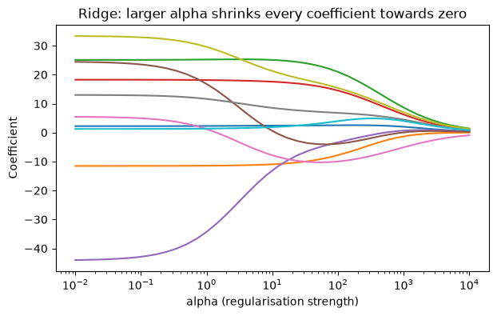

# 21-03 Polynomial features and regularisation

## What you will learn

- Let a linear model fit curves by adding polynomial features.
- Explain how many polynomial features cause overfitting.
- Control overfitting with Ridge and Lasso regularisation and the `alpha` hyperparameter.
- Use Lasso to select features automatically.

## Why it matters

Real relationships are rarely straight lines, and polynomial features let linear regression bend. But flexibility brings overfitting (20-04). **Regularisation** is the standard cure: it penalises large coefficients, trading a little training accuracy for much better behaviour on new data. The same idea, a penalty on complexity controlled by a strength hyperparameter, appears in logistic regression, support vector machines and neural networks.

## Concepts

### Polynomial features

**`PolynomialFeatures`** creates new features from powers of the existing ones and, with several features, their products. It is a **transformer**: it has `fit` and `transform` (or both at once, `fit_transform`), like the scalers in 20-03:

```python
from sklearn.preprocessing import PolynomialFeatures

x = np.array([[2.0], [3.0]])
print(PolynomialFeatures(degree=3, include_bias=False).fit_transform(x))
two = np.array([[2.0, 5.0]])
poly = PolynomialFeatures(degree=2, include_bias=False).fit(two)
print(poly.get_feature_names_out(["a", "b"]))
print(poly.transform(two))
```

```
[[ 2.  4.  8.]
 [ 3.  9. 27.]]
['a' 'b' 'a^2' 'a b' 'b^2']
[[ 2.  5.  4. 10. 25.]]
```

From x, degree 3 gives x, x² and x³. From two features a and b, degree 2 gives a, b, a², a × b and b². The product a × b is an **interaction**: it lets the effect of a depend on the value of b. `include_bias=False` leaves out a column of ones, because `LinearRegression` already fits an intercept.

### Fitting a curve with a linear model

The model is still **linear in its coefficients**, prediction = c₁ × x + c₂ × x² + b, so ordinary least squares works. But the fitted shape is a curve:

```python
rng = np.random.default_rng(42)
x = rng.uniform(0, 10, 200).reshape(-1, 1)
y = 0.5 * x[:, 0] ** 2 - 2 * x[:, 0] + rng.normal(0, 2, 200)
x_squared = PolynomialFeatures(degree=2, include_bias=False).fit_transform(x)
curve = LinearRegression().fit(x_squared, y)
print(np.round(curve.coef_, 3), round(curve.intercept_, 3), round(curve.score(x_squared, y), 3))
```

```
[-1.906  0.504] -0.556 0.956
```

The data was generated from 0.5x² − 2x plus noise, and the model recovered coefficients close to −2 and 0.5. This is the fix for the U-shaped residuals in 21-02.

### Too many features overfit

The number of polynomial features grows fast. The 10 diabetes features become 285 at degree 3 (every power and product up to three at a time), almost as many as the 331 training patients:

```python
scaler = StandardScaler().fit(X_train)
X_train_s, X_test_s = scaler.transform(X_train), scaler.transform(X_test)
poly3 = PolynomialFeatures(degree=3, include_bias=False).fit(X_train_s)
P_train, P_test = poly3.transform(X_train_s), poly3.transform(X_test_s)
print(P_train.shape)
plain = LinearRegression().fit(P_train, y_train)
print("degree 3, no regularisation:", round(plain.score(P_train, y_train), 3), round(plain.score(P_test, y_test), 3))
```

```
(331, 285)
degree 3, no regularisation: 0.909 -41.324
```

The features are standardised first (20-03; 21-04 explains why). Training R² is 0.909; test R² is **−41**: forty times worse than predicting the mean. With nearly one coefficient per patient, the model memorised the training set, using huge coefficients that make wild predictions for anyone new.

### Regularisation: penalising large coefficients

**Regularisation** changes what the model minimises. Instead of only the squared error, it minimises squared error **plus a penalty on the size of the coefficients**. Large coefficients now cost something, so the model only uses them when they reduce the error by enough to be worth it. The strength of the penalty is the hyperparameter **`alpha`**: 0 means no penalty (ordinary least squares); larger values force smaller coefficients.

**Ridge** regression penalises the sum of the **squared** coefficients:

```python
from sklearn.linear_model import Lasso, Ridge

for alpha in [0.1, 10, 100, 1000]:
    ridge = Ridge(alpha=alpha).fit(P_train, y_train)
    print(f"Ridge alpha {alpha:>6}: train {ridge.score(P_train, y_train):.3f}, test {ridge.score(P_test, y_test):.3f}, "
          f"largest coefficient {np.abs(ridge.coef_).max():8.1f}")
```

```
Ridge alpha    0.1: train 0.856, test -2.177, largest coefficient    109.8
Ridge alpha     10: train 0.744, test 0.134, largest coefficient     16.7
Ridge alpha    100: train 0.662, test 0.368, largest coefficient      8.3
Ridge alpha   1000: train 0.545, test 0.395, largest coefficient      3.4
```

As alpha grows, the coefficients shrink, the training score falls, and the test score climbs from −2.2 to 0.395. That is the bias-variance trade-off (20-04) under your control: more regularisation means more bias but much less variance. Too much would underfit again; the best alpha is found by cross-validation (24-03). (Even the best of these, 0.395, is below the plain ten-feature model's 0.485, a sign that the diabetes target really is close to linear in these features.)

### How alpha shrinks coefficients

Fitting Ridge on the original ten standardised features across a range of alphas shows each coefficient shrinking smoothly towards zero:



`np.logspace(-2, 4, 40)` gives 40 values evenly spaced on a log scale, from 0.01 to 10,000, which is the natural way to search a hyperparameter like alpha.

### Lasso: shrinking to exactly zero

**Lasso** penalises the sum of the **absolute values** of the coefficients. Its key property is that it pushes some coefficients to **exactly zero**, removing those features from the model completely:

```python
lasso = Lasso(alpha=1.0).fit(X_train_s, y_train)
print(pd.Series(lasso.coef_, index=diabetes.feature_names).round(2))
print("features kept:", int(np.sum(lasso.coef_ != 0)), "of", len(lasso.coef_))
print("test R squared:", round(lasso.score(X_test_s, y_test), 3))
```

```
age     1.20
sex    -9.30
bmi    25.66
bp     17.04
s1     -8.35
s2     -0.00
s3    -10.83
s4      3.29
s5     21.14
s6      1.06
dtype: float64
features kept: 9 of 10
test R squared: 0.496
```

s2 was dropped (it is strongly correlated with s1, so s1 can carry its information). The test R² of 0.496 slightly beats plain linear regression. Larger alphas drop more features:

```python
for alpha in [0.1, 1, 5, 20]:
    kept = int(np.sum(Lasso(alpha=alpha).fit(X_train_s, y_train).coef_ != 0))
    print(f"Lasso alpha {alpha:>4}: {kept} features kept")
```

```
Lasso alpha  0.1: 9 features kept
Lasso alpha    1: 9 features kept
Lasso alpha    5: 5 features kept
Lasso alpha   20: 3 features kept
```

This makes Lasso a tool for **feature selection**: finding a small set of features that predicts almost as well as all of them, which gives simpler, more explainable models.

### Ridge or Lasso?

- **Ridge** keeps every feature but shrinks them. Good when most features carry some information, and when features are correlated (it shares weight between them).
- **Lasso** drops features. Good when you suspect only a few matter, or want a simpler model.
- **ElasticNet** (in `sklearn.linear_model`) mixes both penalties.

Always **standardise** before regularising: the penalty treats all coefficients alike, so features on large scales (which need small coefficients) would be penalised less than features on small scales.

## Common mistakes

- **Too high a polynomial degree.** The feature count explodes and the model overfits. Degree 2 or 3 is usually plenty, with regularisation.
- **Regularising unscaled features.** The penalty then depends on arbitrary units. Standardise first.
- **Confusing alpha's direction.** In Ridge and Lasso, **larger** alpha means **more** regularisation (simpler model). (In logistic regression and SVMs, Module 22, the setting `C` works the other way.)
- **Choosing alpha with the test set.** Use cross-validation (24-03).

## Try it

Fit a Lasso on the degree-3 polynomial features (`P_train`) with alpha values 0.1, 1 and 5. How many of the 285 features does each keep, and what are the test scores? Which polynomial features survive at alpha 5? (Use `poly3.get_feature_names_out(diabetes.feature_names)`.)

## Exercises

Open `ex_21_03.py`:

1. `polynomial_feature_count`: how many features PolynomialFeatures creates.
2. `fit_polynomial`: fit a polynomial regression on one feature.
3. `ridge_test_scores`: test R² for several alphas.
4. `lasso_kept_features`: the names of the features Lasso keeps.

Run the tests:

```
python -m pytest part-5-supervised-learning/21-regression/21-03-polynomial-features-and-regularisation
```

## Summary

- `PolynomialFeatures` adds powers and interactions, so a linear model can fit curves.
- The number of polynomial features grows quickly and leads to overfitting.
- Regularisation adds a penalty on coefficient size; `alpha` sets its strength (larger is simpler).
- Ridge shrinks all coefficients; Lasso sets some exactly to zero, selecting features.
- Standardise before regularising, and choose alpha by cross-validation.
