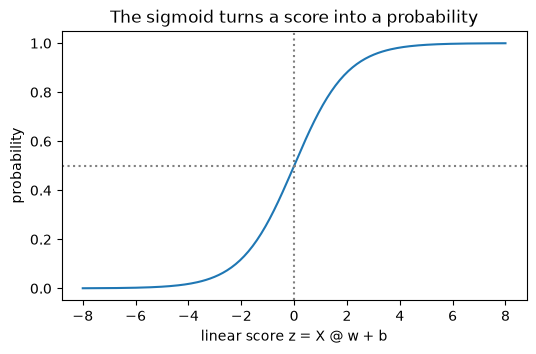
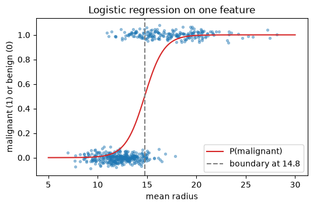

# 22-01 Logistic regression

## What you will learn

- Turn a linear score into a probability with the sigmoid function.
- Fit logistic regression and read `predict_proba`.
- Find and explain the decision boundary.
- Control regularisation with `C`, and apply logistic regression to more than two classes.

## Why it matters

**Logistic regression** is the classification counterpart of linear regression: fast, reliable, and interpretable. It is often the first model to try on a classification problem and a strong baseline that complex models must beat. Its output, a probability, is exactly what you need for the threshold tuning in 22-03. Despite its name, it is a classification model.

## Concepts

### From a score to a probability

Linear regression computes a score, z = **X** @ **w** + b, which can be any number. For classification we want a probability between 0 and 1. The **sigmoid** (or logistic) function squeezes any number into that range:

σ(z) = 1 / (1 + e⁻ᶻ)

In words: very negative scores give probabilities near 0, very positive scores give probabilities near 1, and a score of 0 gives exactly 0.5.

```python
def sigmoid(z):
    return 1 / (1 + np.exp(-z))


print(np.round(sigmoid(np.array([-5, -1, 0, 1, 5])), 3))
```

```
[0.007 0.269 0.5   0.731 0.993]
```



**Logistic regression** is a linear model whose score is passed through the sigmoid: P(class 1) = σ(**X** @ **w** + b). It is fitted by gradient descent (18-04) on a loss called **log loss**, which heavily punishes confident wrong predictions. scikit-learn does the fitting for you.

### One feature

Using only the mean radius to predict whether a tumour is malignant (here coded as 1, the class we care about):

```python
cancer = load_breast_cancer()
radius = cancer.data[:, [0]]       # mean radius
is_malignant = (cancer.target == 0).astype(int)
one_feature = LogisticRegression().fit(radius, is_malignant)
print(np.round(one_feature.coef_, 3), np.round(one_feature.intercept_, 3))
for r in [10, 15, 20]:
    print(r, np.round(one_feature.predict_proba([[r]])[0], 3), one_feature.predict([[r]])[0])
```

```
[[1.025]] [-15.127]
10 [0.992 0.008] 0
15 [0.438 0.562] 1
20 [0.005 0.995] 1
```

`predict_proba` returns one column per class: P(benign) and P(malignant). A tumour of radius 10 is 0.8% likely to be malignant; radius 20, 99.5%. `predict` picks the more likely class. The positive coefficient (1.025) means larger radius makes malignant more likely.

### The decision boundary

The model predicts class 1 when the probability is at least 0.5, which happens exactly when the score z is at least 0. So the **decision boundary**, where the prediction switches, is where **X** @ **w** + b = 0. With one feature, that is radius = −b / w:

```python
boundary = -one_feature.intercept_[0] / one_feature.coef_[0, 0]
print("boundary radius:", round(boundary, 2))
```

```
boundary radius: 14.76
```



With two features the boundary is a straight line, with three a flat plane, and so on: logistic regression is a **linear classifier**. It can only separate classes with a straight boundary, which is its main limitation (22-06 shows a model that can bend).

### All features

With all 30 features, standardised (21-04) so that the regularisation treats them fairly:

```python
X_train, X_test, y_train, y_test = train_test_split(
    cancer.data, cancer.target, test_size=0.25, random_state=42, stratify=cancer.target
)
scaler = StandardScaler().fit(X_train)
model = LogisticRegression(max_iter=1000).fit(scaler.transform(X_train), y_train)
print("test accuracy:", round(model.score(scaler.transform(X_test), y_test), 3))
print(np.round(model.predict_proba(scaler.transform(X_test[:3])), 3))
print(model.predict(scaler.transform(X_test[:3])), y_test[:3])
```

```
test accuracy: 0.986
[[0.031 0.969]
 [1.    0.   ]
 [0.441 0.559]]
[1 0 1] [1 0 1]
```

(Here the target is the dataset's original coding, 1 = benign.) 98.6% test accuracy against a baseline of 62.9% (20-05). The third tumour is a close call, 55.9% benign: the probability tells you how much to trust each prediction. `max_iter` raises the number of optimisation steps; if fitting stops before converging, scikit-learn warns you to increase it.

### Regularisation: C

Logistic regression in scikit-learn is regularised by default, like Ridge (21-03). The strength is set by **`C`**, which works the **opposite way** to alpha: **smaller C means stronger regularisation**.

```python
for C in [0.001, 0.1, 1, 100]:
    fitted = LogisticRegression(C=C, max_iter=5000).fit(scaler.transform(X_train), y_train)
    print(f"C {C:>6}: test accuracy {fitted.score(scaler.transform(X_test), y_test):.3f}, "
          f"largest coefficient {np.abs(fitted.coef_).max():6.2f}")
```

```
C  0.001: test accuracy 0.916, largest coefficient   0.08
C    0.1: test accuracy 0.979, largest coefficient   0.55
C      1: test accuracy 0.986, largest coefficient   1.25
C    100: test accuracy 0.944, largest coefficient  14.73
```

Too small a C underfits (tiny coefficients, 0.916); too large overfits (huge coefficients, 0.944). The default, C = 1, happens to be best here; normally you tune it with cross-validation (24-03).

### More than two classes

Logistic regression handles several classes by learning one set of weights per class and turning the scores into probabilities that add up to 1 (using the **softmax** function, the multi-class version of the sigmoid):

```python
iris = load_iris()
multi = LogisticRegression(max_iter=1000).fit(iris.data, iris.target)
print(multi.coef_.shape)
print(np.round(multi.predict_proba(iris.data[[0, 75, 149]]), 3))
print(multi.predict(iris.data[[0, 75, 149]]))
```

```
(3, 4)
[[0.982 0.018 0.   ]
 [0.005 0.92  0.075]
 [0.    0.235 0.764]]
[0 1 2]
```

`coef_` now has one row of 4 weights for each of the 3 classes, and `predict` picks the class with the highest probability in each row.

### When logistic regression works well

It works well when the classes can be separated reasonably well by a straight boundary, when you want probabilities, and when you need to explain the model (each coefficient says how a feature pushes the odds). It struggles with curved boundaries unless you add polynomial features, and needs scaled features for its regularisation to be fair.

## Common mistakes

- **Forgetting to scale.** With regularisation, unscaled features are penalised unequally, and fitting may also fail to converge (a `ConvergenceWarning`). Standardise first.
- **Confusing C with alpha.** In logistic regression, **smaller** C means **more** regularisation.
- **Reading `predict_proba` columns in the wrong order.** Columns follow `model.classes_`, which is sorted. Check it.
- **Treating it as a regression model.** It predicts class probabilities, not numbers on a continuous scale.

## Try it

Fit logistic regression on just two standardised features of the breast cancer data, `mean radius` and `mean texture`. Find the boundary line where the score is zero: w₁x₁ + w₂x₂ + b = 0, so x₂ = −(w₁x₁ + b) / w₂. Plot the data coloured by class and draw that line.

## Exercises

Open `ex_22_01.py`:

1. `sigmoid`: the logistic function.
2. `classify`: turn probabilities into class labels with a threshold.
3. `boundary_value`: the decision boundary of a one-feature logistic regression.
4. `fit_scaled_logistic`: standardise, then fit logistic regression with a given C.
5. `most_likely_names`: the name of the most probable class for each row of probabilities.

Run the tests:

```
python -m pytest part-5-supervised-learning/22-classification/22-01-logistic-regression
```

## Summary

- Logistic regression passes a linear score through the sigmoid, σ(z) = 1 / (1 + e⁻ᶻ), to get a probability.
- `predict_proba` gives one column per class (in `classes_` order); `predict` picks the most probable.
- The decision boundary, where the probability is 0.5, is where the linear score is 0: a straight line or plane.
- `C` controls regularisation; smaller C is stronger. Scale features first.
- With several classes, it learns one set of weights per class and uses softmax.
