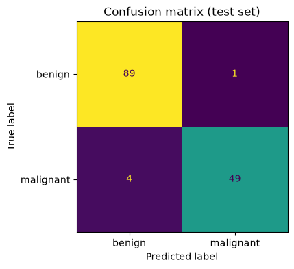

# 22-02 Classification metrics

## What you will learn

- Build and read a confusion matrix.
- Compute precision, recall and F1, and explain what each one rewards.
- Explain why accuracy misleads when classes are imbalanced.
- Use `class_weight="balanced"` to pay more attention to a rare class.

## Why it matters

A classifier can be wrong in two different ways: missing something that is there, or raising a false alarm. In cancer screening, fraud detection and spam filtering, these two mistakes have very different costs, and accuracy lumps them together. The metrics in this lesson separate them, and they are what you will report in the Part 5 project.

## Concepts

In this lesson the **positive** class (1) is **malignant**, the class we want to find, and benign is negative (0). A logistic regression is trained as in 22-01 and evaluated on the test set.

### The confusion matrix

A **confusion matrix** counts every combination of true class and predicted class:

|  | Predicted benign (0) | Predicted malignant (1) |
|--|--|--|
| **Actually benign (0)** | true negatives (TN) | false positives (FP) |
| **Actually malignant (1)** | false negatives (FN) | true positives (TP) |

- A **true positive** is a malignant tumour correctly flagged.
- A **false positive** (a false alarm) is a benign tumour wrongly flagged as malignant.
- A **false negative** (a miss) is a malignant tumour wrongly called benign.
- A **true negative** is a benign tumour correctly passed.

```python
from sklearn.metrics import confusion_matrix

matrix = confusion_matrix(y_test, predictions)
print(matrix)
tn, fp, fn, tp = matrix.ravel()
print(f"TN={tn} FP={fp} FN={fn} TP={tp}")
```

```
[[89  1]
 [ 4 49]]
TN=89 FP=1 FN=4 TP=49
```



Rows are the true classes and columns the predictions, both in sorted order (0, then 1). `ravel()` flattens it in the order TN, FP, FN, TP. The model raised one false alarm and **missed four cancers**. Those four misses matter far more than the one false alarm, and only the confusion matrix shows them.

### Accuracy, precision, recall and F1

From the four counts come the standard metrics:

- **Accuracy** = (TP + TN) / everything: the fraction of all predictions that are correct.
- **Precision** = TP / (TP + FP): of the tumours **flagged** as malignant, the fraction that really are. High precision means few false alarms.
- **Recall** (or **sensitivity**, 19-02) = TP / (TP + FN): of the tumours that **really are** malignant, the fraction the model found. High recall means few misses.
- **F1** = 2 × precision × recall / (precision + recall): a single number that is high only when both precision and recall are high (it is their **harmonic mean**).

```python
from sklearn.metrics import accuracy_score, f1_score, precision_score, recall_score

print(round(accuracy_score(y_test, predictions), 3), round((tp + tn) / (tp + tn + fp + fn), 3))
print(round(precision_score(y_test, predictions), 3), round(tp / (tp + fp), 3))
print(round(recall_score(y_test, predictions), 3), round(tp / (tp + fn), 3))
print(round(f1_score(y_test, predictions), 3))
```

```
0.965 0.965
0.98 0.98
0.925 0.925
0.951
```

Precision 0.98: when this model says malignant, it is almost always right. Recall 0.925: it finds about 92% of cancers, missing 1 in 13. For screening, that recall might not be good enough; 22-03 shows how to raise it.

Which to prioritise depends on the costs:

- **Recall** when a miss is costly: cancer screening, fraud detection, safety faults.
- **Precision** when a false alarm is costly: a spam filter (losing a real email is worse than seeing a spam one), recommending a costly treatment.
- **F1** when both matter and you need a single number.

### The classification report

`classification_report` shows precision, recall and F1 for **every** class, as if each in turn were the positive class:

```python
print(classification_report(y_test, predictions, target_names=["benign", "malignant"], digits=3))
```

```
              precision    recall  f1-score   support

      benign      0.957     0.989     0.973        90
   malignant      0.980     0.925     0.951        53

    accuracy                          0.965       143
   macro avg      0.968     0.957     0.962       143
weighted avg      0.966     0.965     0.965       143
```

`support` is the number of test samples in each class. The **macro average** treats all classes equally; the **weighted average** weights them by support.

### Imbalanced classes

Here is a synthetic problem where only 3% of samples are positive, like fraud among transactions:

```python
X, y_rare = make_classification(n_samples=4000, weights=[0.97], flip_y=0, class_sep=0.8, random_state=42)
Xr_train, Xr_test, yr_train, yr_test = train_test_split(X, y_rare, test_size=0.25, random_state=42, stratify=y_rare)
for name, clf in [("always negative", DummyClassifier(strategy="most_frequent")),
                  ("logistic regression", LogisticRegression())]:
    pred = clf.fit(Xr_train, yr_train).predict(Xr_test)
    print(f"{name:<20} accuracy {accuracy_score(yr_test, pred):.3f}  "
          f"recall {recall_score(yr_test, pred, zero_division=0):.3f}  "
          f"precision {precision_score(yr_test, pred, zero_division=0):.3f}")
print(confusion_matrix(yr_test, LogisticRegression().fit(Xr_train, yr_train).predict(Xr_test)))
```

```
always negative      accuracy 0.970  recall 0.000  precision 0.000
logistic regression  accuracy 0.989  recall 0.633  precision 1.000
[[970   0]
 [ 11  19]]
```

The dummy that never predicts fraud is 97% accurate and catches nothing (recall 0). The real model's accuracy, 98.9%, sounds only slightly better, but it catches 19 of 30 frauds. Accuracy hides the difference; recall shows it. (`zero_division=0` tells scikit-learn what to report when precision is undefined because nothing was predicted positive.)

### Balancing the classes

By default, every training sample counts equally, so the model mostly learns about the common class. **`class_weight="balanced"`** makes each sample's weight inversely proportional to its class's frequency, so the rare class counts as much in total as the common one:

```python
balanced = LogisticRegression(class_weight="balanced").fit(Xr_train, yr_train)
pred = balanced.predict(Xr_test)
print(f"balanced weights     accuracy {accuracy_score(yr_test, pred):.3f}  "
      f"recall {recall_score(yr_test, pred):.3f}  precision {precision_score(yr_test, pred):.3f}")
```

```
balanced weights     accuracy 0.923  recall 0.867  precision 0.263
```

Recall jumps from 0.633 to 0.867, at the cost of many more false alarms (precision 0.263) and lower accuracy. Whether that trade is worth it depends on the costs; 22-03 shows how to choose it precisely with a threshold.

## Common mistakes

- **Reporting accuracy alone on imbalanced data.** Always show the confusion matrix and the precision and recall of the class you care about.
- **Mixing up precision and recall.** Precision is about the **predictions** ("when it says yes, is it right?"); recall is about the **actual positives** ("of the real yeses, how many did it find?").
- **Getting the positive class wrong.** scikit-learn treats label 1 as positive by default. In the original breast cancer data, 1 means benign; recode or pass `pos_label` so that the class you care about is positive.
- **Reading the confusion matrix the wrong way round.** In scikit-learn, rows are true classes and columns are predictions.

## Try it

Train logistic regression on the iris data and print the 3 × 3 confusion matrix and the classification report. Which two species does it confuse? Does that match what you saw in the pairplot in 15-04?

## Exercises

Open `ex_22_02.py`. Compute the metrics yourself from counts; the tests compare with scikit-learn.

1. `confusion_counts`: TN, FP, FN and TP from true and predicted labels.
2. `precision`, `recall` and `f1`: from the counts.
3. `metric_summary`: all four metrics in a dictionary.

Run the tests:

```
python -m pytest part-5-supervised-learning/22-classification/22-02-classification-metrics
```

## Summary

- The confusion matrix counts true negatives, false positives, false negatives and true positives (rows are truth, columns predictions).
- Precision = TP / (TP + FP) measures false alarms; recall = TP / (TP + FN) measures misses; F1 combines them.
- Choose the metric from the costs: recall when misses are costly, precision when false alarms are.
- With imbalanced classes, accuracy is misleading; report precision and recall for the rare class.
- `class_weight="balanced"` trades precision for recall on a rare class.
