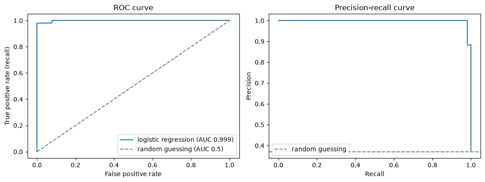

# 22-03 Thresholds, ROC and precision-recall curves

## What you will learn

- Change a classifier's decision threshold to trade precision against recall.
- Draw and read a ROC curve and its area (AUC).
- Draw and read a precision-recall curve.
- Choose a threshold that minimises the real cost of mistakes.

## Why it matters

`predict` turns probabilities into decisions at a threshold of 0.5, but nothing makes 0.5 special. A cancer screen should flag a tumour even at a 20% chance; a system that freezes bank accounts should be very sure first. Choosing the threshold is often the most important decision in deploying a classifier, and ROC and precision-recall curves show every possible choice at once.

## Concepts

The examples use a logistic regression on the breast cancer data with malignant as the positive class, and its predicted probabilities of malignancy on the test set:

```python
probabilities = model.predict_proba(scaler.transform(X_test))[:, 1]
```

`[:, 1]` takes the second column: P(class 1). (The model uses `C=0.05`, slightly stronger regularisation than the default, which gives smoother probabilities.)

### The threshold

`predict` is exactly "probability at least 0.5":

```python
print(np.array_equal(model.predict(scaler.transform(X_test)), (probabilities >= 0.5).astype(int)))
```

```
True
```

You can choose any other **threshold**. Lowering it flags more tumours: more cancers are caught (higher recall) but more benign tumours are flagged too (lower precision). Raising it does the opposite:

```python
for threshold in [0.1, 0.3, 0.5, 0.7, 0.9]:
    pred = (probabilities >= threshold).astype(int)
    print(f"threshold {threshold}: precision {precision_score(y_test, pred):.3f}, recall {recall_score(y_test, pred):.3f}, "
          f"flagged {pred.sum()}")
```

```
threshold 0.1: precision 0.768, recall 1.000, flagged 69
threshold 0.3: precision 0.929, recall 0.981, flagged 56
threshold 0.5: precision 1.000, recall 0.943, flagged 50
threshold 0.7: precision 1.000, recall 0.830, flagged 44
threshold 0.9: precision 1.000, recall 0.642, flagged 34
```

There are 53 malignant tumours in the test set. At 0.5 the model flags 50 and misses three. At 0.1 it catches every one, but 16 of the 69 flagged are benign. One model, very different behaviour, chosen by a single number.

### The ROC curve

The **ROC curve** (receiver operating characteristic, a name from radar engineering) shows every threshold at once. For each threshold it plots:

- the **true positive rate** (recall): the fraction of positives caught, against
- the **false positive rate**: FP / (FP + TN), the fraction of negatives wrongly flagged.

```python
false_positive_rate, true_positive_rate, roc_thresholds = roc_curve(y_test, probabilities)
auc = roc_auc_score(y_test, probabilities)
print("ROC AUC:", round(auc, 4))
```

```
ROC AUC: 0.9985
```



A perfect classifier goes straight up to the top-left corner (catch everything, flag nothing wrongly). Random guessing follows the diagonal. The **AUC** (area under the curve) summarises the whole curve in one number from 0.5 (random) to 1 (perfect). It also has a neat meaning: the probability that a randomly chosen positive gets a higher score than a randomly chosen negative. 0.9985 means the model almost always ranks malignant tumours above benign ones; the only question is where to draw the line.

AUC is useful for comparing models **independently of the threshold**, and it is not fooled by class imbalance the way accuracy is.

### The precision-recall curve

The **precision-recall curve** plots precision against recall for every threshold:

```python
precision, recall, pr_thresholds = precision_recall_curve(y_test, probabilities)
print("average precision:", round(average_precision_score(y_test, probabilities), 4))
```

```
average precision: 0.9978
```

(See the right panel above.) The random-guessing level is the fraction of positives (37% here), not 0.5. **Average precision** summarises the curve, like AUC for ROC.

**ROC or precision-recall?** When positives are rare (fraud, rare diseases), the false positive rate stays tiny even with many false alarms, because the negatives are so numerous, so the ROC curve looks flattering. The precision-recall curve shows false alarms directly through precision. Prefer it for heavily imbalanced problems.

### Choosing a threshold by cost

The best threshold depends on what each mistake costs. Suppose missing a cancer is **20 times** worse than a false alarm (which leads to an unnecessary biopsy). Count the total cost at every threshold and pick the lowest:

```python
cost_of_missed_cancer = 20      # a false negative
cost_of_false_alarm = 1         # a false positive
thresholds = np.linspace(0.01, 0.99, 99)
costs = []
for threshold in thresholds:
    pred = probabilities >= threshold
    false_negatives = np.sum(~pred & (y_test == 1))
    false_positives = np.sum(pred & (y_test == 0))
    costs.append(cost_of_missed_cancer * false_negatives + cost_of_false_alarm * false_positives)
best = thresholds[int(np.argmin(costs))]
print("lowest-cost threshold:", round(best, 2), "cost:", min(costs))
print("cost at 0.5:", costs[49])
```

```
lowest-cost threshold: 0.2 cost: 7
cost at 0.5: 60
```

At the default threshold of 0.5 the three missed cancers cost 60. A threshold of 0.2 brings the total cost down to 7. The same model, used better.

### Meeting a requirement

Sometimes the requirement is a minimum precision or recall ("at least 90% of flagged cases must be real"). Search the curve for thresholds that meet it:

```python
precise_enough = pr_thresholds[precision[:-1] >= 0.9]
print("smallest threshold with precision >= 0.9:", round(precise_enough.min(), 3))
```

```
smallest threshold with precision >= 0.9: 0.248
```

(`precision_recall_curve` returns one more precision value than thresholds, hence `[:-1]`.) Using the **smallest** threshold that satisfies the precision requirement gives the **highest** recall possible under it.

**Important**: in a real project, choose the threshold on a validation set (24-03), not the test set, or the test score will be optimistic.

## Common mistakes

- **Passing predictions instead of probabilities.** `roc_auc_score(y_test, model.predict(X))` uses only 0s and 1s, which gives a meaningless curve with one point. Pass `predict_proba(X)[:, 1]`.
- **Using the wrong probability column.** Column 1 is the probability of `classes_[1]`. Check which class that is.
- **Assuming 0.5 is right.** It is only a default. Choose the threshold from the costs or requirements.
- **Choosing the threshold on the test set.** Tune it on validation data, then report the test score once.

## Try it

Set the cost of a missed cancer to 5 instead of 20, then to 100. How does the best threshold move? Explain in one sentence why.

## Exercises

Open `ex_22_03.py`:

1. `precision_recall_at`: precision and recall at a given threshold.
2. `lowest_cost_threshold`: the threshold with the smallest total cost.
3. `threshold_for_recall`: the highest threshold that still achieves a required recall.
4. `auc`: the ROC AUC of a set of probabilities.

Run the tests:

```
python -m pytest part-5-supervised-learning/22-classification/22-03-thresholds-roc-and-precision-recall
```

## Summary

- `predict` uses a threshold of 0.5 on `predict_proba`; any threshold can be used.
- Lower thresholds raise recall and lower precision; higher thresholds do the opposite.
- The ROC curve plots true positive rate against false positive rate; AUC summarises it (0.5 random, 1 perfect).
- The precision-recall curve is more informative when positives are rare.
- Choose the threshold from the real costs of each mistake, using validation data.
