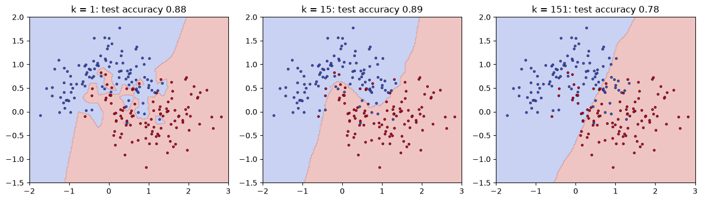

# 22-04 k-nearest neighbours

## What you will learn

- Explain how k-nearest neighbours predicts, and work an example by hand.
- Use `KNeighborsClassifier` and its main hyperparameters, `n_neighbors` and `weights`.
- Choose k, and see how it controls overfitting.
- Explain why scaling is essential, and why k-NN struggles in many dimensions.

## Why it matters

**k-nearest neighbours** (k-NN) is the simplest classifier that really learns from data: to classify something new, find the most similar examples you have already seen and go with the majority. You built a version in 09-05. It needs no training, handles any number of classes and any shape of boundary, and makes a good second baseline after logistic regression. Its weaknesses, scale sensitivity and the curse of dimensionality, teach lessons that apply to every distance-based method in Part 6.

## Concepts

### The intuition

To classify a new sample, k-NN:

1. measures the distance (17-01) from the new sample to **every** training sample;
2. takes the **k** closest ones, its nearest neighbours;
3. predicts the **majority class** among them.

"Training" just means storing the data. All the work happens at prediction time.

### A worked example by hand

Six training points in two groups, and a new point at (2, 2):

```python
training_points = np.array([[1, 1], [2, 1], [1, 2], [5, 5], [6, 5], [5, 6]])
training_labels = np.array(["red", "red", "red", "blue", "blue", "blue"])
new_point = np.array([2, 2])
distances = np.sqrt(((training_points - new_point) ** 2).sum(axis=1))
print(np.round(distances, 2))
nearest = np.argsort(distances)[:3]
print(nearest, training_labels[nearest])
```

```
[1.41 1.   1.   4.24 5.   5.  ]
[1 2 0] ['red' 'red' 'red']
```

`np.argsort` returns the positions that would sort the array, so its first three entries are the three nearest points. All three are red, so with k = 3 the prediction is red.

### The scikit-learn version

```python
knn = KNeighborsClassifier(n_neighbors=3).fit(training_points, training_labels)
print(knn.predict([[2, 2], [5.5, 5.5]]))
distances_found, indexes_found = knn.kneighbors([[2, 2]])
print(np.round(distances_found, 2), indexes_found)
```

```
['red' 'blue']
[[1.   1.   1.41]] [[1 2 0]]
```

`kneighbors` shows which neighbours were used: the same three points found by hand. `predict_proba` gives the fraction of neighbours in each class (20-02).

### Choosing k

**k** (`n_neighbors`) is the main hyperparameter, and it controls the bias-variance trade-off (20-04). On the two-moons dataset (two interleaving half-circles, from `make_moons`):

```python
X, y = make_moons(n_samples=300, noise=0.3, random_state=42)
X_train, X_test, y_train, y_test = train_test_split(X, y, test_size=0.3, random_state=42, stratify=y)
for k in [1, 5, 15, 51, 151]:
    model = KNeighborsClassifier(n_neighbors=k).fit(X_train, y_train)
    print(f"k={k:>3}: train {model.score(X_train, y_train):.3f}, test {model.score(X_test, y_test):.3f}")
```

```
k=  1: train 1.000, test 0.878
k=  5: train 0.905, test 0.889
k= 15: train 0.895, test 0.889
k= 51: train 0.895, test 0.889
k=151: train 0.790, test 0.778
```



- **k = 1**: every training point is its own nearest neighbour, so the training score is a perfect 1.0, and the boundary is jagged, wrapping around individual noisy points. **Overfitting.**
- **k = 15**: a smooth boundary that follows the two moons.
- **k = 151**: with 210 training points, each prediction is a vote of most of the dataset, so the boundary is far too simple. **Underfitting.**

Odd values of k avoid ties in two-class problems. Choose k with cross-validation (24-03).

### Scaling is essential

k-NN uses distances, so features with large ranges dominate (21-04):

```python
unscaled = KNeighborsClassifier().fit(Xc_train, yc_train).score(Xc_test, yc_test)
scaler = StandardScaler().fit(Xc_train)
scaled = KNeighborsClassifier().fit(scaler.transform(Xc_train), yc_train).score(scaler.transform(Xc_test), yc_test)
print(f"unscaled {unscaled:.3f}, scaled {scaled:.3f}")
```

```
unscaled 0.930, scaled 0.979
```

On the breast cancer data, scaling cuts the error rate from 7% to 2%. Always scale before k-NN.

### Distance weighting

By default each of the k neighbours gets an equal vote. `weights="distance"` gives closer neighbours more say, weighting each vote by 1 / distance:

```python
weighted = KNeighborsClassifier(n_neighbors=15, weights="distance").fit(scaler.transform(Xc_train), yc_train)
print(round(weighted.score(scaler.transform(Xc_test), yc_test), 3))
```

```
0.965
```

Here it is slightly worse than the default; whether it helps depends on the data, so treat it as a hyperparameter to try.

### The curse of dimensionality

k-NN assumes that nearby points are similar. In high dimensions that assumption breaks down, because **all points become roughly the same distance apart**. Measure the distances from one random point to 499 others:

```python
rng = np.random.default_rng(42)
for dimensions in [2, 10, 100, 1000]:
    points = rng.random((500, dimensions))
    gaps = np.sqrt(((points[1:] - points[0]) ** 2).sum(axis=1))
    print(f"{dimensions:>4} dimensions: nearest {gaps.min():.2f}, farthest {gaps.max():.2f}, "
          f"ratio {gaps.min() / gaps.max():.2f}")
```

```
   2 dimensions: nearest 0.02, farthest 0.90, ratio 0.02
  10 dimensions: nearest 0.56, farthest 1.79, ratio 0.31
 100 dimensions: nearest 3.63, farthest 5.10, ratio 0.71
1000 dimensions: nearest 12.31, farthest 13.52, ratio 0.91
```

In 2 dimensions the nearest point is 45 times closer than the farthest. In 1,000 dimensions the nearest is barely closer than the farthest, so "nearest neighbour" means very little. This is the **curse of dimensionality**: in many dimensions, data is spread so thinly that every point is far from every other. Reducing the number of features (Lasso, 21-03, or PCA, Module 26) helps distance-based methods.

### When k-NN works well, and when it fails

**Works well:** few features (say, under 20), enough data to cover the space, boundaries of any shape, and when you want a simple, explainable model ("these five similar patients had this outcome").

**Fails:** unscaled features; many features (the curse of dimensionality); very large datasets (every prediction compares against every training sample, which is slow); and features that are irrelevant to the target, which add noise to every distance.

## Common mistakes

- **Not scaling.** The feature with the largest range silently decides the neighbours.
- **k = 1.** It memorises the training data, including noise. Try a range of larger values.
- **Using k-NN with hundreds of features.** Distances lose their meaning. Reduce the dimensions first.
- **Including irrelevant features.** Each one adds noise to the distances; k-NN cannot learn to ignore it the way a linear model can give it a weight of zero.

## Try it

On the scaled breast cancer data, compute the test accuracy for every odd k from 1 to 51 and plot accuracy against k. Where does the curve peak? Repeat with `weights="distance"` on the same plot.

## Exercises

Open `ex_22_04.py`:

1. `knn_predict_one`: classify one point by majority vote of its k nearest training points, by hand.
2. `best_k`: the k with the highest test accuracy.
3. `scaled_knn_accuracy`: k-NN test accuracy after standardising.
4. `distance_ratio`: the nearest-to-farthest distance ratio for a point.

Run the tests:

```
python -m pytest part-5-supervised-learning/22-classification/22-04-k-nearest-neighbours
```

## Summary

- k-NN predicts the majority class among the k closest training samples; training just stores the data.
- Small k overfits (jagged boundaries); large k underfits (overly smooth). Choose k by cross-validation.
- Always scale features; distances are meaningless otherwise.
- `weights="distance"` lets closer neighbours count more.
- In high dimensions all points are nearly equally far apart (the curse of dimensionality), so k-NN works best with few, relevant features.
