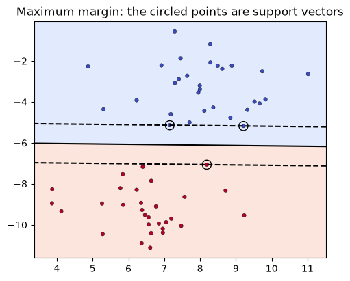
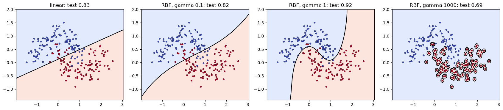

# 22-06 Support vector machines

## What you will learn

- Explain the maximum-margin idea and what support vectors are.
- Control the margin's strictness with `C`.
- Use the kernel trick to draw curved boundaries, and tune the RBF kernel's `gamma`.
- Decide when an SVM is a good choice.

## Why it matters

**Support vector machines** (SVMs) were the leading classifiers for years before deep learning, and they remain excellent for small and medium datasets with clear structure. They introduce two powerful ideas: choosing the boundary that leaves the widest safety margin, and the **kernel trick**, a way to draw curved boundaries using a linear method. The second idea reappears throughout machine learning.

## Concepts

### The widest street

Many straight lines can separate two groups of points. Which is best? An SVM picks the line with the largest **margin**: the widest "street" between the classes, with the boundary down the middle. The intuition: a boundary that stays far from both classes is less likely to misclassify new points that land slightly differently.

The training points that sit on the edges of the street are the **support vectors**. They alone determine the boundary; moving any other point (without crossing the street) changes nothing.

```python
X, y = make_blobs(n_samples=60, centers=2, cluster_std=1.2, random_state=6)
linear = SVC(kernel="linear", C=1.0).fit(X, y)
print("support vectors:", len(linear.support_vectors_))
```

```
support vectors: 3
```



`make_blobs` generates groups of points around centres. The solid line is the boundary, the dashed lines are the edges of the margin, and the three circled points are the support vectors: out of 60 points, only 3 matter. `SVC` is scikit-learn's support vector classifier, and its `decision_function` gives each point's signed distance-like score (positive on one side, negative on the other), which the plotting code in `examples.py` uses to draw the lines.

### C: a hard or soft margin

Real data overlaps, so the street usually cannot be completely empty. The hyperparameter **`C`** sets the penalty for points inside the margin or on the wrong side:

- **Large C**: violations are expensive, so the margin is narrow and fits the training data tightly. Risk: overfitting.
- **Small C**: violations are cheap, so the margin is wide and tolerant, with many points inside it. Risk: underfitting.

```python
for C in [0.01, 1, 100]:
    model = SVC(kernel="linear", C=C).fit(X, y)
    print(f"C {C:>6}: {len(model.support_vectors_)} support vectors, training accuracy {model.score(X, y):.3f}")
```

```
C   0.01: 22 support vectors, training accuracy 1.000
C      1: 3 support vectors, training accuracy 1.000
C    100: 3 support vectors, training accuracy 1.000
```

With small C, the street widens until 22 points sit inside it, and all of them become support vectors. Like logistic regression's C (22-01), **smaller C means stronger regularisation**.

### When a straight line is not enough

The two-moons data cannot be separated by a straight line:

```python
Xm, ym = make_moons(n_samples=300, noise=0.2, random_state=42)
Xm_train, Xm_test, ym_train, ym_test = train_test_split(Xm, ym, test_size=0.3, random_state=42, stratify=ym)
linear_moons = SVC(kernel="linear").fit(Xm_train, ym_train)
rbf_moons = SVC(kernel="rbf").fit(Xm_train, ym_train)
print("linear kernel:", round(linear_moons.score(Xm_test, ym_test), 3))
print("RBF kernel:   ", round(rbf_moons.score(Xm_test, ym_test), 3))
```

```
linear kernel: 0.833
RBF kernel:    0.922
```

### The kernel trick

The idea behind curved boundaries: add new features, and a straight boundary in the bigger feature space can be curved in the original one. You saw this with polynomial features (21-03). Here, adding one feature, each point's squared distance from the origin, already helps a linear SVM:

```python
squared_distance = (Xm_train ** 2).sum(axis=1, keepdims=True)
lifted_train = np.hstack([Xm_train, squared_distance])
lifted_test = np.hstack([Xm_test, (Xm_test ** 2).sum(axis=1, keepdims=True)])
print("linear SVM on lifted features:", round(SVC(kernel="linear").fit(lifted_train, ym_train).score(lifted_test, ym_test), 3))
```

```
linear SVM on lifted features: 0.844
```

(`np.hstack` joins arrays side by side.) The **kernel trick** is that the SVM algorithm only ever needs the dot products (17-02) between pairs of points. A **kernel** is a function that computes the dot product in a much bigger feature space **directly**, without ever creating those features. The **RBF** kernel (radial basis function, the default) corresponds to an infinitely large feature space, and behaves like a similarity measure: points close together count as very similar. That is how `SVC(kernel="rbf")` reached 0.922.

### gamma: how far each point's influence reaches

The RBF kernel's hyperparameter **`gamma`** sets how quickly similarity fades with distance:

- **Small gamma**: each training point influences a wide area, so the boundary is smooth, almost linear. Risk: underfitting.
- **Large gamma**: each point influences only its immediate surroundings, so the boundary wraps tightly around individual points. Risk: overfitting.

```python
for gamma in [0.1, 1, 1000]:
    model = SVC(kernel="rbf", gamma=gamma).fit(Xm_train, ym_train)
    print(f"gamma {gamma:>4}: train {model.score(Xm_train, ym_train):.3f}, test {model.score(Xm_test, ym_test):.3f}")
```

```
gamma  0.1: train 0.867, test 0.822
gamma    1: train 0.962, test 0.922
gamma 1000: train 1.000, test 0.689
```



With gamma = 1000, the model draws a tiny island around every red training point: perfect training accuracy, terrible test accuracy. C and gamma interact, so tune them together with a grid search (24-03).

### Real data: scale first

SVMs measure distances, so they need scaled features (21-04):

```python
print("unscaled:", round(SVC().fit(Xc_train, yc_train).score(Xc_test, yc_test), 3))
print("scaled:  ", round(SVC().fit(scaler.transform(Xc_train), yc_train).score(scaler.transform(Xc_test), yc_test), 3))
```

```
unscaled: 0.923
scaled:   0.979
```

### Probabilities

An SVM's natural output is a decision score, not a probability. To get probabilities, wrap it in **`CalibratedClassifierCV`**, which learns how to turn the scores into well-behaved probabilities:

```python
with_probabilities = CalibratedClassifierCV(SVC(), ensemble=False).fit(scaler.transform(Xc_train), yc_train)
print(np.round(with_probabilities.predict_proba(scaler.transform(Xc_test[:2])), 3))
```

```
[[0.012 0.988]
 [1.    0.   ]]
```

(Older code uses `SVC(probability=True)`, which is deprecated in recent versions of scikit-learn.)

### When SVMs work well, and when they fail

**Work well:** small to medium datasets (up to tens of thousands of rows); many features, even more features than samples; clear margins between classes; complex boundaries via kernels.

**Fail:** very large datasets (training time grows faster than the number of rows); unscaled features; when you need fast, reliable probabilities or an easily explained model; noisy, heavily overlapping classes, where C and gamma are hard to tune.

## Common mistakes

- **Not scaling.** Kernels and margins are distance-based.
- **Tuning C and gamma one at a time.** They interact. Search them together.
- **Huge gamma.** It memorises the training points, as shown above.
- **Using SVMs on millions of rows.** Training becomes very slow; use logistic regression or tree ensembles (Module 23) instead.

## Try it

Run an SVM with the RBF kernel on the scaled breast cancer data for every combination of C in [0.1, 1, 10, 100] and gamma in [0.001, 0.01, 0.1, 1]. Print a table of test accuracies (a pandas pivot table works well). Which corner of the table overfits, and which underfits?

## Exercises

Open `ex_22_06.py`:

1. `svm_test_accuracy`: fit an `SVC` with given settings and return its test accuracy.
2. `support_vector_count`: how many support vectors a fitted SVM uses.
3. `best_gamma`: the gamma with the highest test accuracy.
4. `add_squared_distance`: add each point's squared distance from the origin as a new feature.

Run the tests:

```
python -m pytest part-5-supervised-learning/22-classification/22-06-support-vector-machines
```

## Summary

- An SVM chooses the boundary with the widest margin; the points on the margin are the support vectors.
- `C` sets how strictly the margin is enforced: smaller C is a wider, more tolerant margin (more regularisation).
- The kernel trick computes dot products in a larger feature space without building it, giving curved boundaries.
- The RBF kernel's `gamma` controls how local each point's influence is: large gamma overfits.
- Scale features, tune C and gamma together, and use `CalibratedClassifierCV` for probabilities.
