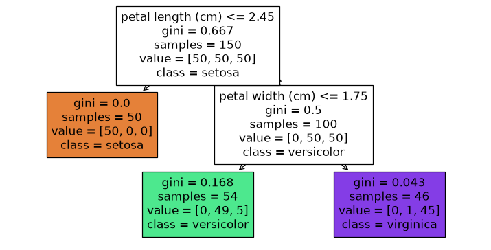

# 23-01 Decision trees

## What you will learn

- Explain how a decision tree splits data with a series of yes/no questions.
- Measure how mixed a group is with Gini impurity and entropy, and find the best split by hand.
- Read a fitted tree as text and as a diagram.
- Control overfitting with `max_depth` and other stopping rules, and explain why trees are unstable.

## Why it matters

A **decision tree** is a flowchart of questions ("is petal length at most 2.45 cm?") that ends in a prediction. It is easy to explain to anyone, needs no feature scaling, and handles any mix of features. On its own it overfits easily, but it is the building block of the two most successful models for tabular data, random forests (23-02) and gradient boosting (23-03).

## Concepts

### Splitting into purer groups

A tree is built from the top down. At each step it chooses the question that best separates the classes, splitting the data into two groups that are each **purer** (more dominated by one class) than before. Then it repeats inside each group, until it reaches a stopping rule. The end points are **leaves**, and each leaf predicts the majority class of the training samples that reached it.

### Measuring purity

**Gini impurity** measures how mixed a group is: the probability that two samples picked at random (with replacement) from the group have different classes. It is 1 − Σ pₖ², where pₖ is the fraction of the group in class k. In words: one minus the sum of the squared class proportions. **Entropy**, −Σ pₖ log₂ pₖ, is an alternative from information theory that behaves similarly.

```python
def gini(labels):
    _, counts = np.unique(labels, return_counts=True)
    proportions = counts / counts.sum()
    return 1 - np.sum(proportions ** 2)


def entropy(labels):
    _, counts = np.unique(labels, return_counts=True)
    proportions = counts / counts.sum()
    return -np.sum(proportions * np.log2(proportions)) + 0.0  # + 0.0 turns -0.0 into 0.0


for group in [["a"] * 10, ["a"] * 5 + ["b"] * 5, ["a"] * 9 + ["b"]]:
    print(f"{''.join(group):<12} gini {gini(group):.3f}  entropy {entropy(group):.3f}")
```

```
aaaaaaaaaa   gini 0.000  entropy 0.000
aaaaabbbbb   gini 0.500  entropy 1.000
aaaaaaaaab   gini 0.180  entropy 0.469
```

Both are 0 for a pure group and largest for an even mix. scikit-learn uses Gini by default (`criterion="gini"`); `criterion="entropy"` usually gives very similar trees.

### Finding the best split by hand

For one feature, try every possible threshold, split the samples into "at most the threshold" and "above", and compute the **weighted** Gini of the two groups (each group's Gini weighted by its size). The best split has the lowest weighted impurity:

```python
petal_length = iris.data[:, 2]
species = iris.target
best = None
for threshold in np.unique(petal_length):
    left, right = species[petal_length <= threshold], species[petal_length > threshold]
    if len(left) == 0 or len(right) == 0:
        continue
    weighted = (len(left) * gini(left) + len(right) * gini(right)) / len(species)
    if best is None or weighted < best[1]:
        best = (threshold, weighted)
print("best threshold:", best[0], "weighted gini:", round(best[1], 3), "starting gini:", round(gini(species), 3))
```

```
best threshold: 1.9 weighted gini: 0.333 starting gini: 0.667
```

Splitting the iris flowers at petal length 1.9 halves the impurity: all 50 setosa go left (a pure group), and the other 100 go right.

```python
stump = DecisionTreeClassifier(max_depth=1, random_state=42).fit(iris.data[:, [2]], species)
print(round(stump.tree_.threshold[0], 2))
```

```
2.45
```

scikit-learn makes the same split. Its threshold, 2.45, sits **halfway** between the largest setosa petal (1.9) and the smallest other petal (3.0), which is a more sensible boundary for new flowers. With several features, the tree tries every threshold of every feature and picks the best overall.

### Reading a tree

`export_text` prints a tree's rules; `plot_tree` draws it:

```python
tree = DecisionTreeClassifier(max_depth=2, random_state=42).fit(iris.data, species)
print(export_text(tree, feature_names=list(iris.feature_names)))
```

```
|--- petal length (cm) <= 2.45
|   |--- class: 0
|--- petal length (cm) >  2.45
|   |--- petal width (cm) <= 1.75
|   |   |--- class: 1
|   |--- petal width (cm) >  1.75
|   |   |--- class: 2
```



Each box shows the question, the Gini impurity, how many training samples reached it, how they divide between the classes (`value`), and the majority class. The right-hand leaf contains 45 virginica and 1 versicolor: not perfectly pure, but the tree stopped at depth 2. These two questions are almost exactly the rule written by hand in 20-01.

### Depth and overfitting

A tree that keeps splitting will eventually give every training sample its own leaf: perfect on training data, poor on new data (20-04). **`max_depth`** limits how many questions in a row it can ask:

```python
for depth in [1, 2, 3, 4, 6, None]:
    model = DecisionTreeClassifier(max_depth=depth, random_state=42).fit(X_train, y_train)
    print(f"max_depth {str(depth):>4}: {model.get_n_leaves():>2} leaves, "
          f"train {model.score(X_train, y_train):.3f}, test {model.score(X_test, y_test):.3f}")
```

```
max_depth    1:  2 leaves, train 0.923, test 0.923
max_depth    2:  4 leaves, train 0.958, test 0.909
max_depth    3:  7 leaves, train 0.977, test 0.944
max_depth    4: 11 leaves, train 0.988, test 0.944
max_depth    6: 17 leaves, train 0.998, test 0.937
max_depth None: 18 leaves, train 1.000, test 0.923
```

On the breast cancer data, depths 3 and 4 give the best test accuracy; the unlimited tree reaches 100% training accuracy and falls back to 92.3%.

### Other stopping rules (pruning)

Several hyperparameters limit growth, which is called **pruning**:

```python
for name, params in [("min_samples_leaf=10", {"min_samples_leaf": 10}),
                     ("min_samples_split=40", {"min_samples_split": 40}),
                     ("ccp_alpha=0.01", {"ccp_alpha": 0.01})]:
    model = DecisionTreeClassifier(random_state=42, **params).fit(X_train, y_train)
    print(f"{name:<22} {model.get_n_leaves():>2} leaves, test {model.score(X_test, y_test):.3f}")
```

```
min_samples_leaf=10    10 leaves, test 0.951
min_samples_split=40    9 leaves, test 0.909
ccp_alpha=0.01          5 leaves, test 0.944
```

- `min_samples_leaf`: every leaf must contain at least this many training samples, so no leaf is based on one or two noisy points.
- `min_samples_split`: a group needs at least this many samples to be split again.
- `ccp_alpha`: **cost-complexity pruning**, which grows the full tree then removes branches that add little; larger values prune more, like a regularisation strength.

`**params` unpacks the dictionary into keyword arguments (10-03).

### Trees are unstable

Small changes in the training data can produce a completely different tree. Here are trees fitted to four bootstrap samples (19-04) of the same training set:

```python
for seed in [0, 2, 4, 5]:
    rows = np.random.default_rng(seed).choice(len(X_train), size=len(X_train), replace=True)
    model = DecisionTreeClassifier(max_depth=2, random_state=42).fit(X_train[rows], y_train[rows])
    root = cancer.feature_names[model.tree_.feature[0]]
    print(f"sample {seed}: root split on '{root}' at {model.tree_.threshold[0]:.3f}, "
          f"test {model.score(X_test, y_test):.3f}")
```

```
sample 0: root split on 'worst concave points' at 0.142, test 0.923
sample 2: root split on 'worst perimeter' at 106.200, test 0.930
sample 4: root split on 'mean concave points' at 0.054, test 0.930
sample 5: root split on 'worst area' at 884.750, test 0.937
```

Four samples, four different first questions. A single tree has high **variance** (20-04). Random forests turn this weakness into a strength by averaging many different trees.

### When trees work well, and when they fail

**Work well:** explaining decisions; mixed feature types; no need for scaling; capturing interactions and non-linear patterns; as the base for forests and boosting.

**Fail:** a single deep tree overfits and is unstable; boundaries are always made of horizontal and vertical steps, so a smooth diagonal boundary needs many splits; small trees are often less accurate than other models.

## Common mistakes

- **Leaving trees unlimited.** The default `max_depth=None` memorises the training set. Set a depth or a minimum leaf size.
- **Scaling features for a tree.** It does no harm, but it does nothing either: splits depend only on the order of values.
- **Over-interpreting one tree's structure.** As shown above, another sample of the data can give a different tree. Do not read too much into which feature is at the top.
- **Reading `value` in `plot_tree` as probabilities.** It shows counts (or fractions, depending on the version) of training samples in each class at that node.

## Try it

Fit trees with `criterion="gini"` and `criterion="entropy"` on the breast cancer data with `max_depth=3`. Print both with `export_text`. How different are they? Compare their test accuracies.

## Exercises

Open `ex_23_01.py`:

1. `gini`: Gini impurity of a list of labels.
2. `entropy`: entropy of a list of labels.
3. `best_threshold`: the threshold on one feature with the lowest weighted Gini.
4. `depth_scores`: training and test accuracy for several depths.

Run the tests:

```
python -m pytest part-5-supervised-learning/23-tree-based-models/23-01-decision-trees
```

## Summary

- A decision tree asks a series of threshold questions, each chosen to make the resulting groups purer.
- Gini impurity, 1 − Σ pₖ², and entropy, −Σ pₖ log₂ pₖ, measure how mixed a group is.
- The best split minimises the size-weighted impurity of the two groups.
- Unlimited trees overfit; limit them with `max_depth`, `min_samples_leaf` or `ccp_alpha`.
- Trees are easy to read and need no scaling, but are unstable: small data changes give different trees.
