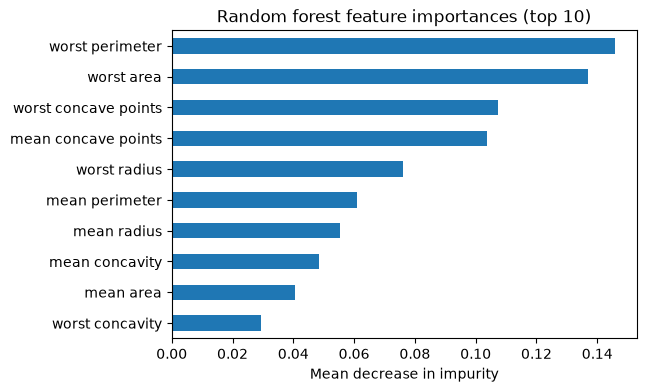

# 23-02 Random forests

## What you will learn

- Explain bagging: training many models on bootstrap samples and combining their votes.
- Explain the extra randomness a random forest adds at each split.
- Use `RandomForestClassifier`, its main hyperparameters, and its out-of-bag score.
- Read feature importances, and know their limits.

## Why it matters

A single decision tree is unstable (23-01), but its errors are different every time. Average many different trees and the errors cancel out while the signal adds up. A **random forest** does exactly this, and it is one of the most reliable models for tabular data: it works well with default settings, rarely overfits badly, needs no scaling, and tells you which features it relied on. It is often the first "serious" model to try after a baseline.

## Concepts

The examples use the breast cancer training and test sets from earlier lessons.

### Bagging by hand

**Bagging** (bootstrap aggregating) means: draw a bootstrap sample of the training data (19-04: same size, with replacement), train a model on it, repeat many times, and let the models vote.

```python
rng = np.random.default_rng(42)
votes = []
for _ in range(25):
    rows = rng.choice(len(X_train), size=len(X_train), replace=True)
    tree = DecisionTreeClassifier(random_state=42).fit(X_train[rows], y_train[rows])
    votes.append(tree.predict(X_test))
votes = np.array(votes)
majority = (votes.mean(axis=0) >= 0.5).astype(int)
single = DecisionTreeClassifier(random_state=42).fit(X_train, y_train)
print("one tree:", round(single.score(X_test, y_test), 3))
print("25 bagged trees:", round(np.mean(majority == y_test), 3))
print("individual bagged trees range:", round(np.mean(votes == y_test, axis=1).min(), 3), "to",
      round(np.mean(votes == y_test, axis=1).max(), 3))
```

```
one tree: 0.923
25 bagged trees: 0.951
individual bagged trees range: 0.895 to 0.958
```

With two classes coded 0 and 1, the mean of the votes is the fraction of trees voting 1, so `>= 0.5` is a majority vote. The 25 individual trees range from 0.895 to 0.958, but their combined vote, 0.951, is close to the best of them, and you did not need to know in advance which tree that would be. Averaging reduces **variance** (20-04) without adding bias.

### The random forest

Bagged trees are still quite similar to each other, because the strongest features tend to win the top splits every time. A **random forest** adds a second source of randomness: at **each split**, a tree may only choose from a **random subset** of the features. This forces the trees to be more different from each other, so their errors are less correlated and cancel out better.

```python
from sklearn.ensemble import RandomForestClassifier

forest = RandomForestClassifier(n_estimators=200, random_state=42).fit(X_train, y_train)
print("random forest:", round(forest.score(X_test, y_test), 3))
print(len(forest.estimators_), forest.estimators_[0].get_depth())
```

```
random forest: 0.958
200 7
```

`n_estimators` is the number of trees; `estimators_` holds the fitted trees. Each tree is grown deep (no depth limit by default) and would overfit on its own; the averaging takes care of that. A forest's `predict_proba` averages the trees' probabilities.

### The main hyperparameters

**`n_estimators`**: more trees never make a forest worse, they just take longer, and the gains level off:

```python
for n in [1, 5, 25, 100, 400]:
    model = RandomForestClassifier(n_estimators=n, random_state=42).fit(X_train, y_train)
    print(f"{n:>3} trees: test {model.score(X_test, y_test):.3f}")
```

```
  1 trees: test 0.923
  5 trees: test 0.937
 25 trees: test 0.951
100 trees: test 0.958
400 trees: test 0.958
```

A few hundred trees is usually plenty.

**`max_features`**: how many features each split may consider. The default for classification is `"sqrt"`, the square root of the number of features (here √30 ≈ 5):

```python
for max_features in ["sqrt", 0.5, None]:
    model = RandomForestClassifier(n_estimators=200, max_features=max_features, random_state=42).fit(X_train, y_train)
    print(f"max_features {str(max_features):<5}: test {model.score(X_test, y_test):.3f}")
```

```
max_features sqrt : test 0.958
max_features 0.5  : test 0.958
max_features None : test 0.951
```

`0.5` means half the features; `None` means all of them, which turns the forest back into plain bagging. Fewer features per split means more varied trees.

Other useful settings: `max_depth` and `min_samples_leaf` limit each tree (23-01), and `n_jobs=-1` uses all processor cores to train trees in parallel.

### The out-of-bag score

Each bootstrap sample leaves out, on average, about a third of the training rows. Those **out-of-bag** rows were never seen by that tree, so they can test it. Combining these gives a free estimate of test performance without a separate validation set:

```python
oob_forest = RandomForestClassifier(n_estimators=200, oob_score=True, random_state=42).fit(X_train, y_train)
print("out-of-bag accuracy:", round(oob_forest.oob_score_, 3))
```

```
out-of-bag accuracy: 0.962
```

The out-of-bag estimate, 0.962, is close to the test score of 0.958.

### Feature importances

A fitted forest records how much each feature reduced impurity across all its splits, averaged over the trees. This is the **impurity-based feature importance**, in `feature_importances_`, which adds up to 1:

```python
importances = pd.Series(forest.feature_importances_, index=cancer.feature_names).sort_values(ascending=False)
print(importances.head(5).round(3))
```

```
worst perimeter         0.146
worst area              0.137
worst concave points    0.107
mean concave points     0.104
worst radius            0.076
dtype: float64
```



Size and concavity measurements dominate, which matches the EDA in 16-01.

### The limits of importances

Feature importances are useful but easy to over-read:

- **They describe the model, not the world.** A high importance means the forest used the feature, not that the feature causes the outcome.
- **Correlated features share the credit.** Perimeter, area and radius all measure size; the forest spreads importance across them, so each looks less important than "size" really is.
- **Even noise gets some importance.** Add a column of pure random numbers:

  ```python
  noisy_train = np.column_stack([X_train, np.random.default_rng(1).normal(size=len(X_train))])
  noisy_forest = RandomForestClassifier(n_estimators=200, random_state=42).fit(noisy_train, y_train)
  print(f"importance of a random noise feature: {noisy_forest.feature_importances_[-1]:.4f}")
  print(f"real features with lower importance: {(noisy_forest.feature_importances_[:-1] < noisy_forest.feature_importances_[-1]).sum()}")
  ```

  ```
  importance of a random noise feature: 0.0027
  real features with lower importance: 0
  ```

  Here the noise ranks last, as it should, but its importance is not zero. Deep trees find spurious splits on anything, and impurity importances are measured on the **training** data. A small importance does not prove a feature is useful.

**Permutation importance** is a more honest alternative: shuffle one feature's values in the **test** set and measure how much the score drops. If the model really relied on the feature, scrambling it hurts:

```python
result = permutation_importance(forest, X_test, y_test, n_repeats=10, random_state=42)
permutation = pd.Series(result.importances_mean, index=cancer.feature_names).sort_values(ascending=False)
print(permutation.head(5).round(3))
```

```
worst texture       0.004
worst perimeter     0.003
mean radius         0.000
smoothness error    0.000
worst symmetry      0.000
dtype: float64
```

Every drop is tiny. Scrambling any **one** size feature barely matters, because the others still carry the same information. This is the correlated-features problem from the other side: impurity importance spreads credit across them, permutation importance finds each one individually dispensable. Neither number alone tells the whole story.

### When random forests work well, and when they fail

**Work well:** tabular data of almost any kind; good results with default settings; robust to outliers and irrelevant features; no scaling needed; built-in validation estimate.

**Fail:** they are much harder to explain than a single tree or a linear model; large forests are slow to predict and take memory; they cannot predict values outside the range seen in training (for regression, the prediction is always an average of training targets); and gradient boosting (23-03) is often slightly more accurate.

## Common mistakes

- **Too few trees.** Results with 5 or 10 trees are noisy. Use at least 100.
- **Treating feature importances as causes.** They show what the model used, on the training data.
- **Ignoring correlated features when reading importances.** Group related features before drawing conclusions.
- **Forgetting `random_state`.** Forests are random; fix the seed to get repeatable results.

## Try it

Compare a single deep tree, a bagged ensemble (`RandomForestClassifier(max_features=None)`) and a random forest (default) on the wine data, using test accuracy and the out-of-bag score. Then plot the forest's top 5 feature importances. Do they match the features that separated the cultivars in 15-04?

## Exercises

Open `ex_23_02.py`:

1. `bagged_vote`: majority-vote predictions from trees trained on bootstrap samples.
2. `forest_scores`: test accuracy for several forest sizes.
3. `top_features`: the most important features of a fitted forest.
4. `oob_accuracy`: the out-of-bag accuracy of a forest.

Run the tests:

```
python -m pytest part-5-supervised-learning/23-tree-based-models/23-02-random-forests
```

## Summary

- Bagging trains models on bootstrap samples and combines their votes, reducing variance.
- A random forest also limits each split to a random subset of features (`max_features`), making trees more varied.
- More trees never hurt; a few hundred is usually enough. Trees are grown deep and averaged.
- The out-of-bag score estimates test performance for free.
- Impurity importances show what the model used, share credit between correlated features and give noise non-zero values; permutation importance measures the drop when a feature is scrambled.
