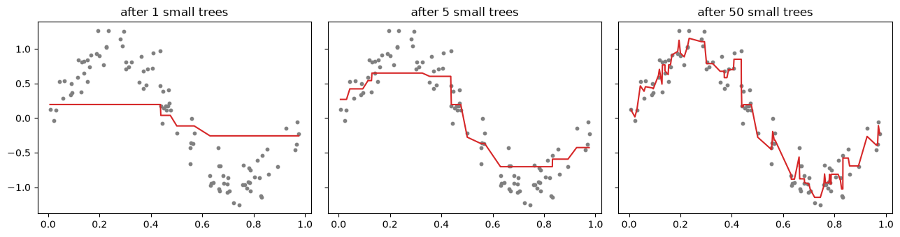
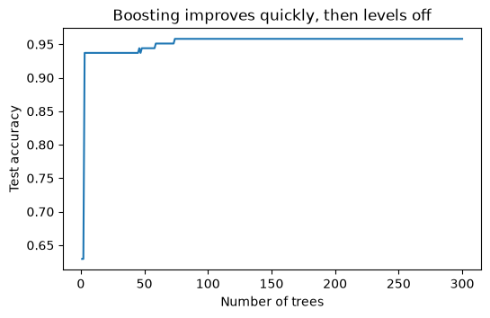

# 23-03 Gradient boosting

## What you will learn

- Explain boosting: adding small models one at a time, each correcting the errors of those before.
- Build a boosted model by hand from small regression trees.
- Use `GradientBoostingClassifier` and `HistGradientBoostingClassifier`.
- Balance the learning rate against the number of trees, and use early stopping.

## Why it matters

**Gradient boosting** is the most accurate general-purpose method for tabular data: libraries built on it (XGBoost, LightGBM, scikit-learn's histogram version) win a large share of data-science competitions on structured data. Where a random forest averages many independent trees, boosting builds trees **in sequence**, each one learning from the mistakes so far. It is the method you are most likely to use for the final model in the Part 5 project.

## Concepts

### Correcting errors, one small tree at a time

Boosting starts with a very simple prediction (for regression, the mean) and then repeats:

1. compute the **residuals**: what the current prediction gets wrong (18-03);
2. fit a **small** tree (often depth 2 to 5) to predict those residuals;
3. add a **fraction** of that tree's predictions to the current prediction.

The fraction is the **learning rate**. Each tree is weak on its own, but together they model complex patterns. It is called **gradient** boosting because the residuals are the negative gradient of the squared-error loss (18-04): each new tree takes a step downhill on the loss, in "function space".

### Boosting by hand

Here is the whole algorithm, using scikit-learn's `DecisionTreeRegressor` (a tree that predicts numbers by averaging the training targets in each leaf) on noisy data from a sine curve:

```python
rng = np.random.default_rng(42)
x = np.sort(rng.uniform(0, 1, 100)).reshape(-1, 1)
y = np.sin(2 * np.pi * x[:, 0]) + rng.normal(0, 0.2, 100)
learning_rate = 0.3
prediction = np.full_like(y, y.mean())
stages = {}
for step in range(1, 51):
    residuals = y - prediction
    small_tree = DecisionTreeRegressor(max_depth=2, random_state=42).fit(x, residuals)
    prediction += learning_rate * small_tree.predict(x)
    if step in (1, 5, 50):
        stages[step] = prediction.copy()
        print(f"after {step:>2} trees: training MSE {np.mean((y - prediction) ** 2):.4f}")
```

```
after  1 trees: training MSE 0.3130
after  5 trees: training MSE 0.0609
after 50 trees: training MSE 0.0093
```



After one depth-2 tree (four flat steps) the fit is crude; after 5 it follows the wave's shape; after 50 it fits closely. Each tree only had to fix what the others got wrong. (With 50 trees it is already following some of the noise: boosting can overfit if it keeps going, unlike a random forest.)

### GradientBoostingClassifier

For classification, the same idea is applied to log loss (22-01) instead of squared error. scikit-learn's **`GradientBoostingClassifier`** uses 100 trees of depth 3 and a learning rate of 0.1 by default:

```python
boosting = GradientBoostingClassifier(random_state=42).fit(X_train, y_train)
forest = RandomForestClassifier(n_estimators=200, random_state=42).fit(X_train, y_train)
print("gradient boosting:", round(boosting.score(X_test, y_test), 3))
print("random forest:    ", round(forest.score(X_test, y_test), 3))
```

```
gradient boosting: 0.958
random forest:     0.958
```

On this small, easy dataset they tie. On larger, harder datasets, tuned boosting usually edges ahead.

### Learning rate versus number of trees

The learning rate and the number of trees work together: a smaller learning rate takes smaller steps, so it needs more trees to get as far, but usually generalises a little better.

```python
for learning_rate, n_trees in [(1.0, 100), (0.1, 100), (0.01, 100), (0.01, 1000)]:
    model = GradientBoostingClassifier(learning_rate=learning_rate, n_estimators=n_trees, random_state=42).fit(X_train, y_train)
    print(f"learning_rate {learning_rate:<5} trees {n_trees:>4}: train {model.score(X_train, y_train):.3f}, "
          f"test {model.score(X_test, y_test):.3f}")
```

```
learning_rate 1.0   trees  100: train 1.000, test 0.958
learning_rate 0.1   trees  100: train 1.000, test 0.958
learning_rate 0.01  trees  100: train 0.988, test 0.937
learning_rate 0.01  trees 1000: train 1.000, test 0.958
```

With a learning rate of 0.01, 100 trees are not enough (underfitting, 0.937); 1,000 trees reach 0.958 again. A common recipe: pick a small learning rate (0.05 to 0.1) and let early stopping choose the number of trees.

### Watching it learn

`staged_predict` gives the predictions after each tree is added, so you can see how the test score develops:

```python
staged = [np.mean(p == y_test) for p in GradientBoostingClassifier(
    learning_rate=0.1, n_estimators=300, random_state=42).fit(X_train, y_train).staged_predict(X_test)]
print("best number of trees:", int(np.argmax(staged)) + 1, "accuracy:", round(max(staged), 3))
```

```
best number of trees: 74 accuracy: 0.958
```



Accuracy climbs quickly over the first few dozen trees and then levels off. (Choosing the number of trees from the test curve, as here, is only for illustration; in practice, use a validation set.)

### Early stopping

**Early stopping** does this properly: it holds back part of the **training** data as a validation set, and stops adding trees once the validation score stops improving:

```python
early = GradientBoostingClassifier(n_estimators=1000, validation_fraction=0.2, n_iter_no_change=10,
                                   random_state=42).fit(X_train, y_train)
print("trees actually used:", early.n_estimators_, "test:", round(early.score(X_test, y_test), 3))
```

```
trees actually used: 130 test: 0.951
```

`validation_fraction=0.2` sets aside 20% of the training data, and `n_iter_no_change=10` stops after 10 trees without improvement. It stopped at 130 of the allowed 1,000, saving time and guarding against overfitting.

### HistGradientBoostingClassifier

**`HistGradientBoostingClassifier`** is a much faster version: it first sorts each feature's values into at most 255 bins (a histogram), so it only has to try 255 thresholds per feature instead of every distinct value. It is the one to use for anything beyond a few thousand rows. It also uses early stopping automatically on large datasets, and **handles missing values** without any imputation:

```python
hist = HistGradientBoostingClassifier(random_state=42).fit(X_train, y_train)
print("hist gradient boosting:", round(hist.score(X_test, y_test), 3), "iterations:", hist.n_iter_)
with_gaps = X_train.copy()
with_gaps[np.random.default_rng(0).random(with_gaps.shape) < 0.1] = np.nan
print("missing values in training data:", int(np.isnan(with_gaps).sum()))
print("still trains:", round(HistGradientBoostingClassifier(random_state=42).fit(with_gaps, y_train).score(X_test, y_test), 3))
```

```
hist gradient boosting: 0.972 iterations: 100
missing values in training data: 1311
still trains: 0.965
```

With 10% of the training values knocked out, it still trains and scores 0.965. Most other models would raise an error on `NaN`. Its main hyperparameters are `learning_rate`, `max_iter` (the number of trees), `max_depth` or `max_leaf_nodes`, and `l2_regularization`.

### Forest or boosting?

| | Random forest | Gradient boosting |
|--|--|--|
| Trees built | independently, in parallel | in sequence, each correcting the last |
| Each tree | deep, overfits on its own | shallow, weak on its own |
| Reduces mainly | variance | bias |
| More trees | never hurts | can overfit; use early stopping |
| Tuning needed | little | more (learning rate, trees, depth) |
| Typical accuracy | very good | often the best for tabular data |

## Common mistakes

- **Too many trees with no early stopping.** Unlike forests, boosting can overfit by adding trees.
- **A high learning rate.** 1.0 often works on easy data but is risky; prefer 0.05 to 0.1 with more trees.
- **Deep trees.** Boosting works best with shallow trees (depth 2 to 6); deep trees make each step overfit.
- **Using `GradientBoostingClassifier` on large data.** It is slow. Use `HistGradientBoostingClassifier`.

## Try it

Use `staged_predict` to plot test accuracy against the number of trees for learning rates 0.01, 0.1 and 1.0 on the same chart (300 trees each). Which reaches its best score fastest? Which looks most stable?

## Exercises

Open `ex_23_03.py`:

1. `boost_by_hand`: boosting with small regression trees, returning the training predictions.
2. `best_tree_count`: the number of trees with the best accuracy, using `staged_predict`.
3. `early_stopping_trees`: how many trees early stopping actually uses.
4. `compare_models`: test accuracy for several fitted model types.

Run the tests:

```
python -m pytest part-5-supervised-learning/23-tree-based-models/23-03-gradient-boosting
```

## Summary

- Boosting adds small trees one at a time, each fitted to the current residuals (the negative gradient of the loss).
- The learning rate scales each tree's contribution; smaller rates need more trees but generalise better.
- Unlike forests, boosting can overfit as trees are added; use early stopping (`n_iter_no_change`, `validation_fraction`).
- `HistGradientBoostingClassifier` is fast, handles missing values, and is the usual choice for real datasets.
- Forests reduce variance with deep independent trees; boosting reduces bias with shallow sequential trees.
