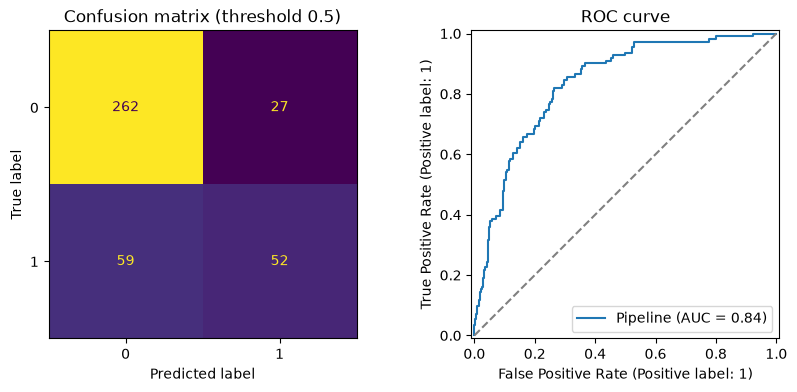

# Predicting customer churn

## Problem and success measure

Predict which customers will cancel their subscription so that the retention team can contact them first. Success is measured by **ROC AUC** for comparing models (it does not depend on a threshold or on the class balance), and by **recall and precision at a chosen threshold** for the final decision. Written before modelling: a missed churner is assumed to cost five times as much as a wasted retention offer.

## Data

2,000 customers, 27.7% of whom churned, so always predicting "stays" would be 72.3% accurate and useless. Four columns have gaps: `satisfaction` (115 missing), `payment_method` (79), `monthly_charges` (52) and `total_charges` (48). Contract type is strongly related to churn: 42.1% of month-to-month customers left, against 14.4% on one-year and 5.3% on two-year contracts.

## Method

- **Split:** stratified 80/20 (1,600 training rows, 400 test rows, `random_state=42`) before any other step. The test set was used once, at the end.
- **Pipeline:** numeric columns get median imputation and scaling; nominal columns get most-frequent imputation and one-hot encoding (`handle_unknown="ignore"`); satisfaction gets most-frequent imputation and ordinal encoding (low < medium < high). Everything is inside a `Pipeline`, so cross-validation refits it on every fold and nothing leaks.
- **Comparison:** 5-fold stratified cross-validation of ROC AUC on the training set.
- **Tuning:** grid search over the logistic regression's `C` in 0.01, 0.1, 1 and 10.
- **Threshold:** chosen from out-of-fold training predictions with a cost of 5 per missed churner and 1 per false alarm.

## Results

Cross-validated ROC AUC on the training data:

| Model | Mean AUC | Std |
|--|--|--|
| Logistic regression | 0.814 | 0.009 |
| Random forest | 0.795 | 0.011 |
| Gradient boosting | 0.760 | 0.021 |
| Baseline (always "stays") | 0.500 | 0.000 |

Logistic regression leads by more than the fold-to-fold spread. Tuning chose `C = 0.1` (cross-validated AUC 0.815, essentially the default's 0.814). On the **test set**, once:

| Threshold | Accuracy | Precision | Recall | Confusion (TN / FP / FN / TP) |
|--|--|--|--|--|
| 0.5 (default) | 0.785 | 0.658 | 0.468 | 262 / 27 / 59 / 52 |
| 0.2 (cost-based) | 0.708 | 0.485 | 0.892 | 184 / 105 / 12 / 99 |

Test ROC AUC is 0.837, in line with the cross-validated 0.815.

## What matters

The largest coefficients of the scaled logistic regression:

| Feature | Coefficient | Reading |
|--|--|--|
| month-to-month contract | +0.81 | much more likely to churn |
| satisfaction (low to high) | −0.65 | happier customers stay |
| two-year contract | −0.61 | much less likely to churn |
| tenure (months) | −0.52 | long-standing customers stay |
| monthly charges | +0.33 | higher bills push people out |
| support calls | +0.32 | more calls, more churn |

These describe associations in this data, not proven causes: for example, customers with many support calls may be unhappy for a reason the data does not contain.

## What the model gets wrong

At the default threshold it finds only 47% of churners (59 of 111 slip through) even though accuracy is 78.5%. Moving the threshold to 0.2 finds 89% but flags 204 customers to catch 99 churners: roughly half of the retention offers go to people who would have stayed. The ROC AUC is unchanged because the model's ranking is the same; only the cut-off moved. The complex models did not help: the data has mostly linear structure and 1,600 rows is small for boosting.

## Limitations

- One 400-row test set: the recall estimate has a wide margin (roughly ±6 points).
- The cost ratio of 5 to 1 is an assumption; the right threshold moves with the real costs.
- The data is synthetic and contains no information about why customers leave beyond the nine columns.

## What to try next

- Interaction features (for example fibre service combined with many support calls).
- Tuned gradient boosting, and calibrated probabilities (22-06) so the probabilities can be used directly in a retention-budget calculation.
- A check of fairness across regions: does recall differ between them?
